Unter **Manage Returns** findest du alle deine Retouren an einem Ort. Von hier aus öffnest du die Retoure-Detailseite einer Bestellung und bearbeitest dort alle ihre Retouren: Du klassifizierst Artikel, bringst Retouren in den nächsten Schritt, erstellst Labels und Rückerstattungen, löst Klärfälle und sprichst dich in der Timeline mit deinem Team ab. Du kannst Retouren auch manuell anlegen und mit Tags organisieren.

## Retourenübersicht

Alle angemeldeten Retouren werden chronologisch aufgelistet. Die wichtigsten Informationen siehst du direkt in der Liste: wann die Retoure registriert wurde, wer der Kunde ist, welchen Status die Retoure hat, welcher Typ sie ist (Umtausch, Gutschein, mit Input) und welche Bezahlmethode bei der Bestellung genutzt wurde.

<Frame>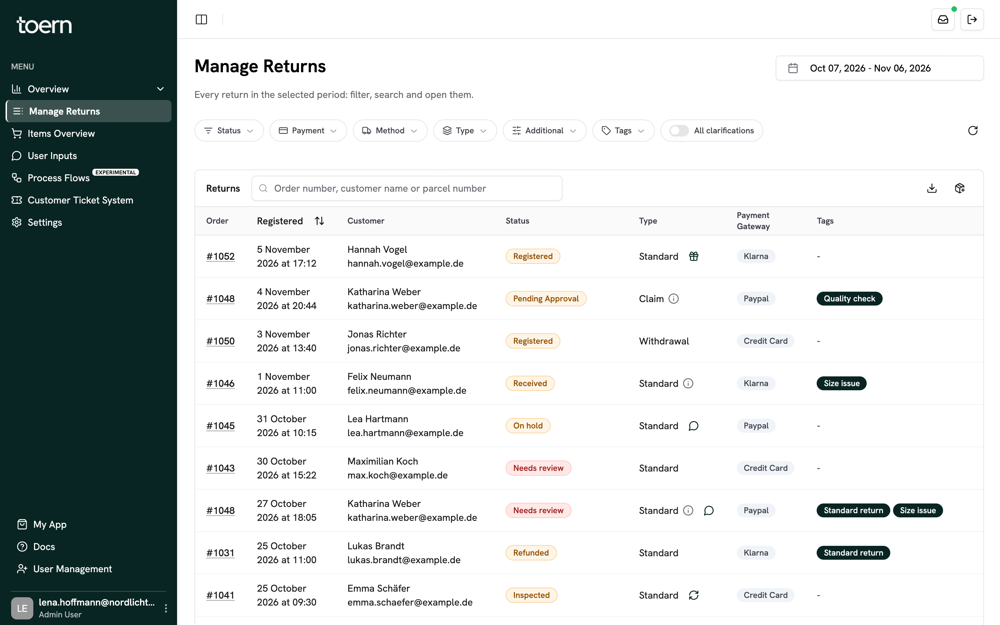</Frame>

Standardmäßig siehst du die Retouren des letzten Monats. Den Zeitraum kannst du anpassen. Du kannst außerdem nach Kunde und Bestellnummer suchen.

### Retourenstatus

Du kannst die Retouren nach diesen Status filtern:

- **registered**: Der Kunde hat die Retoure im Retourenportal registriert. Sie ist noch beim Kunden oder auf dem Weg zum Fulfillment.
- **received**: Die Retoure ist beim Fulfillment angekommen und kann bearbeitet werden.
- **on hold**: Bevor die Prüfung abgeschlossen werden kann, muss noch etwas passieren. Zum Beispiel eine Rückfrage beim Kunden, oder ein Artikel muss noch gewaschen werden.
- **inspected**: Die Artikel der Retoure wurden klassifiziert. Das löst oft eine automatische Rückerstattung aus.
- **refunded**: Die Retoure wurde erstattet. Sie wird danach automatisch auf **completed** gesetzt.
- **completed**: Die Retoure ist abgeschlossen.
- **pending approval**: Eine Reklamation wartet auf deine Freigabe (siehe [Reklamationen mit Freigabe](#reklamationen-mit-freigabe)).
- **needs review**: Die Retoure ist ein Klärfall und muss manuell geprüft werden. Das kann einen Artikel, eine Eingabe, Informationen vom Fulfiller oder ein technisches Problem betreffen. Im Filter **Status** heißt er **Clarification**. Auf der Retoure-Detailseite zeigt dir eine Klärfall-Karte, was passiert ist und wie du es löst (siehe [Klärfälle](/returns/clarifications)).

<Frame>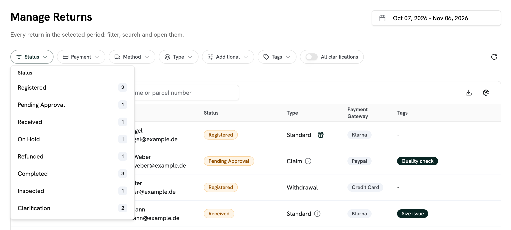</Frame>

### Weitere Filter

Neben **Status** hat die Filterleiste:

1. **Payment**: die Bezahlmethoden, die du nutzt, z. B. PayPal oder Klarna.
2. **Method**: die Retourenmethode, **Carrier**, **Self-ship**, **In Store** oder **Brand upload**.
3. **Type**: **Standard**-Retouren, Widerrufe (**Withdrawal**) oder Reklamationen (**Claim**).
4. **Additional**: Retouren mit Umtauschartikel (**Has Exchange Item**) oder Gutschein-Retouren (**Is Giftcard Return**).
5. **Tags**: deine eigenen Tags (siehe [Retouren-Tags](#retouren-tags)).
6. **All clarifications**: zeigt jeden Klärfall, unabhängig vom gewählten Zeitraum. Dann erscheint **Issue**, das nach Art des Klärfalls filtert, zum Beispiel Retourenlabel, Rückerstattung oder Xentral.

Jeder aktive Filter erscheint als Chip unter der Leiste, zum Beispiel **Tag: Size issue**. Entferne einen mit seinem **×** oder alle mit **Clear filters**.

<Frame>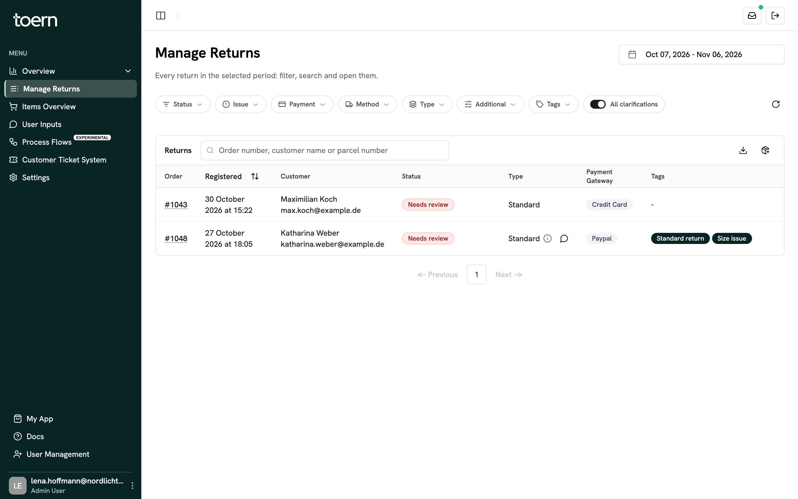</Frame>

<Frame>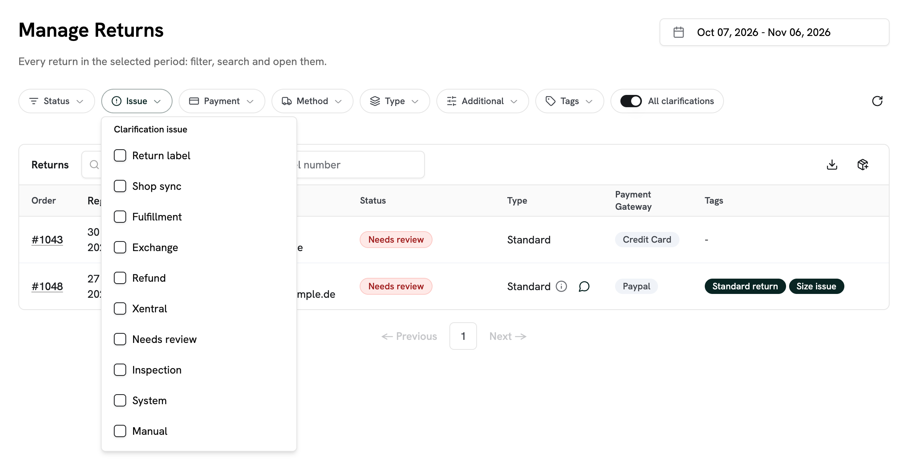</Frame>

Deine Filter gelten auch auf der Retoure-Detailseite: Ihre Pfeile für die vorherige und nächste Bestellung laufen durch dieselbe gefilterte Liste (siehe [Header und Navigation](#header-und-navigation)).

### Export

Mit dem **Download**-Symbol über der Liste (**Export return data**) exportierst du alle Retouren im gewählten Zeitraum. Der Export enthält mehr Informationen als die Übersicht. Diese Spalten sind enthalten:

```text
order_id ; customer_id ; return_reated_at ; return_status ; item_index ; sku ; item_name ; attribute_1 ; attribute_2 ; attribute_3 ; return_reason; user_input; classification; item_id ; variant_id ; exchanged ; item_price ; country_code_origin ; reggular_refund_amount ; giftcard_refund_amount ; refund_type
```

## Retouren manuell anlegen

Normalerweise legen deine Kunden ihre Retouren selbst im toern Retourenportal an. Nutzt ein Kunde diesen Weg nicht oder braucht er Hilfe von deinem Kundenservice, kannst du die Retoure manuell anlegen. Dafür gibt es zwei Wege:

- In der **Retourenübersicht** mit dem Symbol **Create a new return**, wenn du von einem Anruf oder einer E-Mail des Kunden ausgehst und die Bestellung erst suchen musst (unten beschrieben).
- Auf der **Retoure-Detailseite** mit **Create manual return**, wenn die Bestellung schon offen ist (siehe [Noch nicht retournierte Artikel](#noch-nicht-retournierte-artikel)). Das Formular ist dasselbe.

### Bestellung finden

1. Öffne **Manage Returns**.
2. Klicke über der Liste auf das Symbol **Create a new return** (das Paket mit Plus). Die Seite **Create a return** öffnet sich.
3. Gib die Bestellnummer oder den Namen des Kunden in das Suchfeld ein. Suchst du nach dem Namen, siehst du alle Bestellungen dieses Kunden.
4. Klicke auf die gesuchte Bestellung.

<Frame>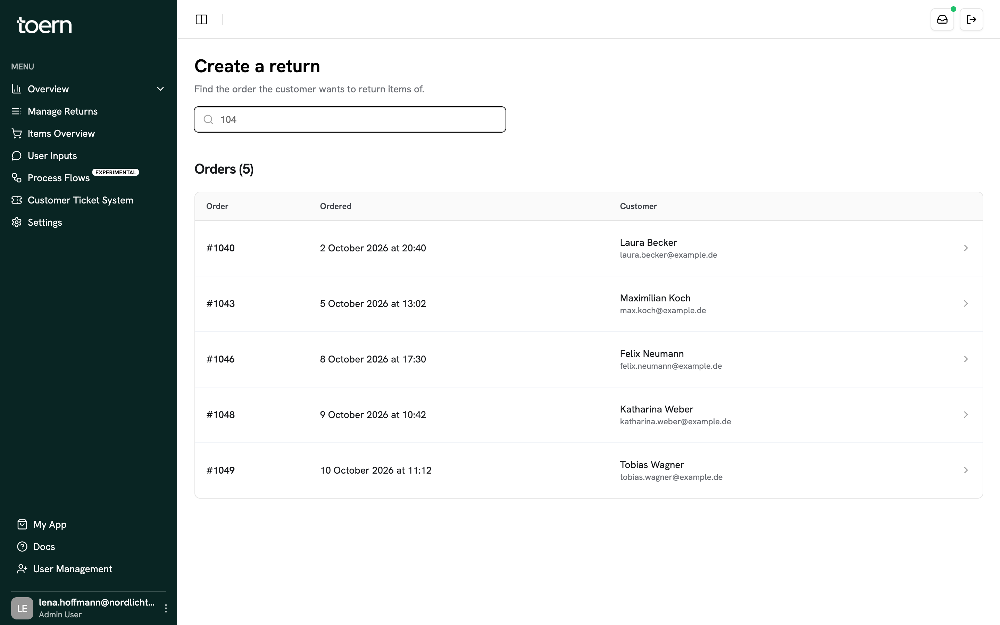</Frame>

### Retoure konfigurieren

<Frame>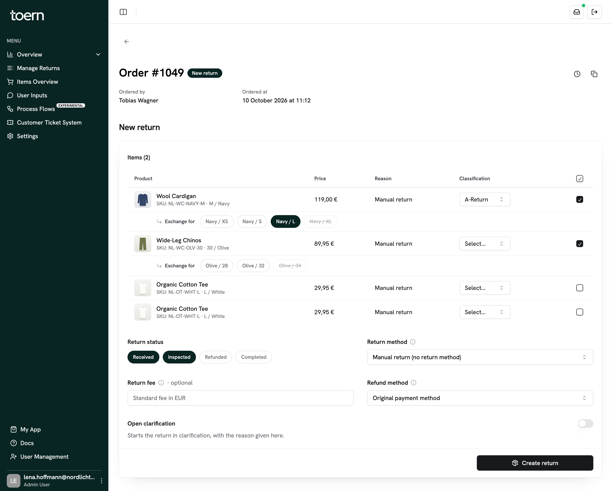</Frame>

1. **Artikel**: Hake die Artikel an, die retourniert werden. Artikel, die schon Teil einer Retoure sind, sind mit **Already returned** markiert und lassen sich nicht wählen.
2. **Klassifizierung** (optional): Du kannst die Artikel direkt klassifizieren, **A-Return** bis **D-Return**. Das ist nur sinnvoll, wenn der Artikel schon bei dir ist.
3. **Umtausch** (optional): Unter einem angehakten Artikel listet **Exchange for** seine Varianten. Wähle eine, um einen Umtausch anzulegen. Das hilft, wenn ein Kunde per E-Mail um einen Umtausch bittet. toern prüft die Varianten über die Shopify-Schnittstelle. Nicht verfügbare Varianten sind durchgestrichen.
4. **Return status**: Wähle den aktuellen Status der Retoure. Standardmäßig sind **Received** und **Inspected** ausgewählt, weil diese Funktion meistens vom Fulfillment genutzt wird.
5. **Return method**: Die Retourenmethode der Retoure oder **Manual return (no return method)**.
6. **Return fee** (optional): Eine Gebühr, die von der Rückerstattung abgezogen wird.
7. **Refund method**: Wähle die Rückerstattungsmethode, auch einen Gutschein. Das hilft zum Beispiel, wenn du eine Retoure nach Ablauf der Retourenfrist anlegst und mit dem Kunden einen Gutschein vereinbarst.
8. **Open clarification** (optional): Schalte es ein und gib einen Grund an, um die Retoure direkt in Klärung zu starten.
9. Klicke auf **Create return**. Die Retoure wird angelegt und du landest auf der Retoure-Detailseite der Bestellung, mit der neuen Retoure geöffnet.

Mit den Symbolen neben der Bestellnummer **verlängerst du die Retourenfrist** (Extend the return window) und **kopierst den Login-Link zum Portal** (Copy the portal login link) für den Kunden.

<Warning>
  Ist die Retoure noch beim Kunden? Dann setze den Status unbedingt zurück. Klicke einmal auf **Received** und **Inspected**. Sonst kann automatisch eine Rückerstattung ausgelöst werden.
</Warning>

<Frame>
  <iframe src="https://app.guideflow.com/embed/zkjyg7vswk" width="100%" height="600" style={{ border: 0 }} allowFullScreen />
</Frame>

## Retoure-Detailseite

Die Retoure-Detailseite zeigt **eine Bestellung mit all ihren Retouren**. Jede Retoure, jeder Widerruf und jede Reklamation, die der Kunde zu dieser Bestellung angemeldet hat (R1, R2, …), steht auf dieser einen Seite, jeweils als eigene Karte. Daneben findest du alles andere zur Bestellung: den Bestellwert, den Kunden und sein Retourenverhalten, die noch nicht retournierten Artikel, die Rückerstattungen, die Xentral-Belege und eine gemeinsame Timeline. Du öffnest die Retouren einer Bestellung nicht mehr einzeln.

<Frame>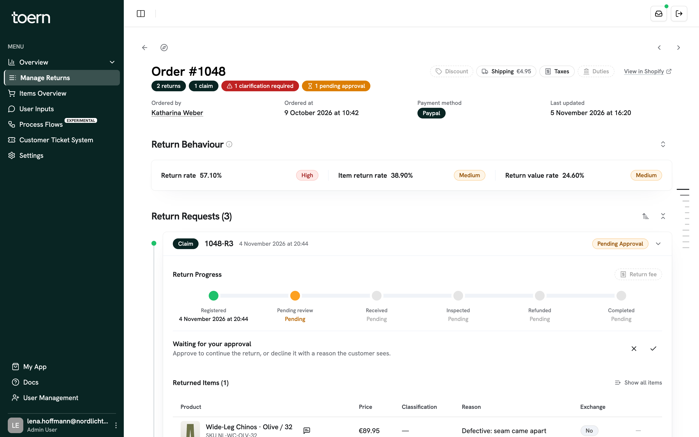</Frame>

### Seite öffnen

- **Aus der Retourenübersicht**: Klicke auf eine Retoure. Die Seite ihrer Bestellung öffnet sich, mit der angeklickten Retoure geöffnet und im Blick.
- **Aus einer Benachrichtigung oder E-Mail**: Links zu einem Kommentar öffnen die Seite der Bestellung, öffnen die Retoure, zu der der Kommentar gehört, und heben den Kommentar in der Timeline hervor.
- **Über die Adresse**: Die Adresse der Seite ist `/return/<Bestellnummer>`. Mit `?r=<Retouren-ID>` am Ende öffnet sich diese Retoure. Links, die auf eine einzelne Retoure zeigen, zum Beispiel `/return/1048-R2` aus älteren Benachrichtigungen, E-Mails oder der Zendesk-App, funktionieren weiter: Sie leiten auf die Seite der Bestellung weiter und öffnen R2.

Die Seite hält sich selbst aktuell. Ändert sich etwas, während du sie offen hast, zum Beispiel eine Rückerstattung läuft im Hintergrund durch, ein Label kommt vom Versanddienstleister oder ein Kollege schreibt einen Kommentar, aktualisiert sich der betroffene Teil der Seite von selbst. Du musst nicht neu laden.

### Aufbau der Seite

<Frame>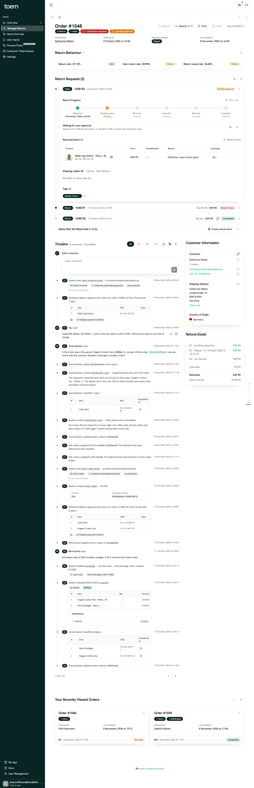</Frame>

| Bereich | Was du dort findest |
| --- | --- |
| [Header](#header-und-navigation) | Bestellnummer, Navigation zur vorherigen und nächsten Bestellung, die Anzahl der Retouren, Widerrufe und Reklamationen, offene Klärfälle und Freigaben, wer bestellt und wie bezahlt hat, und was der Bestellung berechnet wurde. |
| [Return Behaviour](#retourenverhalten) | Wie oft dieser Kunde retourniert, im Vergleich zu deinen anderen Kunden. |
| [Return Requests](#retourenanfragen) | Eine Karte pro Retoure, Widerruf und Reklamation, mit Fortschritt, nächsten Schritten, Klärfällen, Artikeln, Labels, Tracking und Tags. |
| [Items Not Yet Returned](#noch-nicht-retournierte-artikel) | Die Artikel der Bestellung, die noch in keiner Retoure sind, und **Create manual return**. |
| [Xentral Documents](#xentral-belege) | Die Belege der Bestellung in Xentral, wenn Xentral eingerichtet ist. |
| [Customer Information](#kundeninformationen) | Kontaktdaten und Lieferadresse, die du korrigieren kannst. |
| [Refund Detail](#erstattungsdetails) | Jede Rückerstattung der Bestellung, pro Retoure. |
| [Timeline](#timeline) | Alle Aktivitäten und die Kommentare deines Teams über alle Retouren hinweg. |
| [Your Recently Viewed Orders](#zuletzt-angesehene-bestellungen) | Die Bestellungen, die du zuletzt geöffnet hast. |

Auf breiten Bildschirmen stehen Kundeninformationen und Rückerstattungen in einer Spalte neben den Retourenanfragen. Auf schmaleren Bildschirmen, und wenn du den Retourenanfragen die volle Breite gibst, rücken sie nach unten.

<Tip>
  Neu auf der Seite? Klicke auf das **Kompass**-Symbol neben dem Zurück-Pfeil, um die **Seitentour** zu starten. Die **Short tour** (etwa 1 Minute) zeigt, was neu ist. Die **Full tour** (etwa 5 Minuten) führt dich mit Live-Demos durch jeden Teil, zum Beispiel eine Rückerstattung, eine manuelle Retoure und einen Kommentar. Nichts aus den Demos der Tour wird gespeichert.
</Tip>

### Seitenindex

Am rechten Rand der Seite zeigt ein kleiner **Ring**, wo du gerade bist: Er füllt sich beim Scrollen. Fahre mit der Maus darüber, um jeden Bereich der Seite zu sehen, auch jede einzelne Retoure (R1, R2, …), und klicke auf einen, um dorthin zu springen.

<Frame>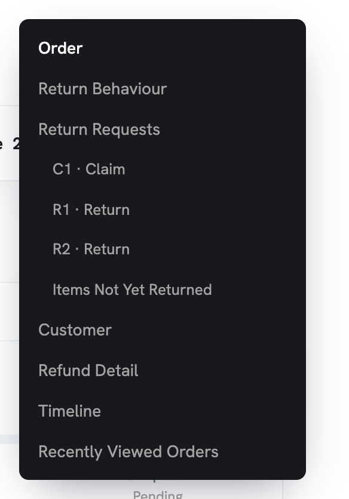</Frame>

## Header und Navigation

<Frame>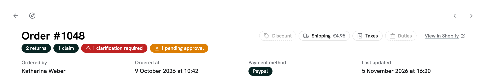</Frame>

### Navigation

- Der Pfeil **←** bringt dich zurück zur Retourenübersicht, mit deinen Filtern so, wie du sie verlassen hast.
- Die Pfeile **‹ ›** öffnen die vorherige und die nächste **Bestellung** der Liste. Fahre mit der Maus über einen Pfeil, um zu sehen, welche Bestellung er öffnet. Gibt es in eine Richtung keine Bestellung, ist der Pfeil deaktiviert.
- Die Pfeile berücksichtigen die Filter und die Sortierung der Übersicht. Hast du die Übersicht zum Beispiel nach Klärfällen gefiltert, springst du direkt zur nächsten Bestellung mit einem Klärfall.
- Der **Kompass** startet die Seitentour.

### Die Bestellung auf einen Blick

Der Header fasst die Bestellung zusammen:

- die **Bestellnummer**. **View in Shopify** öffnet die Bestellung in deinem Shopify-Admin.
- **Schwarze Pills** zählen die Anfragen der Bestellung, zum Beispiel **2 returns**, **1 withdrawal** oder **1 claim**.
- **Badges** zeigen, was auf dich wartet, zum Beispiel **1 clarification required** oder **1 pending approval**. Klicke auf ein Badge, um zur Retoure zu scrollen, die dich braucht.
- **Ordered by**: der Kunde. Ein Klick auf den Namen springt zu den Kundeninformationen.
- **Ordered at**, **Payment method** und **Last updated**, der Zeitpunkt, an dem sich zuletzt etwas an der Bestellung geändert hat.

### Was der Bestellung berechnet wurde

Darunter zeigen Chips, was der Bestellung neben den Artikeln berechnet wurde:

| Chip | Sein Tooltip zeigt |
| --- | --- |
| **Discount** | Den gesamten Rabatt und wie er sich aufteilt: automatische oder manuelle Rabatte, Rabattcodes, auf Artikel oder auf Versand. |
| **Shipping** | Die berechneten Versandkosten, den ursprünglichen Betrag vor Rückerstattungen und das Gewicht der Bestellung. |
| **Taxes** | Den Steuerbetrag und ob er in den Preisen enthalten ist oder hinzukommt. |
| **Duties** | Berechnete Zölle, pro berechtigtem Artikel oder auf die Artikel verteilt. |

Ein **gestrichelter** Chip bedeutet, dass die Bestellung nichts davon hat, zum Beispiel **No discount on this order**.

### Kompakter Header beim Scrollen

Scrollst du nach unten, bleibt eine kompakte Version des Headers oben auf der Seite: die Bestellnummer, die Anzahl der Retouren, Widerrufe und Reklamationen, die Badges für Klärfälle und Freigaben, wer bestellt und wie bezahlt hat. Die Badges funktionieren auch dort, so springst du von überall auf der Seite zu einer Retoure, die dich braucht.

<Frame>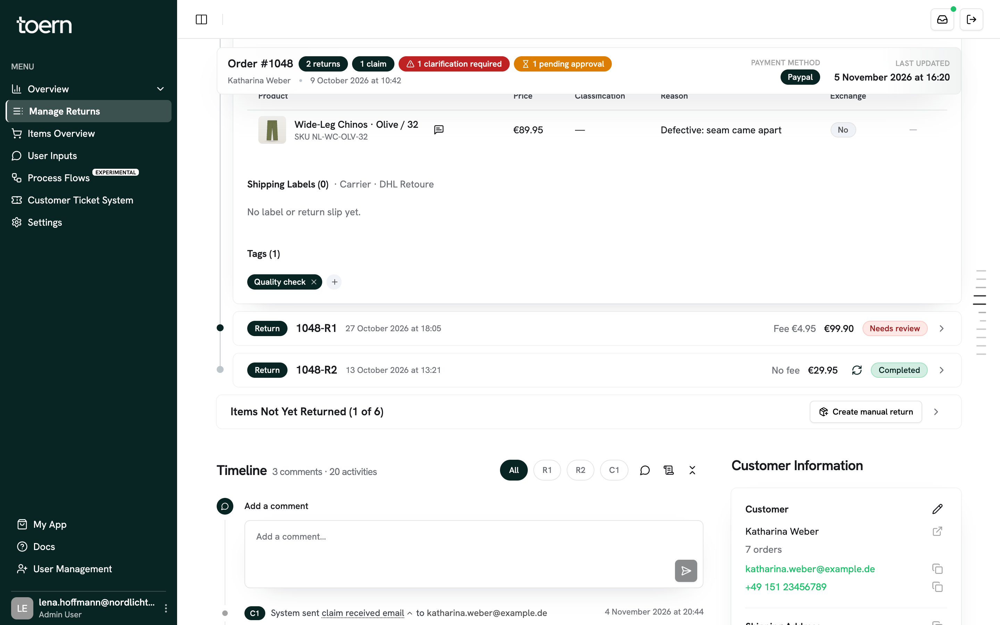</Frame>

## Retourenanfragen

Der Bereich **Return Requests** hat eine Karte für jede Retoure, jeden Widerruf und jede Reklamation der Bestellung. Jede Karte trägt ihren Typ (**Return**, **Withdrawal** oder **Claim**) und ihre Nummer, zum Beispiel **Claim 1048-R3**.

<Frame>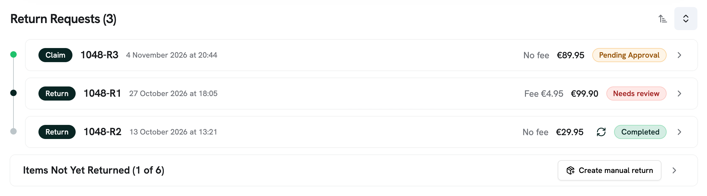</Frame>

Die Schaltflächen oben rechts im Bereich:

- **Latest first** / **Oldest first** sortiert die Karten.
- **Expand all** / **Collapse all** öffnet oder schließt alle Karten auf einmal.
- **Full width** gibt den Karten die volle Breite der Seite. Kundeninformationen und Rückerstattungen rücken dann nach unten. Ein erneuter Klick zeigt sie wieder daneben. Diese Option erscheint auf breiten Bildschirmen.

### Eine Retourenanfrage-Karte

Der Kopf jeder Karte fasst die Anfrage zusammen, so kannst du sie lesen, ohne sie zu öffnen:

- ihr **Typ** und ihre **Nummer**, zum Beispiel **Return 1048-R1**, und das Eingangsdatum,
- zugeklappt: was die Retoure wert ist und ihre Gebühren,
- rechts ihr **Zustand**.

Klicke auf den Kopf, um die Karte zu öffnen oder zu schließen. Die Retoure, wegen der du gekommen bist, zum Beispiel die in der Übersicht angeklickte, ist schon für dich geöffnet.

Eine geöffnete Karte enthält von oben nach unten:

1. [Return Progress](#retourenfortschritt) mit den nächsten Schritten und Aktionen
2. Klärfälle und andere [Hinweise](#hinweise-auf-der-karte), falls vorhanden
3. [Returned Items](#retournierte-artikel)
4. [User Inputs](#kundeneingaben) und [Associated Customer Tickets](#kundentickets), falls vorhanden
5. [Shipping Labels](#versandlabels) und [Shipment Tracking](#sendungsverfolgung)
6. [Connected Orders](#umtausch-und-verbundene-bestellungen) bei Umtausch
7. [Tags](#retouren-tags)

<Frame>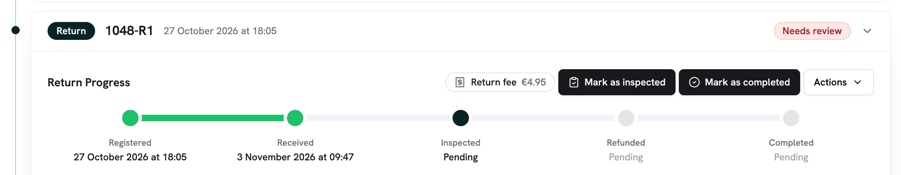</Frame>

### Retourenfortschritt

**Return Progress** zeigt, wo die Retoure steht, von der Anmeldung bis zur Rückerstattung. Jeder Schritt zeigt, wann er erledigt wurde.

| Schritt | Bedeutung |
| --- | --- |
| **Registered** | Der Kunde hat die Retoure angemeldet. |
| **Pending review** / **Approved** / **Declined** | Nur bei Reklamationen, die deine Freigabe brauchen (siehe [Reklamationen mit Freigabe](#reklamationen-mit-freigabe)). |
| **Received** | Das Paket ist in deinem Lager angekommen. |
| **Inspected** | Die Artikel wurden geprüft und klassifiziert. |
| **Refunded** | Die Rückerstattung ist raus. Solange der Zahlungsanbieter sie noch bearbeitet, zeigt der Schritt **Pending transactions**. |
| **Exchanged** | Bei Umtausch: Der Ersatzartikel wurde verschickt. |
| **Completed** | Die Retoure ist abgeschlossen. |

Der Fortschritt zeigt außerdem live die **Prozesse**, die im Hintergrund laufen, zum Beispiel die Rückerstattung, die gerade verschickt wird. Eine Meldung sagt dir, wann einer startet (**Refund process running for R1…**) und wie er ausgegangen ist (**Refund process finished for R1** oder **Refund process failed for R1**). Solange ein Prozess läuft, sind die Schaltflächen der Karte gesperrt, damit du keine zweite Aktion obendrauf startest. Ein fehlgeschlagener Schritt bleibt mit seinem Grund sichtbar, so weißt du, was zu beheben ist.

### Nächste Schritte und Aktionen

Die Buttons neben **Return Progress** sind die nächsten Schritte der Retoure. Jeder sagt, was er tut. Alles andere, was du mit der Retoure machen kannst, findest du unter **Actions**.

<Frame>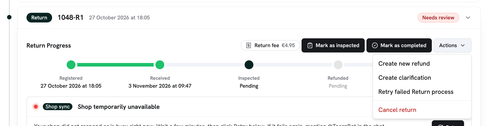</Frame>

**Nächste Schritte (Buttons)**

| Button | Wann du ihn siehst | Was er tut |
| --- | --- | --- |
| **Mark as received** | Die Retoure ist noch nicht eingegangen, nicht storniert und nicht on hold. | Setzt die Retoure auf received, den Schritt vor der Prüfung. Nutze ihn, wenn das Tracking des Versanddienstleisters das nicht schon erledigt hat. Sonst ändert sich nichts. |
| **Mark as inspected** | Die Retoure ist eingegangen, noch nicht geprüft, nicht storniert und nicht on hold. | Markiert die Artikel als geprüft. Klassifiziere vorher jeden Artikel. Ab inspected kann die Rückerstattung raus. Wenn deine Einstellungen es verlangen, warnt dich toern, falls noch nicht jeder Artikel klassifiziert ist: *Not all items are classified yet. Mark the return as inspected anyway?* |
| **Mark as completed** | Die Retoure ist in Klärung. | Schließt die Retoure ab, sobald alles geklärt ist. Sie wird als abgeschlossen markiert. |
| **Create refund** | Die Retoure ist geprüft und noch nicht erstattet (Shopify-Shops). | Öffnet die Erstattungs-Schublade, um die Retoure von Hand zu erstatten (siehe Manuelle Rückerstattungen weiter unten). |

**Actions-Menü**

| Aktion | Wann du sie siehst | Was sie tut |
| --- | --- | --- |
| **Create new refund** | Jede nicht stornierte Retoure, auch nach der Rückerstattung (Shopify-Shops), wenn **Create refund** nicht als Button angezeigt wird. | Öffnet die Erstattungs-Schublade, zum Beispiel für eine weitere Teilerstattung. |
| **Mark as refunded** | Geprüft, noch nicht erstattet. | Setzt die Retoure auf erstattet, ohne Geld zu bewegen, zum Beispiel wenn du außerhalb von toern erstattet hast. |
| **Set on hold** | Die Retoure ist eingegangen. | Hält die Retoure an, zum Beispiel solange du auf eine Antwort des Kunden wartest. Du gibst einen Grund ein. |
| **Resolve on hold** | Die Retoure ist on hold. | Setzt die Retoure fort. |
| **Create clarification** | Nicht storniert und nicht on hold. | Eröffnet einen Klärfall mit deinem eigenen Grund und hält alle Automatisierungen der Retoure an (siehe Klärfälle unten). |
| **Execute return process** | Die Retoure ist noch nicht mit deinem Shop synchronisiert. | Startet den Prozess, der die Retoure in deinem Shop anlegt. |
| **Execute auto refund** | Die Retoure hat deinen Erstattungs-Trigger erreicht und noch keine abgeschlossene Rückerstattung. | Startet die automatische Rückerstattung mit deinen Erstattungseinstellungen. |
| **Execute exchange processing** | Bei Umtausch, sobald die Retoure deinen Umtausch-Trigger erreicht hat. | Startet den Umtausch, zum Beispiel die Umtauschbestellung. |
| **Retry failed …** | Ein Prozess ist fehlgeschlagen und kann wiederholt werden. | Startet den fehlgeschlagenen Prozess neu, zum Beispiel **Retry failed Return process**. |
| **Cancel return** | Nicht erstattet, abgeschlossen, on hold oder schon umgetauscht. | Storniert die Retoure, auch in Shopify. Du gibst einen Grund ein. Das lässt sich nicht rückgängig machen. |

Für Aktionen, die einen Grund brauchen, wie **Set on hold**, **Create clarification** oder **Cancel return**, fragt ein Dialog zuerst danach. Jede Aktion zeigt eine Bestätigung oder eine Fehlermeldung, wenn sie fertig ist, und wird in der [Timeline](#timeline) festgehalten.

Manche Aktionen sind deaktiviert und nennen den Grund, wenn du mit der Maus darüberfährst, zum Beispiel:

- *Xentral orders are refunded in Xentral.*
- *This return is not synced with Shopify yet.*
- *Refund this from the return the exchange order came from, or run the auto refund.* (bei einer Umtauschbestellung)

### Klärfälle

Ist eine Retoure ein Klärfall, bekommt jeder offene Punkt **eine eigene Box** unter dem Fortschritt, die **Klärfall-Karte**. Sie zeigt:

- die **Kategorie** als kleine Pill, zum Beispiel **Shop sync**, **Return label**, **Refund** oder **Needs review**,
- eine **Überschrift**, die sagt, was passiert ist,
- eine kurze **Erklärung**, wo du es behebst,
- **einen Button** rechts, der die Retoure aus der Klärung holt.

<Frame>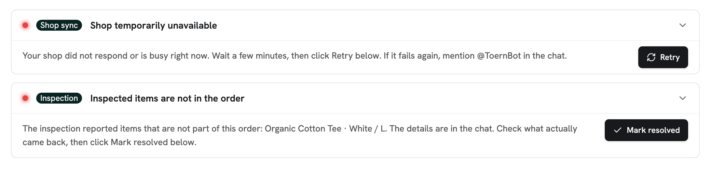</Frame>

Ein Klick auf die Titelzeile einer Box klappt sie zu oder auf. Der Button ist einer von diesen:

| Button | Wann du ihn siehst | Was passiert |
| --- | --- | --- |
| **Retry** | Ein Schritt ist fehlgeschlagen, zum Beispiel das Label oder die Retoure in Shopify. | Behebe zuerst die Ursache und klicke dann. toern startet den fehlgeschlagenen Schritt neu, der Pfeil dreht sich, solange er läuft. Klappt es, schließt sich die Box von selbst. |
| **Mark resolved** | Nichts ist fehlgeschlagen, aber du musst etwas prüfen oder entscheiden. | Kümmere dich darum und klicke dann. Du kannst eine kurze Notiz dazuschreiben, was du gemacht hast. Sie erscheint in der Timeline. |
| **Refund manually** | Die automatische Rückerstattung wurde gestoppt. | Öffnet die Erstattungs-Schublade. Sobald die Rückerstattung durchgeht, schließt sich die Box von selbst. |

Die automatische Verarbeitung, auch die automatische Rückerstattung, läuft erst weiter, wenn **jeder** Punkt der Retoure erledigt ist. Wann ein Punkt eröffnet und wann und von wem er erledigt wurde, steht in der [Timeline](#timeline).

<Note>
  Klärfälle aus der Zeit vor dem neuen Klärfall-System haben keine Kategorie und keinen Button. Sie erscheinen als Hinweis **Return needs review** mit ihrem Grund. Prüfe die Retoure, erledige das Nötige und schließe sie mit **Mark as completed** ab.
</Note>

Alle Kategorien, Ursachen und Lösungen findest du unter [Klärfälle](/returns/clarifications).

### Hinweise auf der Karte

Neben Klärfällen zeigt eine Karte einen Hinweis, wenn die Retoure deine Aufmerksamkeit braucht:

- **Return is on hold**, mit dem Grund, warum sie angehalten wurde. Setze sie mit **Resolve on hold** im **Actions**-Menü fort.
- **Return has been canceled**, mit dem Stornogrund.
- **Refund failed**: Die Rückerstattung ist nicht durchgegangen. Der Hinweis sagt, ob schon Geld geflossen ist, und bietet den passenden nächsten Schritt:
  - **Retry remaining steps**: Der Kunde wurde schon bezahlt. Die Wiederholung erledigt die Folgeschritte, ohne erneut Geld zu bewegen.
  - **Retry auto refund** oder **Retry with same details**: Es ist noch kein Geld geflossen. Die Rückerstattung läuft erneut.
  - **Edit & retry**: öffnet die Erstattungs-Schublade wieder mit deinen Eingaben, damit du sie korrigieren kannst.
  - **Refund manually instead**: öffnet eine neue Erstattungs-Schublade.

Ein Klick auf die Titelzeile eines Hinweises klappt ihn zu oder zeigt seinen vollen Text.

### Reklamationen mit Freigabe

Eine Reklamation, die deine Freigabe braucht, zeigt unter ihrem Fortschritt das Banner **Waiting for your approval**. Bevor du entscheidest, passiert nichts mit der Reklamation:

- **✓ (Approve claim)** nimmt die Reklamation an, sie läuft dann wie eine Retoure weiter.
- **× (Decline claim)** fragt nach einem Grund. Der Kunde sieht diesen Grund.

Fährst du mit der Maus über ein Symbol, siehst du seinen Namen.

Bis dahin sind die anderen Schaltflächen der Reklamation, zum Beispiel ihre Retourengebühr, deaktiviert, mit dem Hinweis *Approve or decline the claim first*. Das Badge **pending approval** im Header bringt dich zur Reklamation.

<Frame>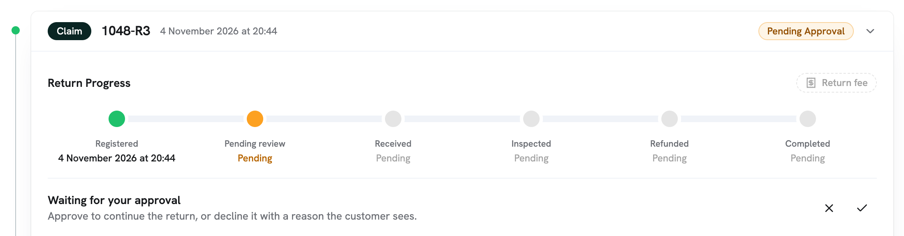</Frame>

### Retourengebühren

Der Chip **Return fee** neben den nächsten Schritten zeigt die Gebühren der Retoure. Klicke darauf, um jede Gebühr mit ihrem Zweck zu sehen: was von der Rückerstattung abgezogen wird und warum.

<Frame>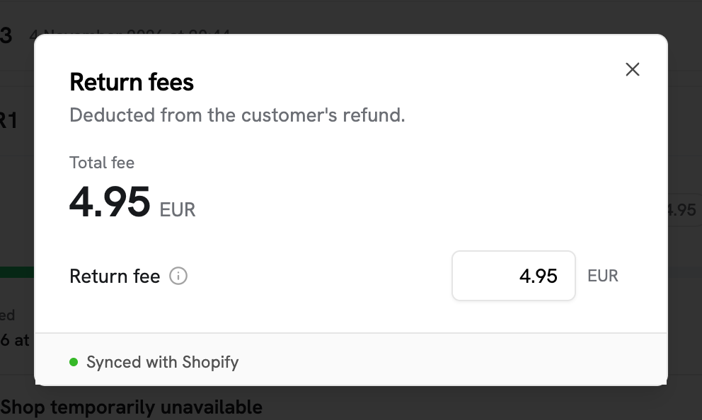</Frame>

- Gib einen neuen Betrag ein, um eine Gebühr zu ändern. Sie speichert sich von selbst.
- Der **Pfeil** neben einer geänderten Gebühr setzt den berechneten Betrag zurück.
- Ein gestrichelter, ausgegrauter Chip bedeutet, dass die Retoure noch keine Gebührendaten hat.

Die Gebühr wird von der Rückerstattung abgezogen, auch bei Rückerstattungen von Hand, es sei denn, du schaltest sie in der Erstattungs-Schublade ab.

### Retournierte Artikel

**Returned Items** listet, was zurückkam und warum, mit diesen Spalten:

| Spalte | Inhalt |
| --- | --- |
| **Product** | Bild, Name, Variante und SKU. Klicke auf das Bild für die [Artikeldetails](#artikeldetails). |
| **Price** | Der Preis, den der Kunde bezahlt hat, mit dem durchgestrichenen Originalpreis, wenn der Artikel rabattiert war. |
| **Classification** | Das Prüfergebnis, **A-Return** bis **D-Return**. |
| **Reason** | Der Retourengrund, den der Kunde gewählt hat, darunter sein Kommentar, falls vorhanden. Ein Symbol zeigt, dass der Kunde Fotos, eine Sprachnachricht oder einen Text hinzugefügt hat. |
| **Exchange** | Ob der Artikel umgetauscht wird, und gegen welche Variante. |

<Frame>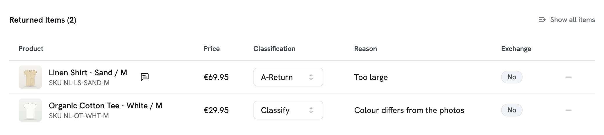</Frame>

**Artikel klassifizieren**

Wähle in der **Classification** eines Artikels **A-Return**, **B-Return**, **C-Return** oder **D-Return**. toern bietet immer diese vier Klassen an. Wie du sie nutzt, stimmst du mit deinem Fulfillment ab.

Bei einer **C-** oder **D-Retoure** fragt toern: *Continue as a normal return, or open a clarification case for this return?* Mit **Open clarification case** bekommt die Retoure den Status **needs review** und hält an, bis du den Klärfall gelöst hast.

**Artikel hinzufügen und entfernen**

Liegen im Paket mehr oder weniger Artikel, als der Kunde angemeldet hat, passe die Artikel der Retoure an:

1. Klicke über der Tabelle auf **Show all items**. Die übrigen Artikel der Bestellung erscheinen unter den retournierten, jeder mit einem **+**. Der Link heißt dann **Show returned items only**.
2. Klicke bei einem Artikel auf **+**, um ihn der Retoure hinzuzufügen.
3. Klicke bei einem retournierten Artikel auf **−**, um ihn aus der Retoure zu nehmen. Ein entfernter Artikel bleibt sichtbar, ausgegraut und mit **Removed** markiert.

<Frame>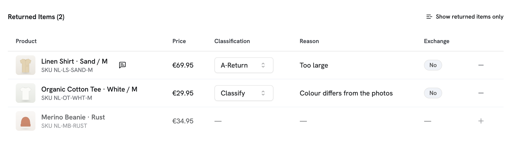</Frame>

Solange ein Prozess läuft, und bei stornierten Retouren oder Retouren on hold, kannst du keine Artikel hinzufügen oder entfernen. Verarbeitet Pickware die Shopify-Retoure für dich, lassen sich die Artikel hier nicht ändern, weil Pickware die Retoure selbst verwaltet.

**Sets und Umtausch**

- Ein **Set** wird mit seinen Teilen angezeigt. **Show parts** listet sie auf, und du kannst einzelne Teile hinzufügen oder entfernen.
- Der **Ersatzartikel** eines Umtauschs ist mit **Exchange replacement** markiert. Schickt der Kunde ihn später zurück, steht auf der Karte, in welcher Retoure.

### Artikeldetails

Klicke auf das Bild eines Artikels, um seine Details zu öffnen:

- das **Produkt**: SKU, Produkt-ID, Barcode und Attribute, und sein Preis,
- **warum er zurückkam**: der Retourengrund und der Kommentar des Kunden,
- **From the Customer**: die Fotos, die Sprachnachricht und der Text, die der Kunde zu diesem Artikel hinzugefügt hat. Klicke auf ein Foto, um es in voller Größe zu öffnen. Die Sprachnachricht spielst du direkt dort ab.

<Frame>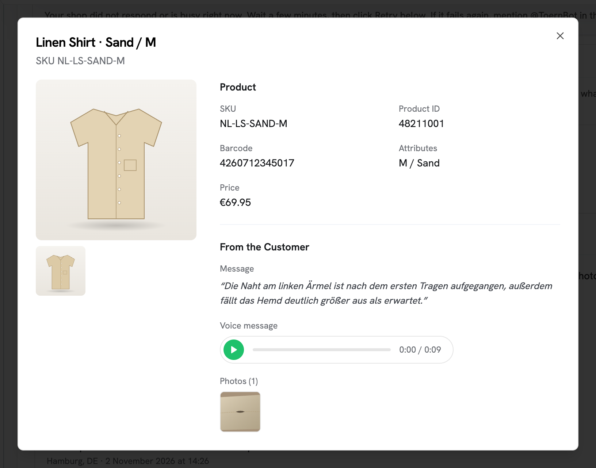</Frame>

### Kundeneingaben

Stellt dein Retourenablauf dem Kunden Fragen, zeigt **User Inputs** seine Antworten für die ganze Retoure, nach Seiten gruppiert. Antworten auf Fragen zu einem einzelnen Artikel stehen bei diesem Artikel in der Spalte **Answers**.

- Hat der Kunde in einer anderen Sprache geantwortet, zeigt das **Sprach**-Symbol Flaggen für die Portalsprachen. Wähle eine, um die Antworten darin zu lesen.
- **Show only the page names** klappt die Antworten zu, **Open all pages** öffnet sie wieder.

### Kundentickets

Gehören Kundentickets zur Retoure, listet **Associated Customer Tickets** sie mit Titel, Dringlichkeit (**Urgent** oder **Standard**), Status (**Open**, **In progress**, **Done**) und Erstelldatum auf. **Open Customer Tickets** bringt dich zur Ticketseite (siehe [Kundentickets](/dashboard/customer-tickets)).

### Versandlabels

**Shipping Labels** zeigt das Label der Retoure und, bei Retouren ohne Label, ihren Rücksendeschein.

<Frame>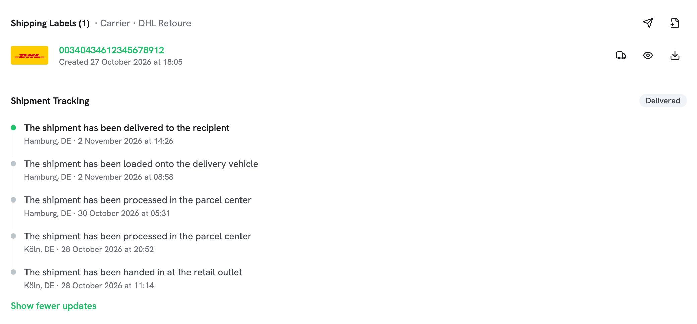</Frame>

Jeder Eintrag zeigt seine Art (**Label**, **RMA**, **Return slip**), die Retourenmethode (**Carrier**, **Self-ship**, **In store** oder **Brand upload**) und wann er erstellt wurde. Du kannst:

- das Label mit **View** ansehen oder mit **Download** herunterladen.
- mit **Generate label** oder **Generate new label** ein Label bei deinem Versanddienstleister anfordern. Während es erstellt wird, siehst du *Creating the label…*, und es erscheint in der Liste, sobald der Versanddienstleister es erstellt hat. Ein neues Label ersetzt das vorherige.
- mit **Upload label** bei Retourenmethoden mit Brand-Upload das Label hochladen, das du selbst erstellt hast (PDF oder Bild, max. 10 MB), mit seiner **Tracking number** und **Tracking URL**. Mit **Notify the customer** schickt toern es dem Kunden per E-Mail.
- mit **Generate return slip** den Rücksendeschein für Self-Ship- und In-Store-Retouren erstellen.
- mit **E-mail return instructions** (mit dem Label oder dem Rücksendeschein) dem Kunden die E-Mail mit der Rücksendeanleitung erneut schicken.

Lehnt der Versanddienstleister das Label ab, sagt der Bereich das und bittet dich, die Adresse, die Konfiguration des Versanddienstleisters und die Einstellungen der Retourenmethode (beide verlinkt) zu prüfen und es dann erneut zu versuchen. Darunter steht die Meldung des Versanddienstleisters.

### Sendungsverfolgung

**Shipment Tracking** zeigt den Rückweg des Pakets aus dem Tracking deines Versanddienstleisters: jedes Update, das er geschickt hat, das neueste zuerst, mit Status, Beschreibung, Ort und Zeit. Die letzten Updates stehen oben. **Show all … updates** zeigt den ganzen Verlauf.

- *Tracking is on. Waiting for the first update from the carrier.* bedeutet, dass das Paket noch nicht gescannt wurde.
- *Shipment tracking is not available for this return.* bedeutet, dass toern für die Sendung dieser Retoure kein Tracking bekommt.

### Umtausch und verbundene Bestellungen

Bei einem Umtausch zeigt **Connected Orders** die zugehörigen Bestellungen:

- die **Umtauschbestellung** mit den Ersatzartikeln, mit Link zu Shopify, sobald sie angelegt ist,
- den **Fulfillment-Auftrag für den Umtausch**, mit einem Hinweis, wenn er in Shopify angehalten ist.

Solange es sie noch nicht gibt, erklärt ein Hinweis, wann sie angelegt werden, zum Beispiel nach der Rückerstattung. Auf einer Umtauschbestellung selbst steht, welche Retoure sie ersetzt (**Replacement for R1**).

## Noch nicht retournierte Artikel

**Items Not Yet Returned** listet die Artikel der Bestellung, die noch in keiner Retoure sind, und wie viele davon jeweils noch offen sind, zum Beispiel **Items Not Yet Returned (1 of 4)**. Der Ersatzartikel eines Umtauschs wird auch gelistet und als solcher markiert: Er gehört zur Bestellung und ist in keiner Retoure, bis der Kunde ihn zurückschickt. Klicke auf den Titel oder den Pfeil, um die Artikel ein- oder auszublenden.

<Frame>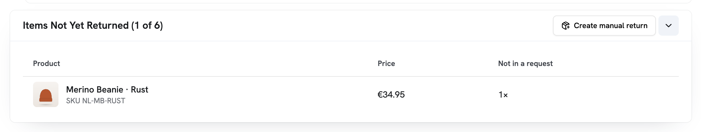</Frame>

### Manuelle Retoure von der Seite anlegen

1. Klicke auf **Create manual return**. Eine Schublade öffnet sich von unten, die Bestellung bleibt darüber sichtbar.
2. Wähle die Artikel für die neue Retoure.
3. Lege darunter Status, Retourenmethode, Gebühr und Rückerstattungsmethode der Retoure fest und eröffne bei Bedarf direkt einen Klärfall. Die Felder sind dieselben wie unter [Retoure konfigurieren](#retoure-konfigurieren).
4. Klicke auf **Create return**. Die Schublade schließt sich und die neue Anfrage erscheint als neue Karte auf der Seite.

<Frame>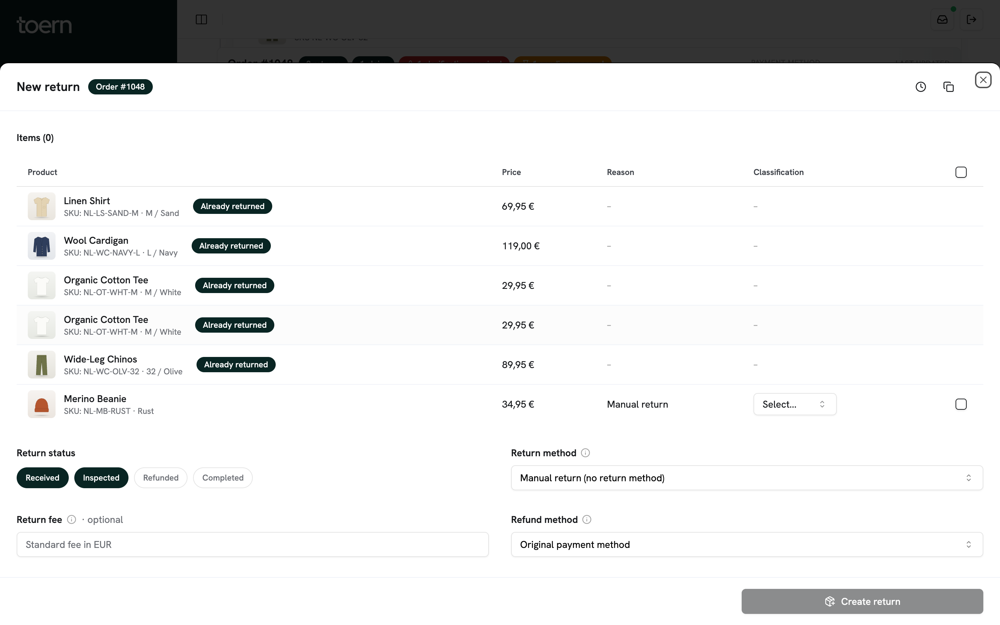</Frame>

Schließt du die Schublade, nachdem du Artikel gewählt hast, fragt toern, ob du sie verwerfen willst.

Ist jeder Artikel der Bestellung Teil einer Retoure, steht im Bereich *Every item of the order is part of a return.*

## Retourenverhalten

**Return Behaviour** zeigt, wie dieser Kunde retourniert, im Vergleich zu deinen anderen Kunden. toern sammelt diese Daten über alle Bestellungen des Kunden bei deiner Brand.

- Zugeklappt siehst du die **Return rate**, die **Item return rate** und die **Return value rate**, jeweils mit einer Stufe: **Low**, **Medium** oder **High**.
- Mit den Pfeilen aufgeklappt siehst du jede Quote und die Zahlen dahinter: **Orders**, **Returns**, **Items ordered**, **Items returned**, **Order value** und **Returned value**.
- Die Stufen folgen den Schwellenwerten, die du in den Einstellungen festlegst. Die Schwellenwerte stehen im Bereich.
- **Not rated** bedeutet, dass es noch nicht genug Daten gibt: Der Kunde braucht eine Mindestanzahl an Bestellungen.

<Frame>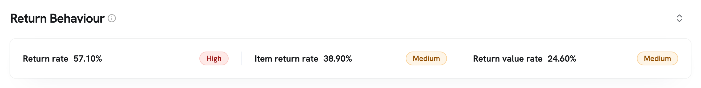</Frame>

Beträge sind in deiner Shop-Währung. Stornierte Retouren zählen nicht, und umgetauschte Artikel zählen nicht zum retournierten Wert.

## Kundeninformationen

**Customer Information** zeigt, wer bestellt hat und wohin die Bestellung ging: Name, Firma, E-Mail, Telefon und Lieferadresse, mit der Anzahl der Bestellungen des Kunden. Mit den Kopier-Symbolen kopierst du E-Mail, Telefonnummer oder Adresse. **View map** zeigt die Adresse auf einer Karte. Das Shopify-Symbol öffnet den Kunden in Shopify.

<Frame>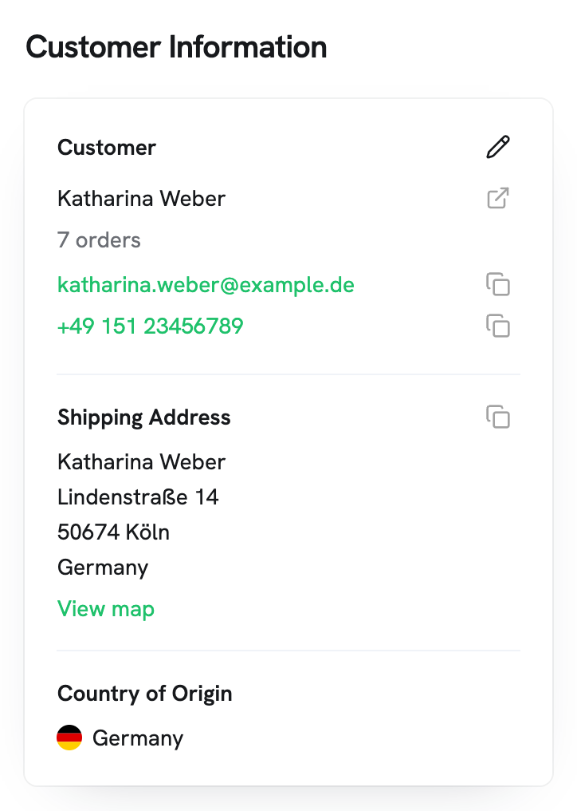</Frame>

### Kundendaten anpassen

Die Kundendaten stammen aus deiner Shop-Integration. Gab es Fehler beim Versand und du musst die Daten für die Retouren ändern, klicke auf den **Stift** (**Edit customer**). Du kannst **Name**, **Company**, **E-mail**, **Address**, **Address line 2**, **Zip code**, **City** und **Country** korrigieren und dann auf **Save changes** klicken.

<Frame>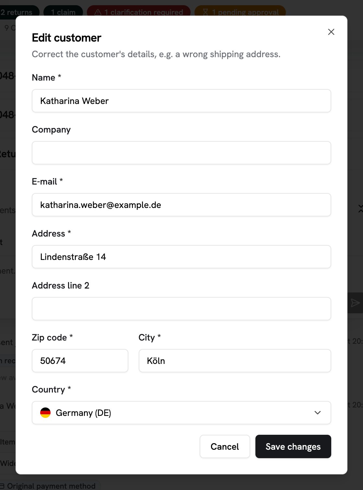</Frame>

<Warning>
  Geänderte Kundendaten werden nur in toern gespeichert. Sie werden nicht in dein Shopsystem übertragen.
</Warning>

Der Bereich zeigt außerdem das **Country of Origin**, das Land, nach dem toern die Retourenregeln anwendet. Wurde es von Hand festgelegt, steht das im Bereich: Alle Retouren- und Erstattungsregeln gelten dann nach diesem Land, auch wenn der Shop die Adresse später aktualisiert.

## Xentral-Belege

**Xentral Documents** zeigt die Belege der Bestellung in Xentral. Der Bereich ist nur auf der Seite, wenn deine Xentral-Zugangsdaten hinterlegt sind und **Display Xentral Return Info** aktiv ist (siehe [Xentral](/integrations/xentral)).

- Zur Bestellung: **Customer**, **Sales order**, **Delivery notes** und **Invoice**.
- Zu jeder Retoure: ihre **Return** und **Credit note**, bei Umtausch die **Exchange sales order**.

Die Belegnummern verlinken nach Xentral. Das **Sync**-Symbol holt die Nummern erneut aus Xentral, zum Beispiel nachdem du dort einen Beleg angelegt hast.

## Erstattungsdetails

**Refund Detail** zeigt jede Rückerstattung der Bestellung, pro Retoure.

<Frame>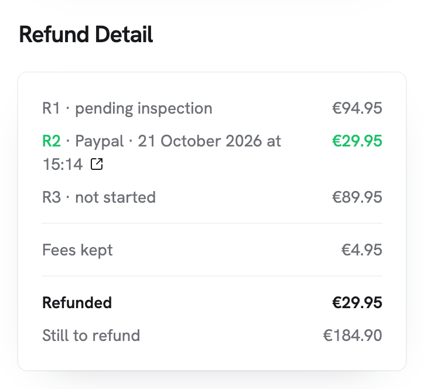</Frame>

Für jede Retoure siehst du:

- ihre **Erstattungsphase**: **not started**, **pending inspection**, **ready to refund**, **refund in progress**, **refund pending**, **refund failed** oder **canceled**,
- was **Refunded** ist und was noch offen ist (**Still to refund**), die einbehaltenen Gebühren (**Fees kept**) und eine eventuelle **Discount adjustment**,
- ob die Rückerstattung **Manual** war, und Gutschein-Erstattungen mit ihrem Bonus (*Includes a 10% bonus*).

Klicke auf **Refund details** für die vollständige Aufstellung: die erstatteten Artikel (mit retournierten, umgetauschten und behaltenen Teilen), Versand, Zölle, Retourengebühr und Aufschläge, jede Zahlung mit ihrem Status (**Successful**, **Pending**, **Awaiting response**, **Failed**), ob der Kunde benachrichtigt wurde, und bei Gutschein-Erstattungen den Gutscheincode.

<Frame>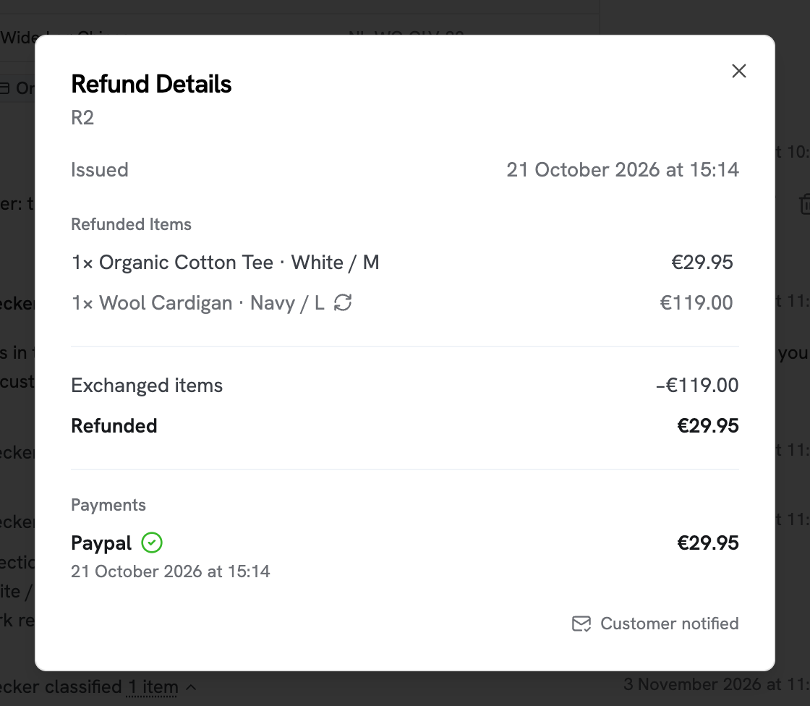</Frame>

## Timeline

Die **Timeline** zeigt alles, was mit der Bestellung passiert ist, über alle Retouren hinweg: die Kommentare deines Teams und die Aktivitäten jeder Retoure, das Neueste zuerst. Jeder Eintrag trägt das Badge seiner Retoure: Retouren sind in der Reihenfolge ihres Eingangs mit **R1, R2, …** nummeriert, Widerrufe mit **W1, W2, …** und Reklamationen mit **C1, C2, …**.

<Frame>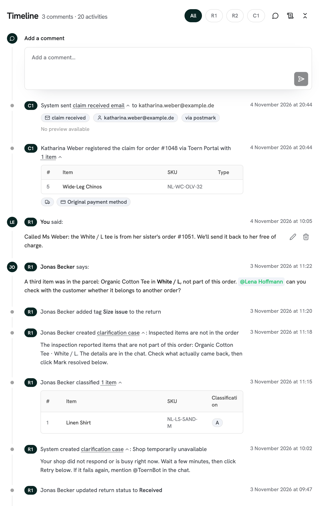</Frame>

### Timeline filtern

- Die **Pills** oben filtern die Timeline: **All** zeigt jede Retoure, **R1**, **R2**, … nur diese eine.
- **Show only comments** (das Sprechblasen-Symbol) blendet die Aktivitäten aus, auch innerhalb der gewählten Retoure. **Show comments and activity** holt sie zurück.
- **Collapse all** klappt die Aktivitäten zu. Kommentare bleiben immer offen. **Expand all** öffnet sie wieder.
- Die Timeline zeigt 20 Einträge pro Seite. **Show all at once** zeigt alles in einer langen Liste.

Der Titel zeigt, wie viele Kommentare und Aktivitäten es gibt, zum Beispiel **3 comments · 14 activities**.

### Aktivitäten

Die Timeline hält jedes wichtige Ereignis einer Retoure fest. Typische Einträge sind:

- Anlage, Statuswechsel und Stornierung der Retoure,
- **Prüfungen** (auch über die API) und **Änderungen an Artikeln**,
- **Rückerstattungen** (inkl. Gutschein) und **Umtausch**,
- **Retourenlabels**, Rücksendescheine und **Sendungsverfolgung**,
- **E-Mails** an den Kunden,
- **Klärfälle**: wann ein Punkt eröffnet und wann und von wem er erledigt wurde, mit der Notiz,
- Änderungen an Tags und Kundendaten,
- gestartete **Prozesse**, zum Beispiel der Retouren- oder Erstattungsprozess, und ihr Ergebnis.

Je nach deinen Integrationen (Shop, Fulfillment, Third Party Services) werden weitere Aktionen protokolliert. Hat eine Aktivität mehr Details, klappe sie auf. Dort findest du zum Beispiel die Klassifizierung einzelner Artikel.

Warnhinweise, die über die API an toern übermittelt werden, erscheinen ebenfalls in der Timeline. Sie sind als Warnung hervorgehoben und lassen sich aufklappen. So erkennst du sofort, dass es sich um einen prüfungsrelevanten Hinweis handelt und nicht um einen normalen Kommentar. Typische Beispiele sind **mehrfache Inspektionen** oder **nicht zuordenbare Artikel**. In den Details siehst du, dass das Update über die API kam, und, falls verfügbar, den verwendeten API-Key. Bei mehrfachen Inspektionen werden die betroffenen Artikel zusätzlich als Tabelle angezeigt.

## Notizen und Benachrichtigungen

### Notizen und Tagging

Schreib deinem Team direkt an der Bestellung, mit einem **Kommentar** in der Timeline. Ein Kommentar gehört immer zu einer Retoure:

- Ist im Filter **All** gewählt, geht ein neuer Kommentar an die neueste Retoure. Das Eingabefeld sagt dir das.
- Wähle vorher mit den Pills eine Retoure, um zu dieser zu kommentieren.

<Frame>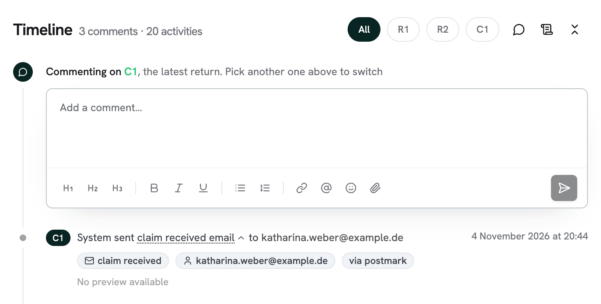</Frame>

Im Eingabefeld kannst du:

- Text mit der Werkzeugleiste **formatieren** (Überschriften, fett, kursiv, unterstrichen, Listen) und Links einfügen,
- **@** tippen, um ein Teammitglied zu erwähnen. toern schlägt dir alle Nutzer vor, die du taggen kannst, und die erwähnte Person bekommt eine E-Mail und eine Benachrichtigung. Du kannst auch den **ToernBot** erwähnen, der die Support-Systeme von toern benachrichtigt,
- eine **Datei anhängen**: Zieh sie auf das Feld,
- Emoticons wie `:)` nutzen, die zu Emojis werden. Der Smiley-Button zeigt alle,
- mit **Enter** absenden und mit **Shift + Enter** eine neue Zeile beginnen.

Ein neuer Kommentar erscheint sofort in der Timeline. Kann er nicht gespeichert werden, wird er wieder herausgenommen und dein Text kommt zurück ins Eingabefeld. Kommentare zeigen Autor und Datum. Nur der Autor kann einen Kommentar später bearbeiten oder löschen.

### Benachrichtigungen

Getaggte Nutzer sehen ihre Benachrichtigungen im oberen Menü rechts beim **Briefkasten**. Gibt es neue, ungelesene Benachrichtigungen, hat der Briefkasten einen grünen Punkt.

<Frame>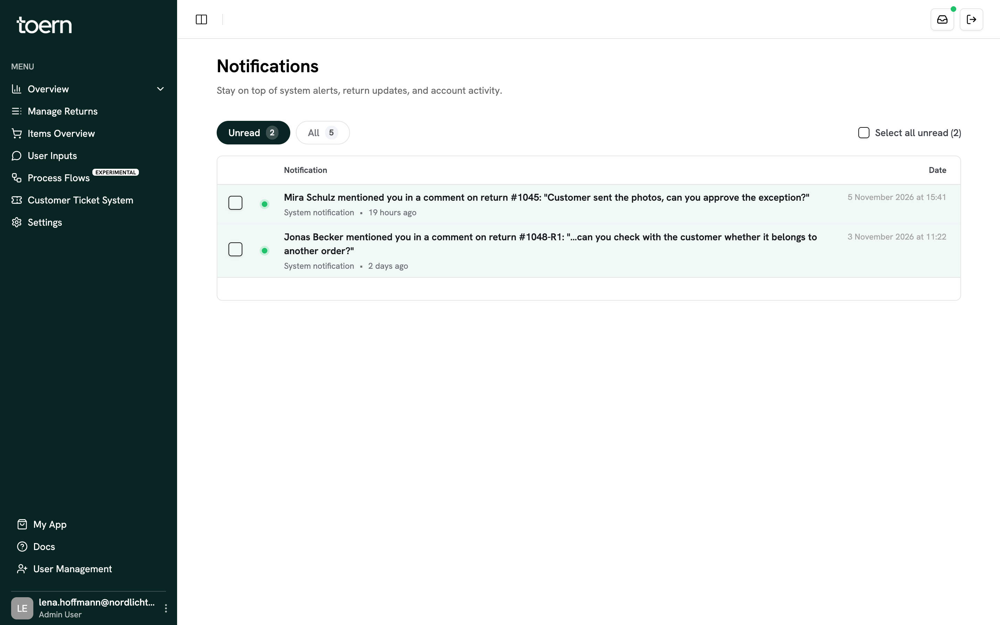</Frame>

Klicke auf den Briefkasten, um die Seite **Notifications** zu öffnen. Der Tab **Unread** zeigt, was du noch nicht gelesen hast, **All** zeigt jede Benachrichtigung. **Select all unread** wählt alle ungelesenen Benachrichtigungen auf einmal aus. Klickst du auf eine Benachrichtigung, öffnet toern die Retoure-Detailseite der Bestellung, öffnet die Retoure, zu der der Kommentar gehört, hebt den Kommentar in der Timeline hervor und markiert die Benachrichtigung als gelesen.

## Zuletzt angesehene Bestellungen

Unten auf der Seite listet **Your Recently Viewed Orders** die Bestellungen, die du zuletzt geöffnet hast. Jede Karte zeigt eine Vorschau der Bestellung und ihrer neuesten Anfrage. Klicke auf eine, um zu ihr zurückzukehren. Mit **Previous** und **Next** blätterst du durch sie.

## Retouren-Tags

Mit **Retouren-Tags** gruppierst du Retouren unabhängig vom Status und unterscheidest sie visuell. Beispiele sind **Standard-Retoure**, **Widerruf**, **Umtausch** oder eigene Tags.

Tags bleiben gespeichert, solange sie genutzt werden. So kannst du dasselbe Tag mehreren Retouren zuweisen und in der Übersicht danach filtern.

### Tags einer Retoure zuweisen

Jede Karte einer Retourenanfrage hat einen Bereich **Tags**. Füge ein Tag mit **Add tag** hinzu und entferne eines mit dem **×** am Tag. Jede Änderung wird in der Timeline festgehalten, inklusive des Nutzers, der sie vorgenommen hat.

<Frame>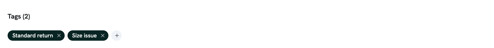</Frame>

### Neues Tag erstellen

Gib in der Tag-Suche (*Search or create a tag…*) einen Namen ein, den es noch nicht gibt, und wähle **Create "[Tag-Name]"**. Damit erstellst du das Tag für deine Brand und weist es der Retoure direkt zu.

<Frame>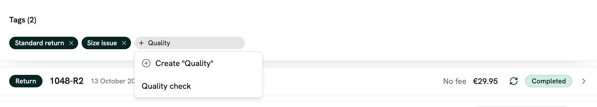</Frame>

Tag-Namen müssen innerhalb einer Brand eindeutig sein, damit der Filter zuverlässig funktioniert. Ein erstelltes Tag bleibt im Tag-Katalog verfügbar.

### Tag-Farben

Jedes neue Tag bekommt automatisch eine zufällige Farbe. Der farbige Punkt erscheint beim Tag in der Übersicht, zum Beispiel im Filter **Tags**. Auf der Retoure-Detailseite werden Tags ohne Farbe angezeigt.

### Retouren nach Tags filtern

Über den Filter **Tags** in der Übersicht suchst du ein oder mehrere Tags und wählst sie aus. Bei mehreren Tags siehst du nur Retouren, die alle ausgewählten Tags haben.

<Frame>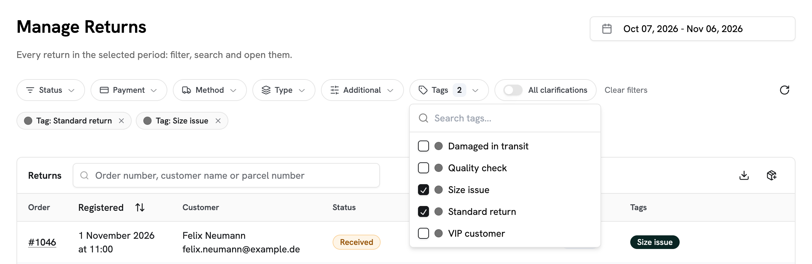</Frame>

## Manuelle Rückerstattungen

Rückerstattungen laufen in der Regel automatisch, nachdem die Retoure klassifiziert wurde. Bei einem Klärfall oder für eine Teilerstattung kannst du jederzeit manuell erstatten. Das geht auch, wenn bereits eine Rückerstattung durchgeführt wurde.

Die Erstattungs-Schublade öffnest du auf der Karte der Retoure:

- mit **Create refund**, dem nächsten Schritt einer geprüften Retoure, die noch nicht erstattet ist,
- mit **Create new refund** im **Actions**-Menü, zum Beispiel für eine weitere Rückerstattung,
- mit **Refund manually** auf einer Klärfall-Karte, wenn die automatische Rückerstattung gestoppt wurde,
- mit **Edit & retry** oder **Refund manually instead** bei einer fehlgeschlagenen Rückerstattung.

<Frame>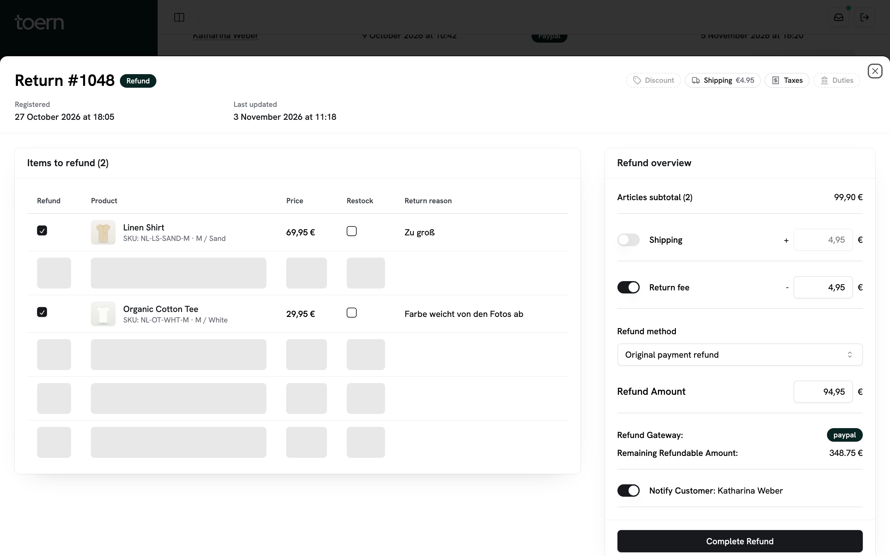</Frame>

In der Schublade:

1. **Wähle die Artikel** für die Rückerstattung. Vorausgewählt sind alle retournierten Artikel ohne angemeldeten Umtausch. Der Betrag folgt den gewählten Artikeln. **Restock** bucht sie wieder in den Bestand. Bereits erstattete Artikel lassen sich nicht erneut wählen.
2. Lege fest, ob die **Versandkosten** (Shipping) erstattet werden und ob die **Retourengebühr** (Return fee) abgezogen wird. Schalte sie ab, um auf sie zu verzichten.
3. Passe bei Bedarf die **Rückerstattungsmethode** an. Neben der ursprünglichen Bezahlmethode kannst du einen **Gutschein** wählen und ihn um einen Prozentsatz erhöhen. So bleibt der Umsatz zum Beispiel bei verspäteten Retourenanmeldungen im Shop.
4. Prüfe den **Betrag** (Amount). Er füllt sich aus deinen Angaben, und du kannst ihn ändern, zum Beispiel um einen Prozentsatz als Angebot bei einer Reklamation abzuziehen.
5. Lege mit **Notify customer** fest, ob dein Kunde die Erstattungs-E-Mail bekommt. Sie wird im Shopsystem konfiguriert.
6. Klicke auf **Complete Refund**.

Die Schublade schließt sich und die Rückerstattung läuft im Hintergrund. Die Karte zeigt ihren Fortschritt live, **Refund Detail** das Ergebnis. Schlägt sie fehl, bietet die Karte sie mit denselben Werten erneut an (siehe [Hinweise auf der Karte](#hinweise-auf-der-karte)).

<Note>
  Rechtlich musst du die Versandkosten erstatten, wenn alle Artikel einer Bestellung retourniert wurden. Das ist in den Einstellungen der Standard, du kannst es aber deaktivieren.
</Note>

Für automatische Rückerstattungen kannst du dieselben Einstellungen und einen Maximalwert in den [Rückerstattungs-Einstellungen](/returns/refund) festlegen.

## Interaktive Anleitungen

Die interaktive Anleitung zur Retoure-Detailseite ist die **Seitentour** im Dashboard: Klicke bei einer beliebigen Bestellung auf den Kompass neben dem Zurück-Pfeil. Die Anleitungen unten führen durch die Retourenübersicht und das Erstattungsformular.

<Tabs>
  <Tab title="Dashboard Manage Returns">
    <Frame>
      <iframe src="https://app.guideflow.com/embed/vkm5vmot2r" width="100%" height="600" style={{ border: 0 }} allowFullScreen />
    </Frame>
  </Tab>
  <Tab title="Dashboard Manual Refund">
    <Frame>
      <iframe src="https://app.guideflow.com/embed/gkyvmg5t4k" width="100%" height="600" style={{ border: 0 }} allowFullScreen />
    </Frame>
  </Tab>
</Tabs>

## Weiterführende Seiten

<CardGroup cols={2}>
  <Card title="Klärfälle" icon="circle-exclamation" href="/returns/clarifications">
    Jede Kategorie, Ursache und Lösung einer Klärfall-Karte.
  </Card>
  <Card title="Rückerstattung" icon="money-bill-wave" href="/returns/refund">
    Einstellungen für automatische Rückerstattungen.
  </Card>
  <Card title="Kundentickets" icon="ticket" href="/dashboard/customer-tickets">
    Die Tickets zu einer Retoure.
  </Card>
  <Card title="Xentral" icon="plug" href="/integrations/xentral">
    Die Xentral-Belege auf der Retoure-Detailseite anzeigen.
  </Card>
</CardGroup>

## Einschränkungen

### Retourenübersicht

- Das Dashboard ist aktuell nur auf Englisch verfügbar.
- **Filter**
  - Du kannst nach Retourenstatus, Bezahlmethode, Umtausch und Gutschein filtern. Nicht nach Retourengrund, Input oder Kommentar.
  - Nur Klärfälle lassen sich mit **All Clarifications** unabhängig vom gewählten Zeitraum filtern. Mit **Issue** grenzt du sie zusätzlich nach Art des Problems ein.
- **Export**
  - Der Export enthält nur die vordefinierten Spalten. Du kannst sie vorab nicht anpassen.
- **Create a new return**
  - Bei manuellen Retouren ist der Retourengrund immer **Manual return**.
  - Manuelle Retouren haben standardmäßig den Status **Inspected**. Willst du etwas anderes, musst du den Status anpassen.
  - Mit **Extend the return window** kannst du die Retourenfrist nur um genau das hinterlegte Zeitfenster verlängern.

### Retoure-Detailseite

- Sets können nur über offizielle Bundle-Apps in Shopify retourniert werden, in denen die Einzelartikel eines Sets hinterlegt sind.
- **Kommentare**
  - Mit **@** kannst du nur andere Nutzer in toern taggen.
  - Ein Kommentar gehört immer zu einer Retoure der Bestellung. Wähle die Retoure, bevor du schreibst.
  - Alle Kommentare, die über die API zu einzelnen Artikeln an toern übermittelt werden, werden in einer Notiz zusammengefasst.
  - Kommentare über die API, wie "Adresse falsch", werden in toern angezeigt. Daraus kann automatisch ein Klärfall erstellt werden (mit Return Clarification Reasons). Das gilt nur für Kommentare, nicht für die allgemeinen Retourengründe. Automatisierungen auf Basis dieser Kommentare sind nicht möglich.
  - toern passt Artikel (hinzufügen, entfernen) nur auf Basis des ersten API-Calls an. Alle weiteren führen zu einem Klärfall. Sonst könnte es durch Automatisierungen nach Status-Updates zu doppelten Rückerstattungen kommen.
- **Retourenlabels**
  - Jede Retoure hat immer nur ein Label (oder einen Rücksendeschein) mit Tracking. Erstellst du ein neues Label, ersetzt es das vorherige.
- **Manuelle Rückerstattungen**
  - Manuelle Rückerstattungen gibt es für Shopify-Shops.
  - Sind automatische Rückerstattungen aktiv und willst du die Erstattung anpassen, erstelle zuerst einen Klärfall und führe dann eine manuelle Rückerstattung durch.
  - Manuelle Rückerstattungen haben aktuell keine Verbindung zu Xentral. Löse hier immer die automatische Rückerstattung aus oder lege die Dokumente selbst an.
