Under **Manage Returns** you find all your returns in one place. From here you open an order's return detail page, where you process all of its returns: you classify items, move returns to the next step, create labels and refunds, solve clarification cases, and talk to your team in the timeline. You can also create returns manually and organize them with tags.

## Returns overview

All registered returns are listed chronologically. You see the most important information right in the list: when the return was registered, who the customer is, the status of the return, its type (exchange, gift card, with input), and the payment method used for the order.

<Frame>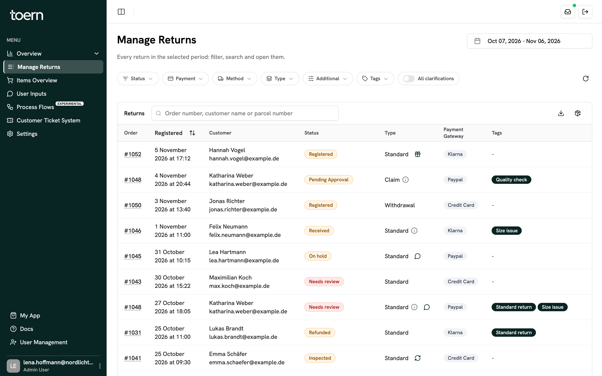</Frame>

By default you see the returns of the last month. You can adjust the time range. You can also search by customer and order number.

### Return status

You can filter returns by these statuses:

- **registered**: The customer registered the return in the return portal. It is still with the customer or on its way to the fulfillment.
- **received**: The return has arrived at the fulfillment and can be processed.
- **on hold**: Something still needs to be done before the inspection can be completed. For example, a question to the customer, or an item still needs to be washed.
- **inspected**: The items of the return have been classified. This often triggers an automatic refund.
- **refunded**: The return has been refunded. It is then automatically set to **completed**.
- **completed**: The return is completed.
- **pending approval**: A claim is waiting for your approval (see [Claims awaiting approval](#claims-awaiting-approval)).
- **needs review**: The return is a clarification case and needs a manual check. This can concern an item, an input, information from the fulfiller, or a technical issue. In the **Status** filter it is called **Clarification**. On the return detail page, a clarification card shows you what happened and how to solve it (see [Clarifications](#clarifications) and [Clarification cases](/en/returns/clarifications)).

<Frame>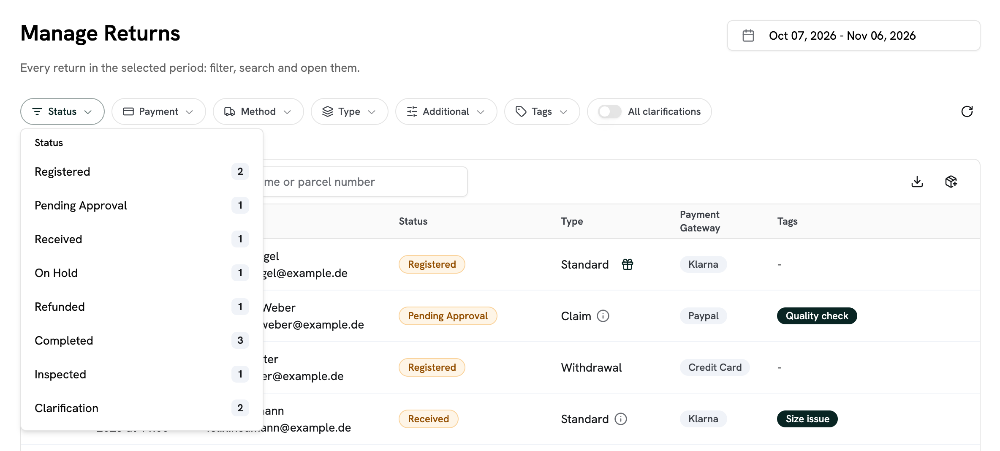</Frame>

### More filters

Besides **Status**, the filter bar has:

1. **Payment**: the payment methods you use, e.g. PayPal or Klarna.
2. **Method**: the return method, **Carrier**, **Self-ship**, **In Store** or **Brand upload**.
3. **Type**: **Standard** returns, **Withdrawal**s or **Claim**s.
4. **Additional**: returns with an exchange item (**Has Exchange Item**) or gift card returns (**Is Giftcard Return**).
5. **Tags**: your own tags (see [Return tags](#return-tags)).
6. **All clarifications**: shows every clarification case, independent of the selected time range. Then **Issue** appears, which filters by kind of clarification case, for example return label, refund or Xentral.

Every active filter shows as a chip below the bar, for example **Tag: Size issue**. Remove one with its **×**, or all with **Clear filters**.

<Frame>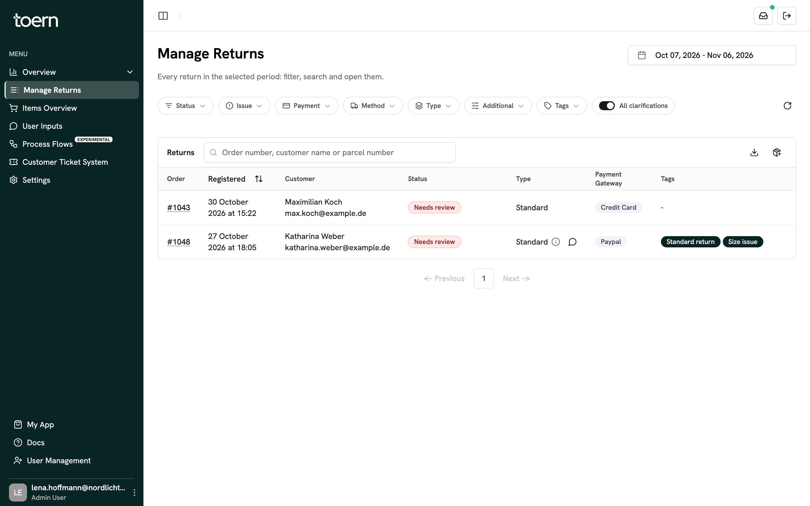</Frame>

<Frame>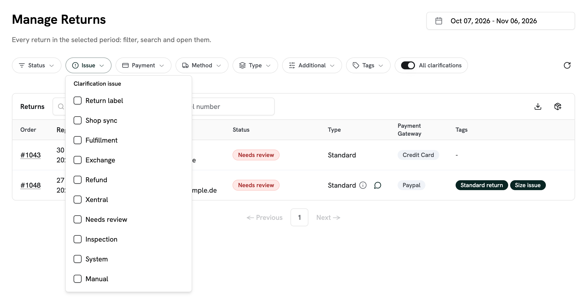</Frame>

Your filters travel with you to the return detail page: its previous and next arrows walk through the same filtered list (see [Header and navigation](#header-and-navigation)).

### Export

With the **download** icon above the list (**Export return data**) you export all returns in the selected time range. The export contains more information than the overview. These columns are included:

```text
order_id ; customer_id ; return_reated_at ; return_status ; item_index ; sku ; item_name ; attribute_1 ; attribute_2 ; attribute_3 ; return_reason; user_input; classification; item_id ; variant_id ; exchanged ; item_price ; country_code_origin ; reggular_refund_amount ; giftcard_refund_amount ; refund_type
```

## Create returns manually

Usually customers create their returns themselves in the toern return portal. If a customer doesn't use this way or needs help from your customer service, you can create the return manually. There are two ways:

- From the **returns overview** with the **Create a new return** icon, when you start from a customer's call or email and still need to find the order (described below).
- From the **return detail page** with **Create manual return**, when the order is already open (see [Items not yet returned](#items-not-yet-returned)). The form is the same.

### Find the order

1. Open **Manage Returns**.
2. Click the **Create a new return** icon (the parcel with a plus) above the list. The page **Create a return** opens.
3. Enter the order number or the customer's name in the search field. When you search by name, you see all orders of this customer.
4. Click the order you're looking for.

<Frame>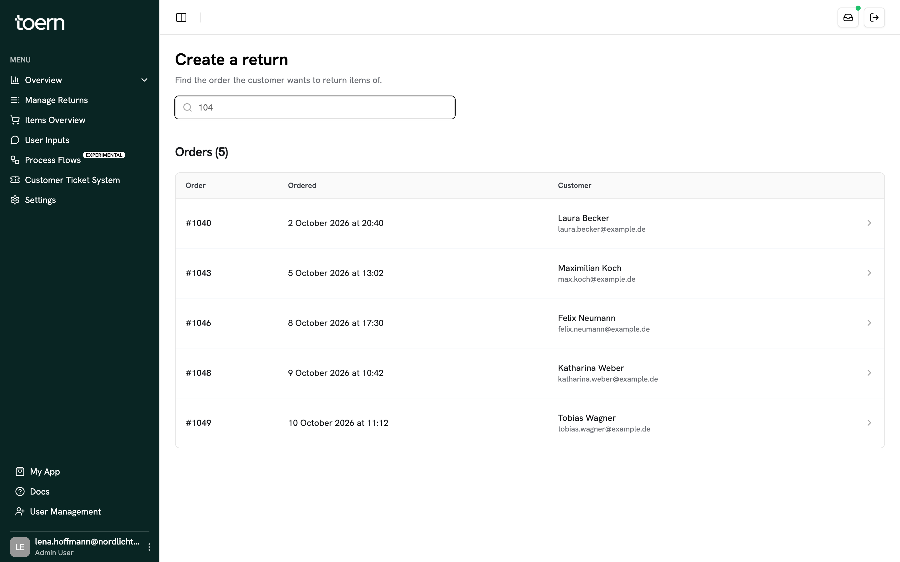</Frame>

### Configure the return

<Frame>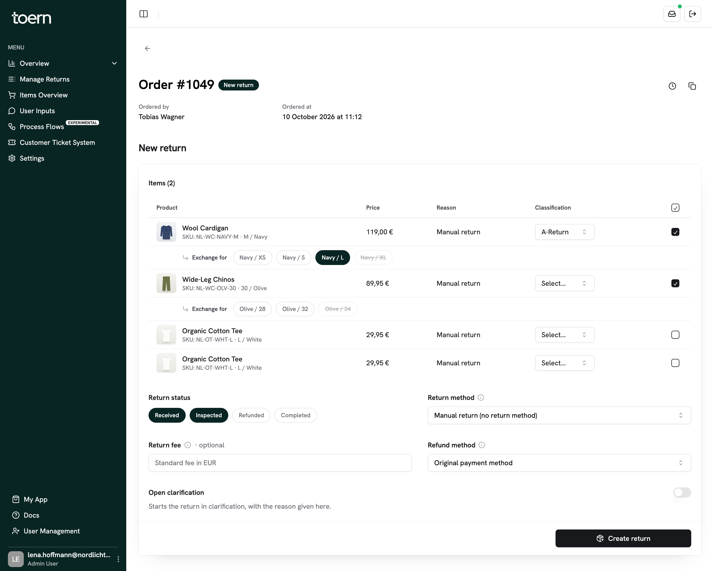</Frame>

1. **Items**: Tick the items to return. Items that are already part of a return are marked **Already returned** and can't be picked.
2. **Classification** (optional): You can classify the items right away, **A-Return** to **D-Return**. This only makes sense if the item is already with you.
3. **Exchange** (optional): Below a ticked item, **Exchange for** lists the item's variants. Pick one to create an exchange. This helps when a customer asks for an exchange by email. toern checks the variants via the Shopify interface. Variants that aren't available are struck through.
4. **Return status**: Select the current status of the return. By default, **Received** and **Inspected** are selected, because this feature is mostly used by the fulfillment.
5. **Return method**: The return method of the return, or **Manual return (no return method)**.
6. **Return fee** (optional): A fee to deduct from the refund.
7. **Refund method**: Select the refund method, including a gift card. This helps, for example, if you create a return after the return window has expired and agree with the customer on a gift card.
8. **Open clarification** (optional): Turn it on and enter a reason to start the return in clarification right away.
9. Click **Create return**. The return is created and you land on the order's return detail page, with the new return opened.

The icons next to the order number **extend the return window** and **copy the portal login link** for the customer.

<Warning>
  Is the return still at the customer's home? Then make sure to reset the status. Click **Received** and **Inspected** once. Otherwise a refund can be triggered automatically.
</Warning>

<Frame>
  <iframe src="https://app.guideflow.com/embed/zkjyg7vswk" width="100%" height="600" style={{ border: 0 }} allowFullScreen />
</Frame>

## Return detail page

The return detail page shows **one order with all of its returns**. Every return, withdrawal and claim the customer registered for this order (R1, R2, …) is on this one page, each as its own card. Next to them you find everything else about the order: the order's value, the customer and their return behaviour, the items not returned yet, the refunds, Xentral documents and one combined timeline. You no longer open the returns of an order one by one.

<Frame>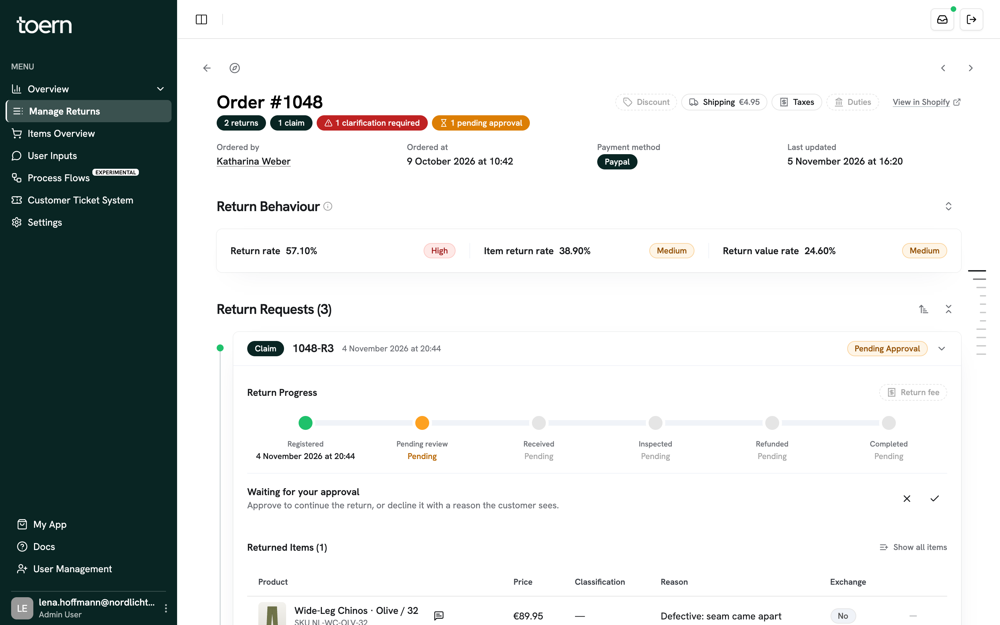</Frame>

### Open the page

- **From the returns overview**: click a return. The page of its order opens, with the return you clicked opened and scrolled into view.
- **From a notification or email**: links to a comment open the order's page, open the return the comment belongs to and highlight the comment in the timeline.
- **From an address**: the page's address is `/return/<order number>`. With `?r=<return ID>` at the end, that return opens. Links that point to a single return, such as `/return/1048-R2` from older notifications, emails or the Zendesk app, keep working: they forward to the order's page and open R2.

The page keeps itself up to date. When something changes while you have it open, for example a refund finishes in the background, a label arrives from the carrier, or a colleague writes a comment, the affected part of the page refreshes by itself. You don't need to reload.

### What's on the page

<Frame>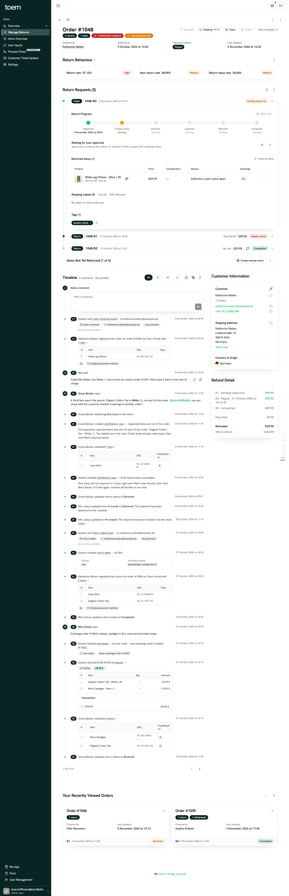</Frame>

| Area | What you find there |
| --- | --- |
| [Header](#header-and-navigation) | Order number, navigation to the previous and next order, the counts of returns, withdrawals and claims, open clarifications and approvals, who ordered and how they paid, and what the order was charged. |
| [Return Behaviour](#return-behaviour) | How often this customer returns, compared to your other customers. |
| [Return Requests](#return-requests) | One card per return, withdrawal and claim, with its progress, next steps, clarifications, items, labels, tracking and tags. |
| [Items Not Yet Returned](#items-not-yet-returned) | The order's items that no return contains yet, and **Create manual return**. |
| [Xentral Documents](#xentral-documents) | The order's documents in Xentral, if Xentral is set up. |
| [Customer Information](#customer-information) | Contact details and shipping address, which you can correct. |
| [Refund Detail](#refund-detail) | Every refund of the order, per return. |
| [Timeline](#timeline) | All activity and your team's comments across every return. |
| [Your Recently Viewed Orders](#recently-viewed-orders) | The orders you opened before. |

On wide screens, customer information and refunds sit in a column beside the return requests. On narrower screens, and when you give the return requests the full width, they move below.

<Tip>
  New to the page? Click the **compass** icon next to the back arrow to start the **page tour**. The **Short tour** (about 1 minute) shows what's new. The **Full tour** (about 5 minutes) walks you through every part with live demos, for example a refund, a manual return and a comment. Nothing from the tour's demos is saved.
</Tip>

### Page index

On the right edge of the page, a small **ring** shows where you are: it fills as you scroll. Hover over it to see every section of the page, including each return (R1, R2, …), and click one to jump there.

<Frame>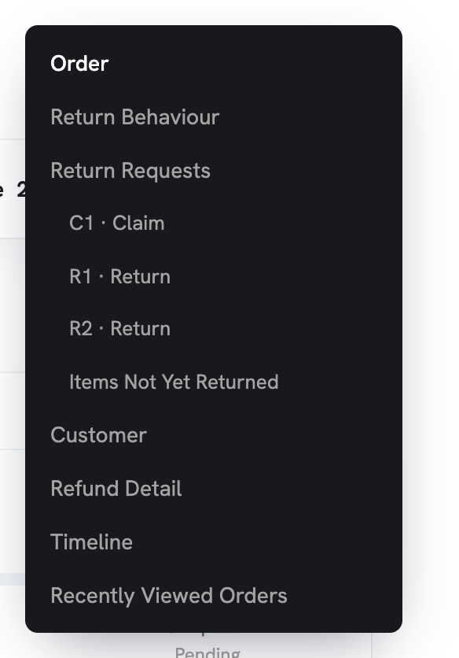</Frame>

## Header and navigation

<Frame>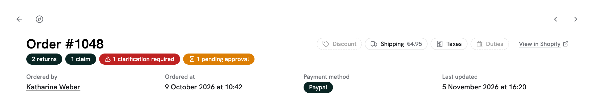</Frame>

### Navigation

- The **←** arrow takes you back to the returns overview, with your filters as you left them.
- The **‹ ›** arrows open the previous and the next **order** in the list. Hover over an arrow to see which order it opens. If there's no order in that direction, the arrow is disabled.
- The arrows respect the overview's filters and sorting. For example, if you filtered the overview by clarification cases, you jump straight to the next order with a clarification case.
- The **compass** starts the page tour.

### The order at a glance

The header sums up the order:

- The **order number**. **View in Shopify** opens the order in your Shopify admin.
- **Black pills** count the order's requests, for example **2 returns**, **1 withdrawal** or **1 claim**.
- **Badges** show what's waiting for you, for example **1 clarification required** or **1 pending approval**. Click a badge to scroll to the return that needs you.
- **Ordered by**: the customer. Click the name to jump to the customer information.
- **Ordered at**, **Payment method** and **Last updated**, the time anything on the order last changed.

### What the order was charged

Below, chips show what the order was charged besides the items:

| Chip | Its tooltip shows |
| --- | --- |
| **Discount** | The total discount and how it splits: automatic or manual discounts, discount codes, on items or on shipping. |
| **Shipping** | The shipping charged, the original amount before refunds, and the order's weight. |
| **Taxes** | The tax amount and whether it is included in the prices or added on top. |
| **Duties** | Duties charged, for each eligible item or spread across the items. |

A **dashed** chip means the order has none of it, for example **No discount on this order**.

### The compact header while scrolling

When you scroll down, a compact version of the header stays at the top of the page: the order number, the counts of returns, withdrawals and claims, the clarification and approval badges, who ordered, and how they paid. The badges keep working there, so you can jump to a return that needs you from anywhere on the page.

<Frame>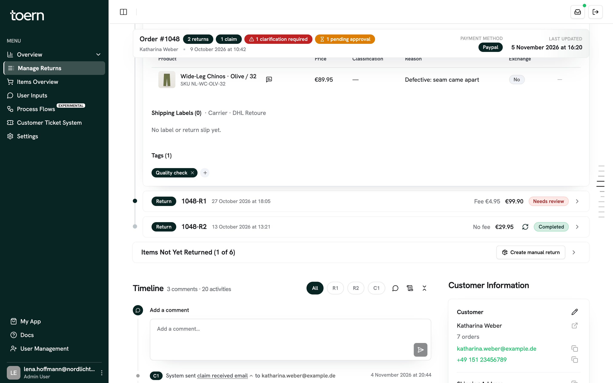</Frame>

## Return requests

The **Return Requests** section has one card for each return, withdrawal and claim of the order. Each card is labelled with its type (**Return**, **Withdrawal** or **Claim**) and its number, for example **Claim 1048-R3**.

<Frame>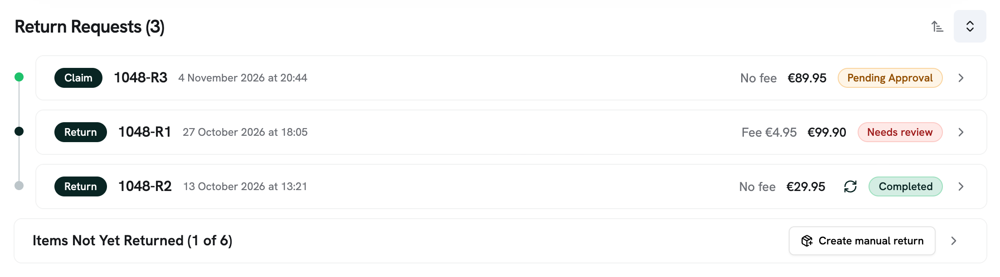</Frame>

The controls at the top right of the section:

- **Latest first** / **Oldest first** sorts the cards.
- **Expand all** / **Collapse all** opens or folds all cards at once.
- **Full width** gives the cards the page's full width. Customer information and refunds then move below. Click it again to show them beside the cards. This option appears on wide screens.

### A return request card

Each card's header sums the request up, so you can read it without opening it:

- its **type** and **number**, for example **Return 1048-R1**, and the date it came in,
- folded: what the return is worth and its fees,
- its **state** on the right.

Click the header to open or fold the card. The return you came for, for example the one you clicked in the overview, is opened for you.

An open card contains, from top to bottom:

1. [Return Progress](#return-progress) with the [next steps and actions](#next-steps-and-actions)
2. [Clarifications](#clarifications) and other [notices](#notices-on-a-card), if any
3. [Returned Items](#returned-items)
4. [User Inputs](#user-inputs) and [Associated Customer Tickets](#associated-customer-tickets), if any
5. [Shipping Labels](#shipping-labels) and [Shipment Tracking](#shipment-tracking)
6. [Connected Orders](#exchanges-and-connected-orders), for exchanges
7. [Tags](#return-tags)

<Frame>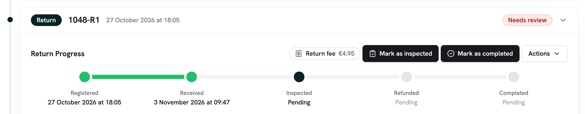</Frame>

### Return progress

**Return Progress** shows where the return stands, from registration to refund. Each step shows when it was done.

| Step | Meaning |
| --- | --- |
| **Registered** | The customer registered the return. |
| **Pending review** / **Approved** / **Declined** | Only for claims that need your approval (see [Claims awaiting approval](#claims-awaiting-approval)). |
| **Received** | The parcel arrived at your warehouse. |
| **Inspected** | The items were checked and classified. |
| **Refunded** | The refund went out. While the payment provider still processes it, the step shows **Pending transactions**. |
| **Exchanged** | For exchanges: the replacement was sent. |
| **Completed** | The return is closed. |

The progress also shows the **processes** that run in the background, live, for example the refund being sent. A message tells you when one starts (**Refund process running for R1…**) and how it ended (**Refund process finished for R1** or **Refund process failed for R1**). While a process runs, the card's buttons are locked, so you can't start a second action on top of it. A failed step stays visible with its reason, so you know what to fix.

### Next steps and actions

The buttons beside **Return Progress** are the return's next steps. Each says what it does. Everything else you can do with the return is under **Actions**.

<Frame>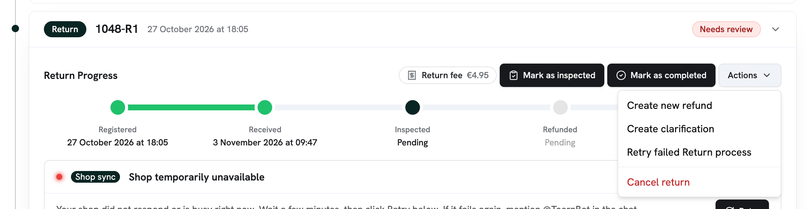</Frame>

**Next steps (buttons)**

| Button | When you see it | What it does |
| --- | --- | --- |
| **Mark as received** | The return isn't received yet, not canceled and not on hold. | Moves the return on to received, the step before the inspection. Use it when the carrier's tracking hasn't done it for you. Nothing else changes. |
| **Mark as inspected** | The return is received, not inspected yet, not canceled and not on hold. | Marks the items as checked. Classify each item first. From inspected, the refund can go out. If your settings ask for it, toern warns you when not every item is classified yet: *Not all items are classified yet. Mark the return as inspected anyway?* |
| **Mark as completed** | The return is in clarification. | Closes the return once everything is cleared up. It is marked as completed. |
| **Create refund** | The return is inspected and not refunded yet (Shopify shops). | Opens the refund drawer to refund the return by hand (see [Manual refunds](#manual-refunds)). |

**Actions menu**

| Action | When you see it | What it does |
| --- | --- | --- |
| **Create new refund** | Any return that isn't canceled, also once refunded (Shopify shops), when **Create refund** isn't shown as a button. | Opens the refund drawer, for example for a further partial refund. |
| **Mark as refunded** | Inspected, not refunded yet. | Sets the return to refunded without moving money, for example when you refunded outside toern. |
| **Set on hold** | The return is received. | Pauses the return, for example while you wait for an answer from the customer. You enter a reason. |
| **Resolve on hold** | The return is on hold. | Continues the return. |
| **Create clarification** | Not canceled and not on hold. | Opens a clarification case with your own reason and pauses all automations of the return (see [Clarifications](#clarifications)). |
| **Execute return process** | The return isn't synced to your shop yet. | Starts the process that creates the return in your shop. |
| **Execute auto refund** | The return reached your refund trigger and has no completed refund. | Starts the automatic refund with your refund settings. |
| **Execute exchange processing** | Exchanges, once the return reached your exchange trigger. | Starts the exchange, for example the exchange order. |
| **Retry failed …** | A process failed and can be retried. | Restarts the failed process, for example **Retry failed Return process**. |
| **Cancel return** | Not refunded, completed, on hold or already exchanged. | Cancels the return, also in Shopify. You enter a reason. This can't be undone. |

For actions that need a reason, such as **Set on hold**, **Create clarification** or **Cancel return**, a dialog asks for it first. Every action shows a confirmation or an error message when it's done, and is recorded in the [timeline](#timeline).

Some actions are disabled with a reason when you hover over them, for example:

- *Xentral orders are refunded in Xentral.*
- *This return is not synced with Shopify yet.*
- *Refund this from the return the exchange order came from, or run the auto refund.* (on an exchange order)

### Clarifications

When a return is a clarification case, each open issue gets **its own box** below the progress, the **clarification card**. It shows:

- the **category** as a small pill, for example **Shop sync**, **Return label**, **Refund** or **Needs review**,
- a **headline** that says what happened,
- a short **explanation** of where to fix it,
- **one button** on the right that gets the return out of clarification.

<Frame>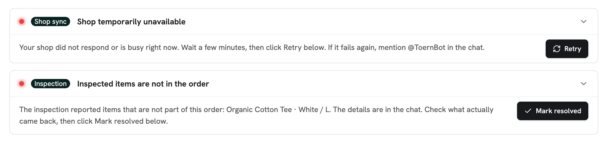</Frame>

Click a box's title row to fold or open it. The button is one of these:

| Button | When you see it | What happens |
| --- | --- | --- |
| **Retry** | A step failed, for example the label or the return in Shopify. | Fix the cause first, then click it. toern restarts the failed step, and the arrow turns while it runs. If it works, the box closes by itself. |
| **Mark resolved** | Nothing failed, but you have to check or decide something. | Take care of it, then click. You can add a short note on what you did. It is shown on the timeline. |
| **Refund manually** | The automatic refund was stopped. | Opens the refund drawer. Once the refund goes through, the box closes by itself. |

Automated processing, including the automatic refund, only continues once **every** issue of the return is resolved. When each issue was opened and resolved, and by whom, is in the [timeline](#timeline).

<Note>
  Clarification cases from before the new clarification system have no category or button. They show as a **Return needs review** notice with their reason. Check the return, do what's needed, and close it with **Mark as completed**.
</Note>

All categories, causes and solutions are described in [Clarification cases](/en/returns/clarifications).

### Notices on a card

Besides clarifications, a card shows a notice when the return needs your attention:

- **Return is on hold**, with the reason it was put on hold. Continue it with **Resolve on hold** in the **Actions** menu.
- **Return has been canceled**, with the cancellation reason.
- **Refund failed**: the refund didn't go through. The notice says whether money has already moved and offers the matching next step:
  - **Retry remaining steps**: the customer has already been paid. Retrying finishes the follow-up steps without moving money again.
  - **Retry auto refund** or **Retry with same details**: no money has moved yet. The refund runs again.
  - **Edit & retry**: reopens the refund drawer with the values you entered, so you can correct them.
  - **Refund manually instead**: opens a fresh refund drawer.

Click a notice's title row to fold it or show its full text.

### Claims awaiting approval

A claim that needs your approval shows the banner **Waiting for your approval** under its progress. Nothing happens to the claim before you decide:

- **✓ (Approve claim)** accepts the claim, so it continues like a return.
- **× (Decline claim)** asks you for a reason. The customer sees this reason.

Hover over an icon to see its name.

Until then, the claim's other controls, for example its return fee, are disabled with the hint *Approve or decline the claim first*. The header's **pending approval** badge takes you to the claim.

<Frame>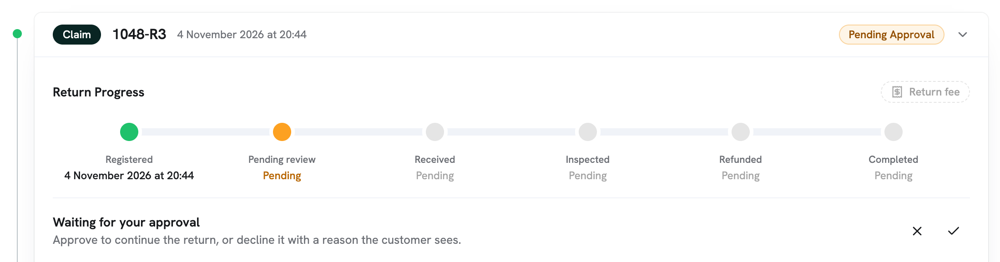</Frame>

### Return fees

The **Return fee** chip beside the next steps shows the return's fees. Click it to see each fee with what it's for, what's deducted from the refund, and why.

<Frame>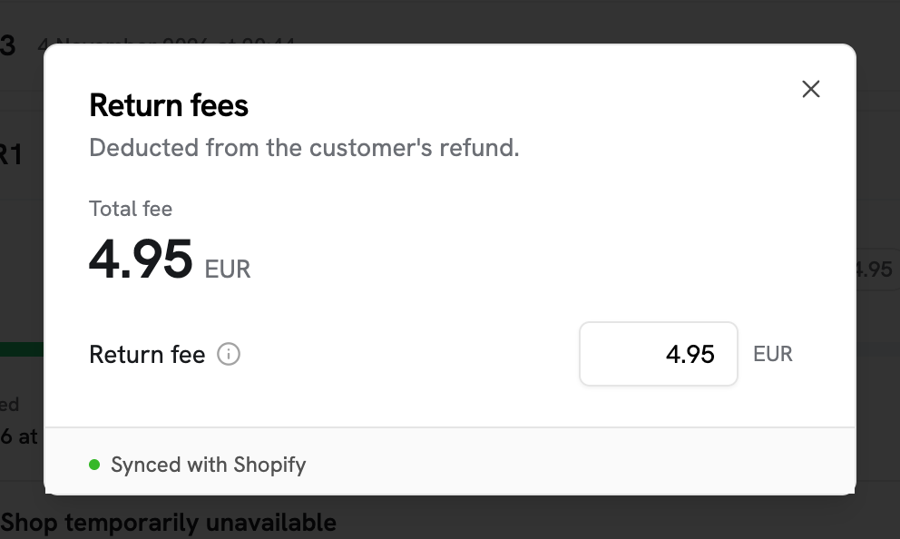</Frame>

- Type a new amount to change a fee. It saves by itself.
- The **arrow** next to a changed fee puts back the calculated amount.
- A dashed, muted chip means the return has no fee data yet.

The fee is deducted from the refund, also for refunds you create by hand, unless you switch it off in the refund drawer.

### Returned items

**Returned Items** lists what came back and why, with these columns:

| Column | Content |
| --- | --- |
| **Product** | Picture, name, variant and SKU. Click the picture for the [item details](#item-details). |
| **Price** | The price the customer paid, with the original price struck through when the item was discounted. |
| **Classification** | The inspection result, **A-Return** to **D-Return**. |
| **Reason** | The return reason the customer picked, with their comment below, if any. An icon shows that the customer added photos, a voice message or a text. |
| **Exchange** | Whether the item is exchanged, and for which variant. |

<Frame>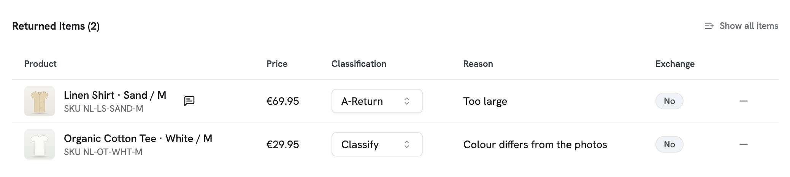</Frame>

**Classify items**

Pick **A-Return**, **B-Return**, **C-Return** or **D-Return** in an item's **Classification**. toern always offers these four classes. How you use them is up to you and your fulfillment.

For a **C-** or **D-Return**, toern asks whether to *Continue as a normal return, or open a clarification case for this return?*. With **Open clarification case**, the return gets the status **needs review** and stops until you've resolved it.

**Add and remove items**

If the parcel contains more or fewer items than the customer registered, change the return's items:

1. Click **Show all items** above the table. The order's other items appear below the returned ones, each with a **+**. The link then reads **Show returned items only**.
2. Click **+** on an item to add it to the return.
3. Click **−** on a returned item to take it out of the return. A removed item stays visible, faded and marked **Removed**.

<Frame>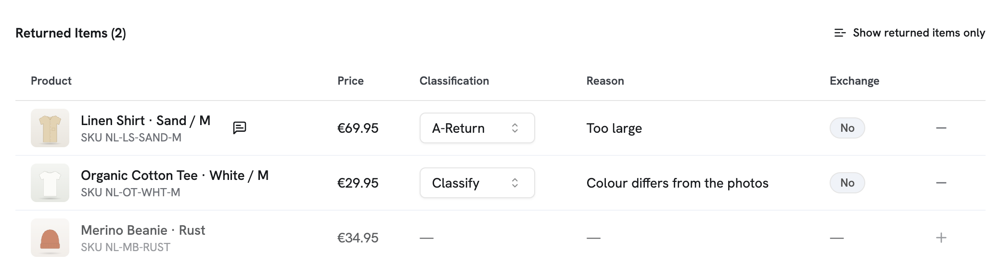</Frame>

Items can't be added or removed while a process runs, or on a canceled or on-hold return. If Pickware processes the Shopify return for you, items can't be changed here, because Pickware handles the return itself.

**Sets and exchanges**

- A **set** is shown with its parts. **Show parts** lists them, and you can add or remove single parts.
- An exchange's **replacement item** is marked **Exchange replacement**. If the customer sends it back later, the card says in which return.

### Item details

Click an item's picture to open its details:

- the **product**: SKU, product ID, barcode and attributes, and its price,
- **why it came back**: the return reason and the customer's comment,
- **From the Customer**: the photos, voice message and text the customer added for this item. Click a photo to open it in full size. Play the voice message right there.

<Frame>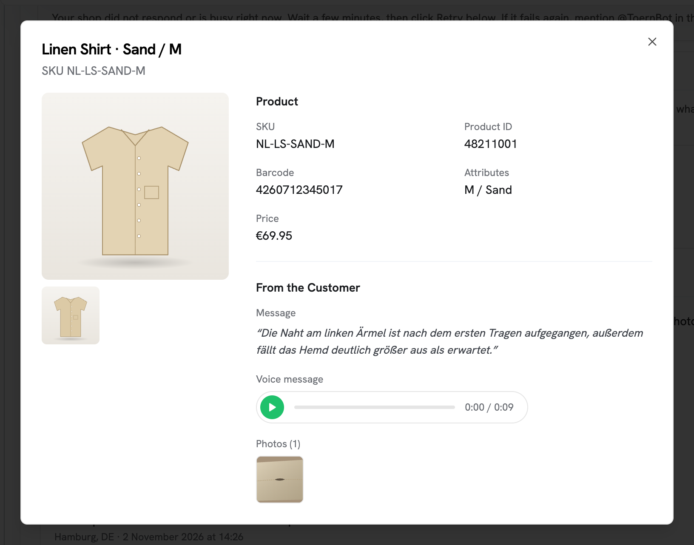</Frame>

### User inputs

If your return flow asks the customer questions, **User Inputs** shows their answers for the whole return, grouped by page. Answers to questions about a single item are shown with that item in the **Answers** column.

- When the customer answered in another language, the **language** icon shows flags for the portal languages. Pick one to read the answers in it.
- **Show only the page names** folds the answers, and **Open all pages** opens them again.

### Associated customer tickets

When customer tickets belong to the return, **Associated Customer Tickets** lists them with their title, urgency (**Urgent** or **Standard**), status (**Open**, **In progress**, **Done**) and creation date. **Open Customer Tickets** takes you to the tickets page (see [Customer tickets](/en/dashboard/customer-tickets)).

### Shipping labels

**Shipping Labels** shows the return's label and, for returns without a label, its return slip.

<Frame>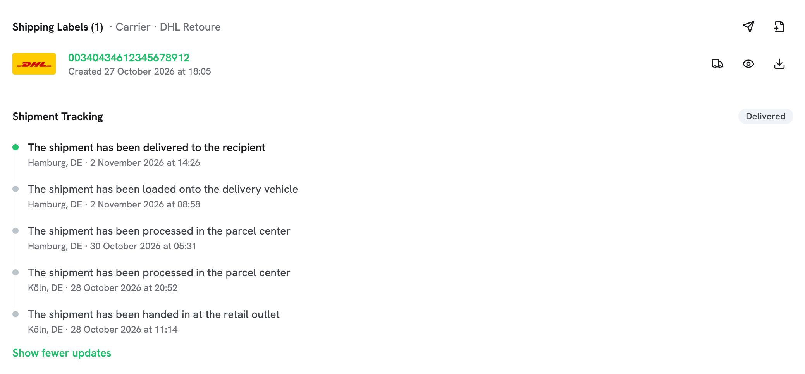</Frame>

Each entry shows its kind (**Label**, **RMA**, **Return slip**), the return method (**Carrier**, **Self-ship**, **In store** or **Brand upload**) and when it was created. You can:

- **View** the label in a new tab, or **Download** it.
- **Generate label** or **Generate new label**: requests a label from your carrier. While it's being created you see *Creating the label…*, and it appears in the list as soon as the carrier has created it. A new label replaces the previous one.
- **Upload label**: for brand-upload return methods, upload the label you created yourself (PDF or image, max. 10 MB) with its **Tracking number** and **Tracking URL**. With **Notify the customer**, toern emails it to the customer.
- **Generate return slip**: creates the return slip for self-ship and in-store returns.
- **E-mail return instructions** (with the label or the return slip): sends the customer the return instructions email again.

If the carrier rejects the label, the section says so and asks you to check the address, the shipping provider configuration and the return method settings (both linked), then try again. Below that, it shows the carrier's own message.

### Shipment tracking

**Shipment Tracking** shows the parcel's way back, from your carrier's tracking: every update the carrier sent, newest first, with its status, description, place and time. The latest updates are shown first. **Show all … updates** lists the whole history.

- *Tracking is on. Waiting for the first update from the carrier.* means the parcel hasn't been scanned yet.
- *Shipment tracking is not available for this return.* means toern receives no tracking for this return's shipment.

### Exchanges and connected orders

For an exchange, **Connected Orders** shows the orders that belong to it:

- the **exchange order** with the replacement items, linked to Shopify, once it's created,
- the **exchange fulfillment order**, with a note if it's on hold in Shopify.

Until they exist, a note explains when they're created, for example after the refund is processed. On an exchange order itself, the page says which return it replaces (**Replacement for R1**).

## Items not yet returned

**Items Not Yet Returned** lists the order's items that no return contains yet, with how many of each are still open, for example **Items Not Yet Returned (1 of 4)**. An exchange's replacement item is listed too, marked as such: it's part of the order and in no return until the customer sends it back. Click the title or the arrow to show or hide the items.

<Frame>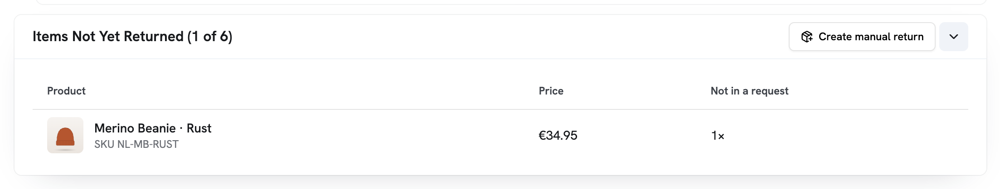</Frame>

### Create a manual return from the page

1. Click **Create manual return**. A drawer opens from the bottom, with the order still in view above it.
2. Pick the items for the new return.
3. Below, set the return's status, return method, fee and refund method, and open a clarification case right away if needed. The fields are the same as in [Configure the return](#configure-the-return).
4. Click **Create return**. The drawer closes and the new request appears on the page as a new card.

<Frame>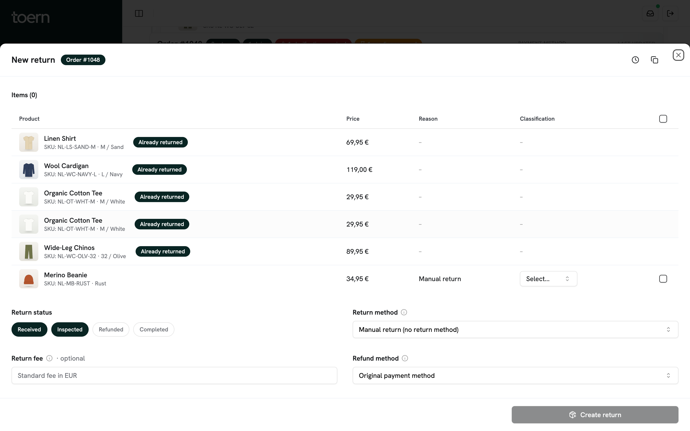</Frame>

If you close the drawer after picking items, toern asks whether to discard them.

When every item of the order is part of a return, the section says *Every item of the order is part of a return.*

## Return behaviour

**Return Behaviour** shows how this customer returns, next to your other customers. toern collects this data across all of the customer's orders with your brand.

- Folded, you see the **Return rate**, **Item return rate** and **Return value rate**, each with a level: **Low**, **Medium** or **High**.
- Expanded with the arrows, you see every rate and the figures behind them: **Orders**, **Returns**, **Items ordered**, **Items returned**, **Order value** and **Returned value**.
- The levels follow the thresholds you set in the settings. The thresholds are shown in the section.
- **Not rated** means there isn't enough data yet: the customer needs a minimum number of orders.

<Frame>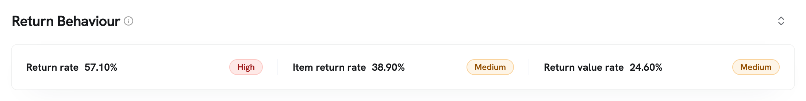</Frame>

Amounts are in your shop currency. Canceled returns don't count, and exchanged items don't count towards the returned value.

## Customer information

**Customer Information** shows who ordered and where the order went: name, company, email, phone and shipping address, with the customer's number of orders. Use the copy icons to copy the email, phone number or address. **View map** shows the address on a map. The Shopify icon opens the customer in Shopify.

<Frame>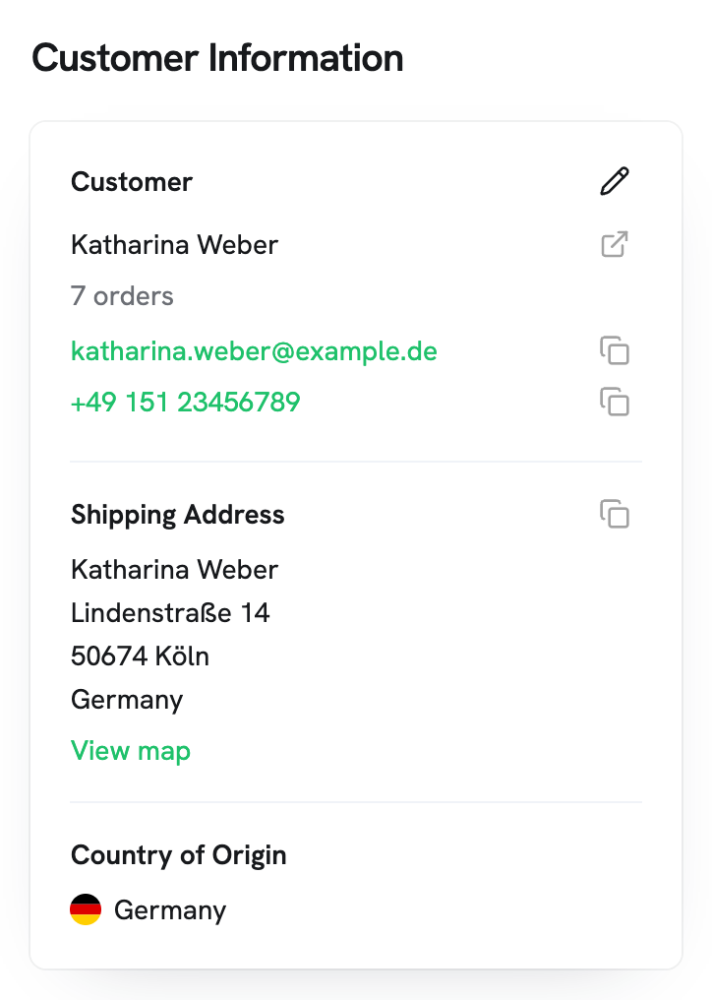</Frame>

### Edit customer data

The customer data comes from your shop integration. If there were errors in shipping and you need to change the data for the returns, click the **pencil** (**Edit customer**). You can correct the **Name**, **Company**, **E-mail**, **Address**, **Address line 2**, **Zip code**, **City** and **Country**, then click **Save changes**.

<Frame>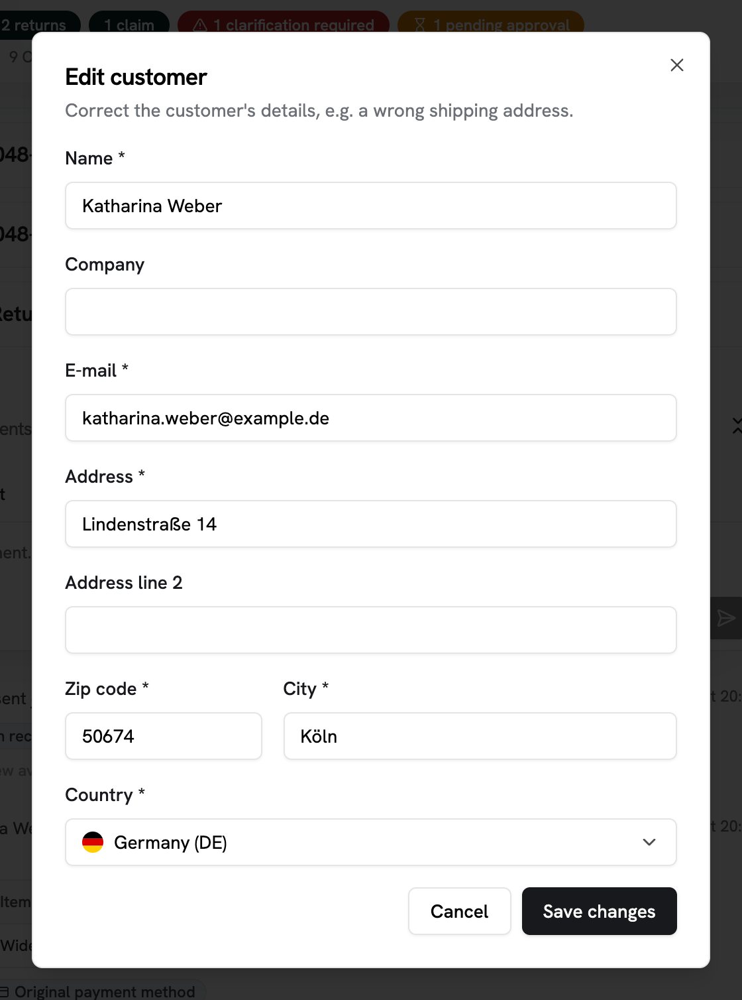</Frame>

<Warning>
  Changed customer data is only saved in toern. It is not transferred to your shop system.
</Warning>

The section also shows the **Country of Origin**, the country toern applies the return rules of. If it was set by hand, the section says so: all return and refund rules then apply based on this country, even if the shop updates the address later.

## Xentral documents

**Xentral Documents** shows the order's documents in Xentral. The section is only on the page when your Xentral access credentials are set and **Display Xentral Return Info** is on (see [Xentral](/en/integrations/xentral)).

- For the order: the **Customer**, **Sales order**, **Delivery notes** and **Invoice**.
- For each return: its **Return** and **Credit note**, and for exchanges the **Exchange sales order**.

The document numbers link into Xentral. The **sync** icon fetches the numbers from Xentral again, for example after you created a document there.

## Refund detail

**Refund Detail** shows every refund of the order, per return.

<Frame>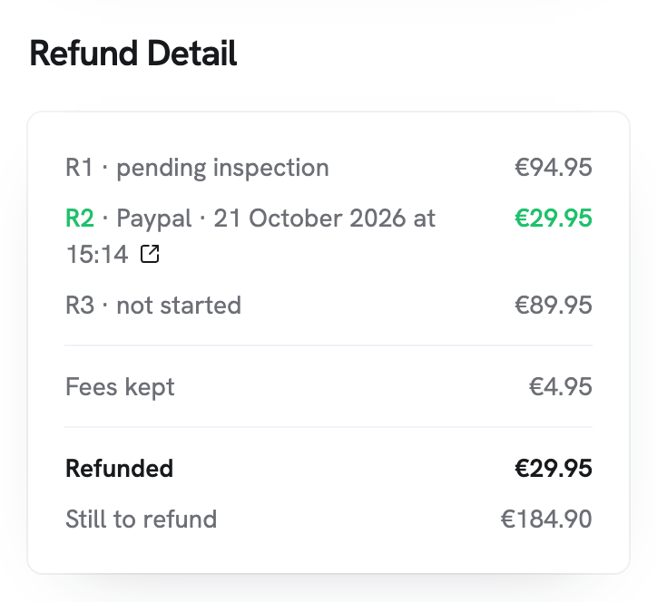</Frame>

For each return you see:

- its **refund stage**: **not started**, **pending inspection**, **ready to refund**, **refund in progress**, **refund pending**, **refund failed** or **canceled**,
- what was **Refunded** and what's **Still to refund**, the **Fees kept** and any **Discount adjustment**,
- whether the refund was **Manual**, and gift card refunds with their bonus (*Includes a 10% bonus*).

Click **Refund details** to see the full breakdown: the refunded items (with returned, exchanged and kept parts), shipping, duties, return fee and surcharges, every payment with its status (**Successful**, **Pending**, **Awaiting response**, **Failed**), whether the customer was notified, and the gift card code for gift card refunds.

<Frame>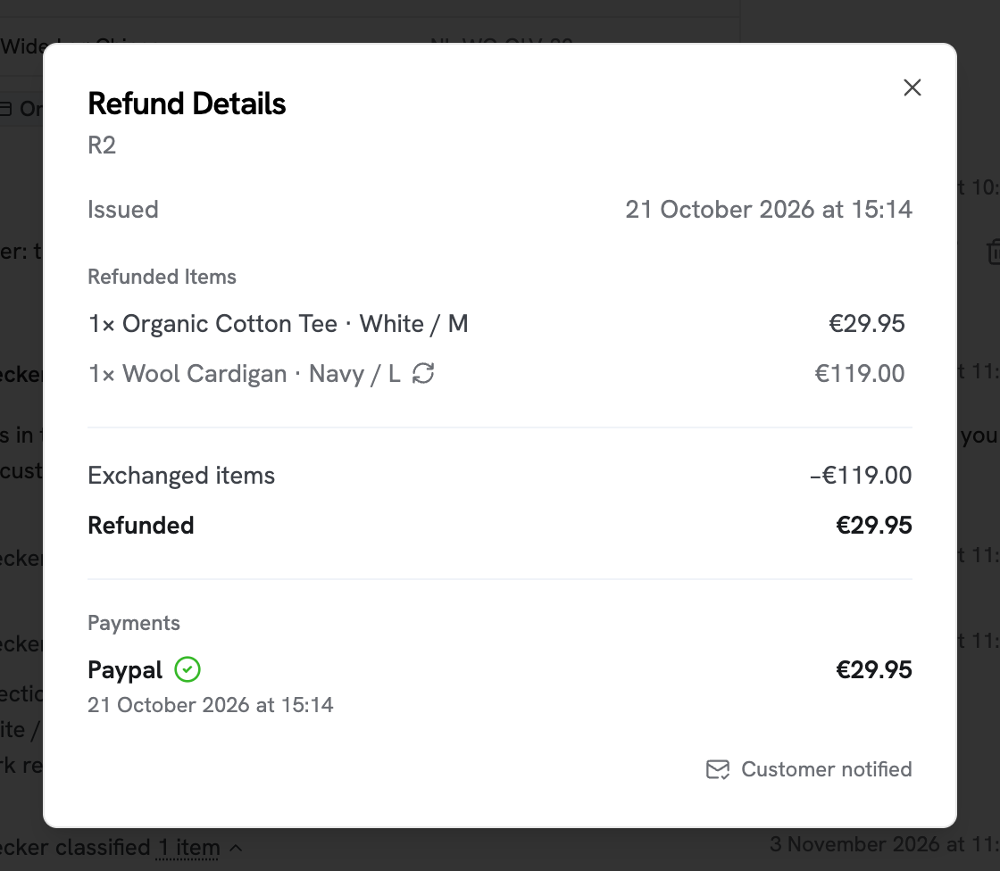</Frame>

## Timeline

The **Timeline** shows everything that happened on the order, across all returns: your team's comments and the activity of every return, newest first. Each entry carries the badge of its return: returns are numbered **R1, R2, …**, withdrawals **W1, W2, …** and claims **C1, C2, …**, in the order they came in.

<Frame>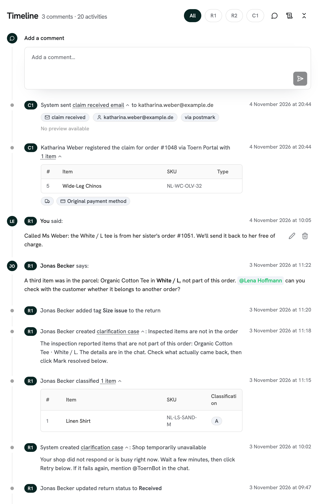</Frame>

### Filter the timeline

- The **pills** at the top filter the timeline: **All** shows every return, **R1**, **R2**, … only that one.
- **Show only comments** (the speech bubble icon) hides the activity, also within the return you picked. **Show comments and activity** brings it back.
- **Collapse all** folds the activity entries. Comments always stay open. **Expand all** opens them again.
- The timeline shows 20 entries per page. **Show all at once** lists everything in one long list.

The title shows how many comments and activities there are, for example **3 comments · 14 activities**.

### Activity

The timeline records every meaningful event of a return. Typical entries are:

- creation, status changes and cancellations of the return,
- **inspections** (also via the API) and **changes to items**,
- **refunds** (incl. gift card) and **exchanges**,
- **return labels**, return slips and **shipment tracking**,
- **emails** to the customer,
- **clarification cases**: when an issue was opened, and when and by whom it was resolved, with the note,
- tag and customer changes,
- started **processes**, for example the return or refund process, and their outcome.

Depending on your integrations (shop, fulfillment, third-party services), more actions are logged. If an activity has more details, expand it. There you find, for example, the classification of single items.

Warnings sent to toern via the API also appear in the timeline. They are highlighted as warnings and can be expanded, so you see right away that it's a hint that needs checking and not a normal comment. Typical examples are **multiple inspections** or **items that can't be matched**. The details show that the update came via the API and, if available, the API key used. For multiple inspections, the affected items are shown in a table.

## Notes and notifications

### Notes and tagging

Write to your team right on the order with a **comment** in the timeline. A comment always belongs to one return:

- With **All** picked in the filter, a new comment goes to the latest return. The composer says so.
- Pick a return with the pills first to comment on that one.

<Frame>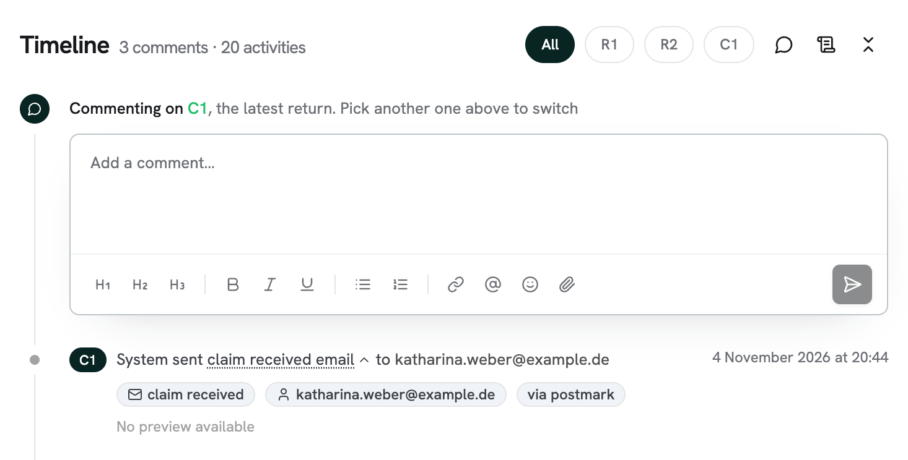</Frame>

In the composer you can:

- **format** text with the toolbar (headings, bold, italic, underline, lists) and add links,
- type **@** to mention a teammate. toern suggests all users you can tag, and the person you mention gets an email and a notification. You can also mention the **ToernBot**, which notifies toern's support systems,
- **attach a file**: drop it onto the box,
- use emoticons like `:)`, which turn into emojis. The smiley button lists them all,
- press **Enter** to post, and **Shift + Enter** for a new line.

A new comment shows in the timeline at once. If it can't be saved, it's taken out again and your text goes back into the composer. Comments show their author and date. Only the author can edit or delete a comment later.

### Notifications

Tagged users see their notifications in the top menu on the right at the **mailbox**. If there are new, unread notifications, the mailbox shows a green dot.

<Frame>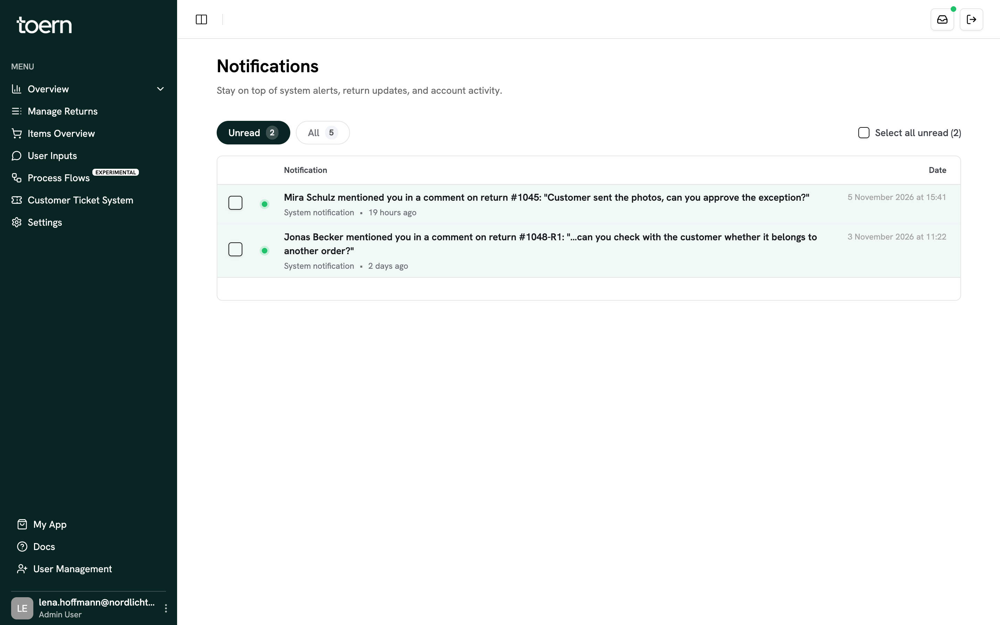</Frame>

Click the mailbox to open the **Notifications** page. The **Unread** tab lists what you haven't read yet, and **All** lists every notification. **Select all unread** selects every unread notification at once. When you click a notification, toern opens the order's return detail page, opens the return the comment belongs to, highlights the comment in the timeline and marks the notification as read.

## Recently viewed orders

At the bottom of the page, **Your Recently Viewed Orders** lists the orders you opened before. Each card previews the order and its latest request. Click one to go back to it. Use **Previous** and **Next** to page through them.

## Return tags

With **return tags** you group returns independently of their status and tell them apart visually. Examples are **standard return**, **withdrawal**, **exchange**, or your own tags.

Tags stay saved as long as they're in use. This way you can assign the same tag to several returns and filter by it in the overview.

### Assign tags to a return

Every return request card has a **Tags** section. Add a tag with **Add tag**, and remove one with the **×** on the tag. Every change is logged in the timeline, including the user who made it.

<Frame>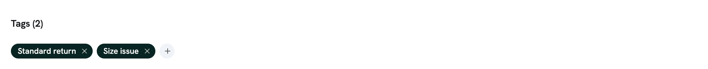</Frame>

### Create a new tag

In the tag search (*Search or create a tag…*), enter a name that doesn't exist yet and pick **Create "[tag name]"**. This creates the tag for your brand and assigns it to the return right away.

<Frame>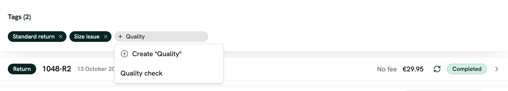</Frame>

Tag names must be unique within a brand so the filter works reliably. A created tag stays available in the tag catalog.

### Tag colors

Every new tag automatically gets a random color. The colored dot appears next to the tag in the overview, for example in the **Tags** filter. On the return detail page, tags are shown without color.

### Filter returns by tags

Use the **Tags** filter in the overview to search and select one or more tags. With several tags, you only see returns that have all selected tags.

<Frame>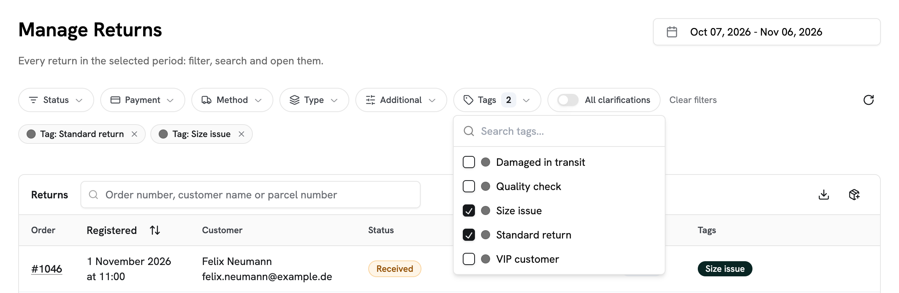</Frame>

## Manual refunds

Refunds usually run automatically after the return has been classified. For a clarification case or a partial refund you can refund manually at any time. This also works if a refund has already been made.

You open the refund drawer from the return's card:

- with **Create refund**, the next step of an inspected return that isn't refunded yet,
- with **Create new refund** in the **Actions** menu, for example for a further refund,
- with **Refund manually** on a clarification card, when the automatic refund was stopped,
- with **Edit & retry** or **Refund manually instead** on a failed refund.

<Frame>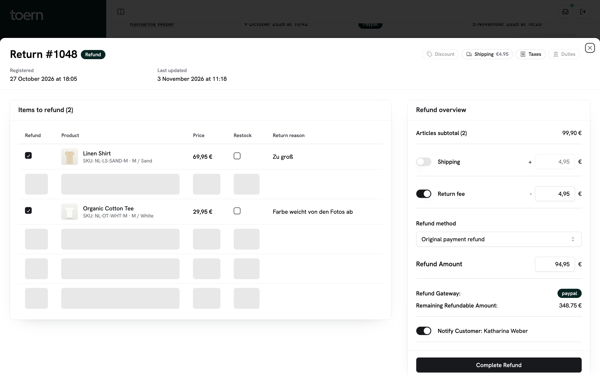</Frame>

In the drawer:

1. **Pick the items** to refund. All returned items without a registered exchange are preselected. The amount follows the items you pick. **Restock** puts them back into stock. Items already refunded can't be picked again.
2. Decide whether **Shipping** costs are refunded, and whether the **Return fee** is deducted. Switch it off to waive it.
3. Adjust the **refund method** if needed. Besides the original payment method you can choose a **gift card** and increase it by a percentage. This keeps revenue in your shop, for example for late return registrations.
4. Check the **Amount**. It fills in from your choices, and you can change it, for example to deduct a percentage as an offer for a complaint.
5. Decide whether your customer gets the refund email with **Notify customer**. It is configured in your shop system.
6. Click **Complete Refund**.

The drawer closes and the refund runs in the background. The card shows its progress live, and **Refund Detail** shows the outcome. If it fails, the card offers it again with the same values (see [Notices on a card](#notices-on-a-card)).

<Note>
  Legally, you must refund the shipping costs if all items of an order were returned. This is the default in the settings, but you can turn it off.
</Note>

For automatic refunds you can define the same settings and a maximum value in the [refund settings](/en/returns/refund).

## Interactive guides

The in-app **page tour** is the interactive guide to the return detail page: click the compass next to the back arrow on any order. The guides below walk through the returns overview and the refund form.

<Tabs>
  <Tab title="Dashboard Manage Returns">
    <Frame>
      <iframe src="https://app.guideflow.com/embed/vkm5vmot2r" width="100%" height="600" style={{ border: 0 }} allowFullScreen />
    </Frame>
  </Tab>
  <Tab title="Dashboard Manual Refund">
    <Frame>
      <iframe src="https://app.guideflow.com/embed/gkyvmg5t4k" width="100%" height="600" style={{ border: 0 }} allowFullScreen />
    </Frame>
  </Tab>
</Tabs>

## Related pages

<CardGroup cols={2}>
  <Card title="Clarification cases" icon="circle-exclamation" href="/en/returns/clarifications">
    Every category, cause and solution of a clarification card.
  </Card>
  <Card title="Refund" icon="money-bill-wave" href="/en/returns/refund">
    Settings for automatic refunds.
  </Card>
  <Card title="Customer tickets" icon="ticket" href="/en/dashboard/customer-tickets">
    The tickets linked to a return.
  </Card>
  <Card title="Xentral" icon="plug" href="/en/integrations/xentral">
    Show the Xentral documents on the return detail page.
  </Card>
</CardGroup>

## Limitations

### Returns overview

- The dashboard is currently only available in English.
- **Filters**
  - You can filter by return status, payment method, exchange, and gift card. Not by return reason, input, or comment.
  - Only clarification cases can be filtered independently of the selected time range, using **All Clarifications**. With **Issue** you can narrow them down further by kind of problem.
- **Export**
  - The export only contains the predefined columns. You can't customize them beforehand.
- **Create a new return**
  - For manual returns, the return reason is always **Manual return**.
  - Manual returns have the status **Inspected** by default. If you want something else, you need to adjust the status.
  - With **Extend the return window** you can only extend the return window by exactly the configured time frame.

### Return detail page

- Sets can only be returned via official bundle apps in Shopify that store the single items of a set.
- **Comments**
  - With **@** you can only tag other users in toern.
  - A comment always belongs to one return of the order. Pick the return before you write.
  - All comments sent to toern via the API for single items are combined in one note.
  - Comments received via the API, such as "wrong address", are shown in toern. A clarification case can be created from them automatically (with Return Clarification Reasons). This only applies to comments, not to general return reasons. Automations based on these comments are not possible.
  - toern adjusts items (adding, removing) only based on the first API call. All further calls lead to a clarification case. Otherwise automations after status updates could cause duplicate refunds.
- **Return labels**
  - Each return has one label (or return slip) with tracking at a time. If you create a new label, it replaces the previous one.
- **Manual refunds**
  - Manual refunds are available for Shopify shops.
  - If automatic refunds are active and you want to adjust the refund, first create a clarification case and then make a manual refund.
  - Manual refunds currently have no connection to Xentral. Always trigger the automatic refund here or create the documents yourself.
