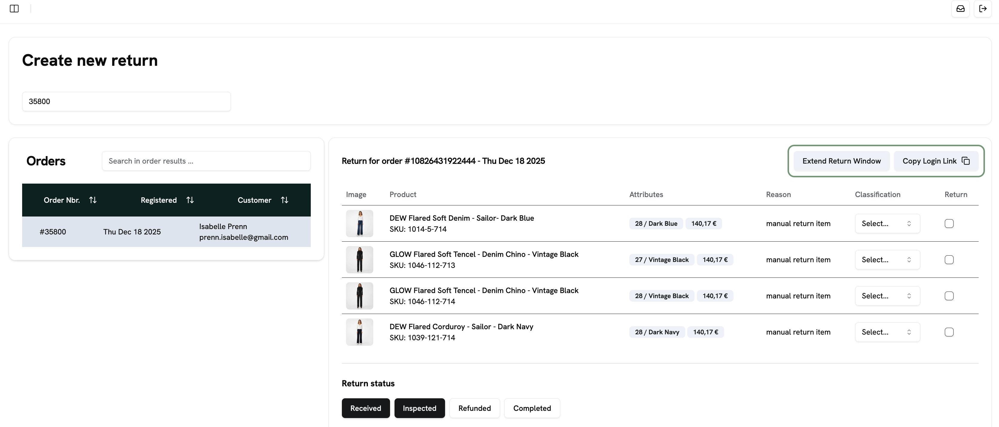
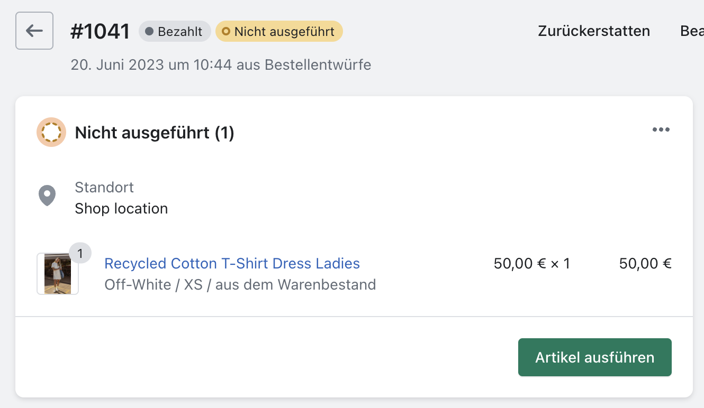
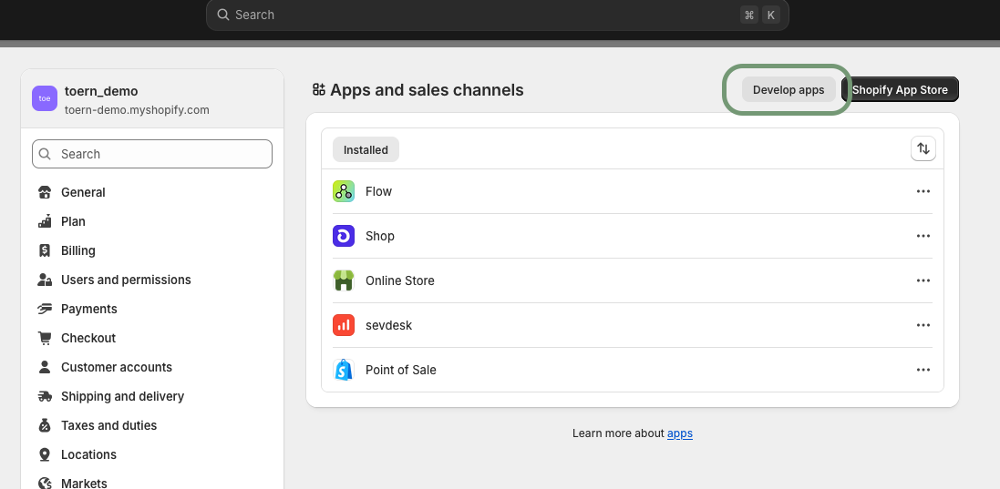

Here you'll find answers to the most common questions about toern. The second part of this page lists all clarification cases that can occur with returns, refunds and exchanges, and how to solve them.

## Registering returns and exchanges

<AccordionGroup>
  <Accordion title="The return window has expired. How can I still register a return?">
    You have two options: create a manual return or extend the return window for the order.

    **Create a manual return:**

    1. Go to **Manage Returns**.
    2. Click **Create New Return**.
    3. Search for the order number.
    4. Select the row with the order you're looking for.
    5. Select the items to be returned.
    6. Select the current state of the return, e.g. **Registered**, **Received** (if the goods are already at the fulfiller) or **Inspected** (if the fulfiller has already classified them).
    7. Click **Create**. The return is created and you see the usual return view.

    Under **Refund Method** you choose whether the customer gets their money back via the original payment method or receives a gift card for the shop.

    **Extend the return window:**

    Search for the order via **Create New Return** and open it.

    

    With **Extend Return Window** you extend the return window for this order. The customer can then register the return in the portal themselves. With **Copy Login Link** you copy a link you can send to the customer. It takes them straight to the item selection, so they don't have to enter their order details again.

    Learn more in [Manage returns](/en/dashboard/manage-returns).
  </Accordion>
  <Accordion title="How do I register a return for a customer?">
    You create the return manually in the dashboard:

    1. Go to **Manage Returns**.
    2. Click **Create New Return**.
    3. The search field searches all orders. You can search by customer name or order number.
    4. Select the matching order from the list.
    5. The order details appear on the right. Select the relevant items and classify them if needed.
    6. Adjust the timeline under **Return Status**. **Inspected** means the return is already with you and has been processed. Click the two buttons **Received** and **Inspected** to reset the status. The return then has the status **Registered**, as if the customer had registered it themselves.
    7. Create a clarification case if needed.
    8. Click **Create**. The return is created and then runs through the normal return process.

    <Warning>
      If the goods are still with the customer, make sure to reset the status. Otherwise the refund may be triggered automatically.
    </Warning>

    Learn more in [Manage returns](/en/dashboard/manage-returns).
  </Accordion>
  <Accordion title="How do I register an exchange for a customer?">
    You have two ways:

    - **Via the return portal:** Open the link to your portal (it's on your shop website). Go through the return process for the customer and select the items for the exchange.
    - **Via the dashboard:** Create a manual return under **Manage Returns → Create New Return**. As soon as you select an item, you can turn it into an exchange via the dropdown. **Show Variants for Exchange** shows all available variants of the item. toern checks them via the Shopify interface.

    Learn more in [Exchange](/en/returns/exchange) and [Manage returns](/en/dashboard/manage-returns).
  </Accordion>
  <Accordion title="Who pays the shipping costs for a pure exchange?">
    For a pure exchange, no return fee is deducted. A pure exchange means: apart from the exchanged item, no other items are returned. In this case the customer doesn't get any money back.

    As a goodwill gesture, no fee is deducted because the customer will most likely keep the new item. If they want to return that item too, they have to contact your customer service. You can then charge any return fee manually.

    Learn more in [Exchange](/en/returns/exchange).
  </Accordion>
</AccordionGroup>

## Refunds

<AccordionGroup>
  <Accordion title="How do I process a manual refund? How do I remove the return fee? How do I refund the shipping costs?">
    You usually process a manual refund when there's no automation for the return or it was cancelled.

    1. Open the return you want to refund.
    2. Click **Create New Refund** (possible at any time) or **Refund** (only possible if it's the next step in the timeline).
    3. Select the return to be refunded if it isn't preselected. On the right you see all refund settings. They follow your brand's default settings. Here you can, for example, remove the return fee or refund the shipping costs.
    4. With **Real Refund Amount** you can also enter a fully custom amount, independent of the return items and default settings. It can't exceed the maximum refund amount (the order value).

    Learn more in [Refund](/en/returns/refund) and [Manage returns](/en/dashboard/manage-returns).
  </Accordion>
  <Accordion title="How and when does the customer receive their gift card?">
    The gift card is issued like a normal refund, after the trigger you set in the refund settings. toern triggers sending the gift card with the calculated amount. The customer receives it by email. How long it's valid depends on your settings.

    Learn more in [Gift card refund](/en/returns/gift-card-refund).
  </Accordion>
</AccordionGroup>

## Communication with customers

<AccordionGroup>
  <Accordion title="How do I create a new label for a customer?">
    1. Open the customer's return.
    2. In the **Return Labels** box, click **Generate New Label**.
    3. Wait a moment. At the bottom right you first see the message "New label requested, please wait for the new label to be created." Once the label has been replaced, you see "label recreated".
    4. Open the label with **Open PDF**, download it and send it to the customer.
  </Accordion>
  <Accordion title="What should I write in the email with a new shipping label?">
    This template covers all typical cases (shown here in English; the original template is German):

    > Hi XY,
    >
    > thanks for getting back to me – that's annoying, of course, and it shouldn't happen. At first glance, the label and the QR code look correct to me, but to be on the safe side I've created a new return label and attached it.
    >
    > What often helps:
    >
    > - Drop off the return at a different DHL branch
    > - Print the label just in case, so the barcode can be scanned directly
    > - QR code and/or barcode not working? The branch can enter the number below it manually – please insist that they try this
    >
    > I hope it works smoothly now. If not, just get back to me directly!
    >
    > Best regards
  </Accordion>
  <Accordion title="Which emails does the customer receive, and when?">
    During the return process, the customer receives several personalized emails about the process and status of their return:

    - **Registration confirmation:** At the end of the return process, the customer sees a confirmation. It already says that the label will arrive by email, or that they'll get an email with the shipping address and next steps.
    - **Email with label:** It contains the label and information on the next steps:

      > Pack the items you registered for return back into their original packaging and seal the box carefully. Visit a [carrier] location near you and show the shipping label there to send your parcel back. The refund will be issued after your parcel has arrived with us. Please note that the refund is only made after we receive the goods.

    - **Email with shipping address:** It doesn't contain a label, but information on the process and, if applicable, a return slip the customer prints and puts in the parcel:

      > Please note that we can't accept unstamped returns or cash-on-delivery shipments. To make sure your return reaches us, we recommend shipping it as an insured parcel with tracking. If a return slip is attached, please print it and put it in the parcel. It contains all the information we need to match your return quickly and correctly. Pack the items you registered for return back into their original packaging and seal the box carefully. Use the address above and send the items back to us. The refund will be issued after your parcel has arrived with us. Please note that the refund is only made after we receive the goods.

    - **Notification after processing:** Once fulfillment has processed and classified the return, the customer receives a notification. It's created by your shop in Shopify and triggered via the toern connection.
    - **Gift card:** For a gift card refund, a gift card is issued in Shopify instead of a refund. It's also preconfigured by your shop and only triggered by toern.
  </Accordion>
  <Accordion title="Can I customize the emails sent to customers?">
    Yes. If you selected **Transactional E-Mails by toern** as your notification service, you can customize the subject, Cc/Bcc and content per event and language in the [email editor](/en/branding/email-templates). There you can also check the emails with test data and send test emails.

    If you use [Klaviyo](/en/integrations/klaviyo), you keep managing the content directly in Klaviyo.
  </Accordion>
  <Accordion title="How and where do I add the return policy to my shop?">
    Every shop system has its own section for policies. Your customers can read them there. Where exactly you find the setting depends on your shop system.

    Feel free to use the pre-written text snippets we shared with you at the start of onboarding.
  </Accordion>
</AccordionGroup>

## Shopify

<AccordionGroup>
  <Accordion title="Why isn't my return status shown in Shopify?">
    Shopify **only** shows a return status if the item is fulfilled.

    If the item isn't fulfilled, the transfer from toern fails. The status can't be passed to Shopify and isn't shown there.

    

    Don't worry: you can still see the return reasons in the [analytics in toern](/en/dashboard/analytics).
  </Accordion>
  <Accordion title="Where do I adjust the Shopify permissions for my shop?">
    Some features need special permissions in Shopify, e.g. exchanges, gift cards and refunds. You have to grant these permissions before you can enable the features. If they're missing, you see an error message listing the required permissions.

    Here's how to grant the permissions in your Shopify shop:

    1. Open **Apps and sales channels**.
    2. Click **Develop apps** at the top right.

       

    3. Select the **toern Retoureportal** app and open **Configuration**.
    4. Click **Edit** next to **Admin API integration**. Tick the checkboxes for the required permissions.

    Learn more in [Shopify integration](/en/getting-started/shopify-integration).
  </Accordion>
</AccordionGroup>

## General questions

<AccordionGroup>
  <Accordion title="How do I create a new user for my brand?">
    You create new users yourself in **User Management**. Click **Add New User** and enter the full name, email address and role. The new user receives their login details by email.

    Learn more in [User management](/en/dashboard/user-management).
  </Accordion>
</AccordionGroup>

## Clarification cases and how to solve them

If toern can't continue processing a return automatically, or you should check it on purpose, a **clarification case** is created. The return gets the status **needs review** or **Clarification**, and in the return you see a separate clarification card for every open issue. How clarification cases work in general is explained under [Clarification cases](/en/returns/clarifications).

Below you'll find all clarification cases, sorted by kind of problem, as in the **Issue** filter of the return overview. The title of each entry is the title of the clarification card. Values in square brackets, for example [country] or [items], are filled in on the card with the data of the return.

<Tip>
  Each clarification card shows exactly one button:

  - **Retry**: Fix the cause and restart the failed step. If it works, the issue closes by itself.
  - **Mark resolved**: Check the return and close the issue, optionally with a note for the timeline.
  - **Refund manually**: Refund the return yourself. As soon as the refund goes through, the issue closes by itself.
  - **Mention @ToernBot in the chat**: toern support needs to look into the problem.

  Automated processing only continues once all issues of a return are resolved.
</Tip>

### Return label

The return or exchange label could not be created.

<AccordionGroup>
  <Accordion title="Customer address is incomplete">
    The return label could not be created because the customer address is missing something, for example the street, house number or postal code. Complete it under Customer Information › Edit customer, then click **Retry** on the clarification card.

    If you generated the label yourself under Shipping Labels, the card shows **Mark resolved** instead: fix the cause, generate the label again under **Shipping Labels › Generate New Return Label**, then mark the issue as resolved.

    **Button on the clarification card:** Retry
  </Accordion>
  <Accordion title="Carrier rejected the address">
    Your carrier did not accept the customer address. Street, house number, postal code and city have to be right, and no field may be too long. Correct it under Customer Information › Edit customer, then click **Retry** on the clarification card.

    If you generated the label yourself under Shipping Labels, the card shows **Mark resolved** instead: fix the cause, generate the label again under **Shipping Labels › Generate New Return Label**, then mark the issue as resolved.

    **Button on the clarification card:** Retry
  </Accordion>
  <Accordion title="Carrier is not set up">
    The return label could not be created because the access credentials of your carrier are missing, incomplete or invalid. Check them under Settings › Returns Shipping Services, in the Access Credentials of your carrier, then click **Retry** on the clarification card.

    If you generated the label yourself under Shipping Labels, the card shows **Mark resolved** instead: fix the cause, generate the label again under **Shipping Labels › Generate New Return Label**, then mark the issue as resolved.

    **Button on the clarification card:** Retry
  </Accordion>
  <Accordion title="Carrier login failed">
    Your carrier rejected your access credentials. They have to be right and be your live credentials, not test ones. Check them under Settings › Returns Shipping Services, in the Access Credentials of your carrier, then click **Retry** on the clarification card.

    If you generated the label yourself under Shipping Labels, the card shows **Mark resolved** instead: fix the cause, generate the label again under **Shipping Labels › Generate New Return Label**, then mark the issue as resolved.

    **Button on the clarification card:** Retry
  </Accordion>
  <Accordion title="Carrier is not set up for this country">
    Your carrier has no return address for returns from [country]. Add one under Settings › Returns Shipping Services, in the country settings of your carrier, then click **Retry** on the clarification card.

    If you generated the label yourself under Shipping Labels, the card shows **Mark resolved** instead: fix the cause, generate the label again under **Shipping Labels › Generate New Return Label**, then mark the issue as resolved.

    **Button on the clarification card:** Retry
  </Accordion>
  <Accordion title="Return method is not set up correctly">
    The return method of this return has no carrier, or its carrier is not set up correctly. Check the return method under Settings › Returns › Return Methods, then click **Retry** on the clarification card.

    If you generated the label yourself under Shipping Labels, the card shows **Mark resolved** instead: fix the cause, generate the label again under **Shipping Labels › Generate New Return Label**, then mark the issue as resolved.

    **Button on the clarification card:** Retry
  </Accordion>
  <Accordion title="No label possible from this country">
    Your carrier cannot create a return label from [country], because these returns need customs documents, which are not supported yet. Send the customer return instructions yourself, then click **Mark resolved** on the clarification card. To avoid this, offer a different return method for [country] under Settings › Returns › Return Methods.

    **Button on the clarification card:** Mark resolved
  </Accordion>
  <Accordion title="Carrier temporarily unavailable">
    Your carrier did not respond or reported a temporary error while creating the label. Wait a few minutes, then click **Retry** on the clarification card. If it fails again, mention **@ToernBot** in the chat.

    If you generated the label yourself under Shipping Labels, the card shows **Mark resolved** instead: fix the cause, generate the label again under **Shipping Labels › Generate New Return Label**, then mark the issue as resolved.

    **Button on the clarification card:** Retry
  </Accordion>
  <Accordion title="Label has no tracking number">
    Your carrier created the return label without a tracking number, so it could not be added to the return in your shop. Mention **@ToernBot** in the chat so we can check the label.

    **Button on the clarification card:** Mention @ToernBot in the chat
  </Accordion>
  <Accordion title="Return label could not be created">
    Creating the return label failed for an unknown reason. Check the customer address under Customer Information › Edit customer, then click **Retry** on the clarification card. If it fails again, mention **@ToernBot** in the chat.

    If you generated the label yourself under Shipping Labels, the card shows **Mark resolved** instead: fix the cause, generate the label again under **Shipping Labels › Generate New Return Label**, then mark the issue as resolved.

    **Button on the clarification card:** Retry
  </Accordion>
  <Accordion title="Sendcloud is not set up for exchange labels">
    The shipping label for the exchange items could not be created because your Sendcloud access credentials are missing. Add them under Settings › Integrations › Sendcloud › Access Credentials, then click **Retry** on the clarification card.

    **Button on the clarification card:** Retry
  </Accordion>
  <Accordion title="Sendcloud login failed">
    Sendcloud rejected your access credentials, so the shipping label for the exchange items could not be created. Check them under Settings › Integrations › Sendcloud › Access Credentials, then click **Retry** on the clarification card.

    **Button on the clarification card:** Retry
  </Accordion>
  <Accordion title="No Sendcloud sender address for this country">
    No Sendcloud sender address is set for [country], so the shipping label for the exchange items could not be created. Add one under Settings › Integrations › Sendcloud › Sender Addresses, then click **Retry** on the clarification card.

    **Button on the clarification card:** Retry
  </Accordion>
  <Accordion title="Sendcloud rejected the exchange label">
    Sendcloud did not create the shipping label for the exchange items. Usually the customer address is incomplete, or none of your shipping rules in Sendcloud fits this shipment. Check the address under Customer Information › Edit customer and your shipping rules in Sendcloud, then click **Retry** on the clarification card. Message from Sendcloud: "[message]"

    **Button on the clarification card:** Retry
  </Accordion>
  <Accordion title="Exchange label could not be created">
    The shipping label for the exchange items could not be created, and Sendcloud gave no reason. Check the address under Customer Information › Edit customer and your Sendcloud settings under Settings › Integrations › Sendcloud, then click **Retry** on the clarification card. If it fails again, mention **@ToernBot** in the chat.

    **Button on the clarification card:** Retry
  </Accordion>
  <Accordion title="Exchange label not added to the order">
    The shipping label for the exchange items was created, but could not be added to the order in Shopify. Click **Retry** on the clarification card; the label is not created again.

    **Button on the clarification card:** Retry
  </Accordion>
</AccordionGroup>

### Shop sync

The return could not be created or updated in your shop.

<AccordionGroup>
  <Accordion title="Shop connection is missing">
    The access credentials of your shop are missing, so we could not reach it. Reconnect your shop under Settings › Shop Integration › Shopify Access Credentials, then click **Retry** on the clarification card.

    **Button on the clarification card:** Retry
  </Accordion>
  <Accordion title="Shop denied access">
    Your shop rejected our request. Usually the toern app was uninstalled, its permissions were changed, or the shop is paused. In Shopify, check under Apps that the toern app is installed and has all permissions, then click **Retry** on the clarification card.

    **Button on the clarification card:** Retry
  </Accordion>
  <Accordion title="Shop temporarily unavailable">
    Your shop did not respond or is busy right now. Wait a few minutes, then click **Retry** on the clarification card. If it fails again, mention **@ToernBot** in the chat.

    **Button on the clarification card:** Retry
  </Accordion>
  <Accordion title="Shop system is not set">
    No supported shop system is set for your brand, so the return could not be synced to your shop. Mention **@ToernBot** in the chat so we can check your shop settings.

    **Button on the clarification card:** Mention @ToernBot in the chat
  </Accordion>
  <Accordion title="Return could not be created in your shop">
    The return could not be created in your shop, and your shop gave no reason. Check in Shopify that the order exists and that its items are shipped (fulfilled) and not returned yet, then click **Retry** on the clarification card. If it fails again, mention **@ToernBot** in the chat.

    **Button on the clarification card:** Retry
  </Accordion>
  <Accordion title="Shopify rejected the return">
    Shopify did not create this return. Usually its items were already returned or refunded there, the order was canceled, or the items are not shipped (fulfilled) yet. Open the order in Shopify and fix it there, then click **Retry** on the clarification card. Message from Shopify: "[message]"

    **Button on the clarification card:** Retry
  </Accordion>
  <Accordion title="Tracking could not be added in your shop">
    The return was created in your shop, but the return label and tracking number could not be added to it. Click **Retry** on the clarification card. If it fails again, mention **@ToernBot** in the chat.

    **Button on the clarification card:** Retry
  </Accordion>
  <Accordion title="Return fee could not be calculated">
    The return fee of this return could not be calculated, for example because no fee or currency is set for the customer's country. Check the return fees under Settings › Returns › Return Methods, then click **Retry** on the clarification card.

    **Button on the clarification card:** Retry
  </Accordion>
  <Accordion title="Return could not be updated in your shop">
    The items of this return were changed, but the return in your shop could not be updated, so the refund was not started. Click **Retry** on the clarification card. If it fails again, mention **@ToernBot** in the chat.

    **Button on the clarification card:** Retry
  </Accordion>
  <Accordion title="Return in your shop can no longer be changed">
    The items of this return were changed, but the return in Shopify has the status "[status]" and can no longer be updated. Update it in Shopify yourself. Then click **Refund manually** on the clarification card; this issue then closes by itself.

    **Button on the clarification card:** Refund manually
  </Accordion>
  <Accordion title="Return could not be canceled in your shop">
    Canceling this return failed in Shopify, so it was not canceled in toern either. In Shopify it may already be refunded, exchanged or closed. Check the return in Shopify, and if it still needs to be canceled, cancel it again under Actions › Cancel Return. Then click **Mark resolved** on the clarification card.

    **Button on the clarification card:** Mark resolved
  </Accordion>
</AccordionGroup>

### Fulfillment

Your shop has nothing returnable for the items of the order.

<AccordionGroup>
  <Accordion title="Order has nothing to return in your shop">
    Your shop reports no items of this order that can be returned. Usually the order is not shipped (fulfilled) yet, its items were already returned, or the order was canceled. Mark the items as fulfilled in Shopify, then click **Retry** on the clarification card.

    **Button on the clarification card:** Retry
  </Accordion>
  <Accordion title="Some items are not fulfilled">
    These items cannot be returned in your shop yet, because they are not shipped (fulfilled) or were already returned: [items]. Mark them as fulfilled in Shopify, then click **Retry** on the clarification card. If they were canceled and never sent, click **Mark received** at the top of the return, remove them under Returned Items, then click **Retry** on the clarification card.

    **Button on the clarification card:** Retry
  </Accordion>
  <Accordion title="Order item not found in your shop">
    An item of this order could not be found in your shop, for example because it was deleted. Mention **@ToernBot** in the chat so we can check the order.

    **Button on the clarification card:** Mention @ToernBot in the chat
  </Accordion>
</AccordionGroup>

### Exchange

The exchange or the exchange order could not be processed.

<AccordionGroup>
  <Accordion title="Exchange item has no replacement">
    An item of this return is marked for exchange, but no replacement item is set. Mention **@ToernBot** in the chat so we can check the exchange.

    **Button on the clarification card:** Mention @ToernBot in the chat
  </Accordion>
  <Accordion title="Replacement item not available">
    The price of the replacement item could not be loaded from Shopify. The item may have been deleted or is not sold in the customer's market. Check the item in Shopify, then click **Retry** on the clarification card.

    **Button on the clarification card:** Retry
  </Accordion>
  <Accordion title="Exchange could not be checked in Shopify">
    The return was created in Shopify, but its exchange order could not be checked afterwards. Check the exchange order in Shopify, and mention **@ToernBot** in the chat before you click **Retry**, so the return is not created twice.

    **Button on the clarification card:** Mention @ToernBot in the chat
  </Accordion>
  <Accordion title="Exchange order could not be created">
    The order for the replacement items could not be created in your shop, and your shop gave no reason. Check in Shopify that every replacement item still exists and is in stock, then click **Retry** on the clarification card. If it fails again, mention **@ToernBot** in the chat.

    **Button on the clarification card:** Retry
  </Accordion>
  <Accordion title="Shopify rejected the exchange order">
    Shopify did not create the order for the replacement items of this exchange. Usually a replacement item is out of stock, was deleted or is no longer sold in the customer's market. Check the replacement items in Shopify, then click **Retry** on the clarification card. Message from Shopify: "[message]"

    **Button on the clarification card:** Retry
  </Accordion>
  <Accordion title="Replacement item out of stock">
    At least one replacement item of this exchange is out of stock in Shopify, so the exchange order could not be created. Make sure every replacement item is in stock in Shopify, then click **Retry** on the clarification card.

    **Button on the clarification card:** Retry
  </Accordion>
  <Accordion title="Replacement item no longer exists in your shop">
    One or more replacement items of this exchange no longer exist in Shopify, so the exchange order could not be created. Add them back in Shopify, then click **Retry** on the clarification card. If that is not possible, mention **@ToernBot** in the chat.

    **Button on the clarification card:** Retry
  </Accordion>
  <Accordion title="Exchange items not ready for shipping yet">
    Shopify has not prepared the exchange items of this return for shipping yet, so they could not be released. Wait a few minutes, then click **Retry** on the clarification card. If the exchange was handled outside toern, for example because the return was refunded directly in Shopify, click **Mark complete** at the top of the return instead.

    **Button on the clarification card:** Retry
  </Accordion>
  <Accordion title="Exchange items could not be released for shipping">
    The exchange items are on hold in Shopify, and the hold could not be released, so they are not sent yet. Click **Retry** on the clarification card. If it fails again, release the hold on the exchange order in Shopify yourself, then click **Retry** on the clarification card again.

    **Button on the clarification card:** Retry
  </Accordion>
  <Accordion title="Reserved exchange order could not be released">
    The reservation tag could not be removed from the exchange order in Shopify, so the order may still be held back from shipping. Click **Retry** on the clarification card. If it fails again, remove the tag from the order in Shopify yourself, then click **Retry** on the clarification card again.

    **Button on the clarification card:** Retry
  </Accordion>
  <Accordion title="Return not received in time, exchange order canceled">
    The return did not arrive within X days, so the exchange order reserved for it was canceled in Shopify and its stock released. If the return still arrives, decide how to continue with the exchange, then click **Mark resolved** on the clarification card.

    **Button on the clarification card:** Mark resolved
  </Accordion>
  <Accordion title="Exchange items changed">
    An exchange item of this return was changed, so the replacement items being sent may no longer match the return, and the refund may be wrong. Check the exchange order in Shopify and the refund under Return Refunds, then click **Mark resolved** on the clarification card.

    **Button on the clarification card:** Mark resolved
  </Accordion>
</AccordionGroup>

### Refund

The refund could not be carried out automatically, or it was stopped on purpose so you can check it.

<AccordionGroup>
  <Accordion title="No refund method selected">
    This return has no refund method, so it could not be refunded automatically. Click **Refund manually** on the clarification card; this issue then closes by itself.

    **Button on the clarification card:** Refund manually
  </Accordion>
  <Accordion title="Return from outside the EU">
    This return comes from [country], outside the EU. As agreed with you, these returns are not refunded automatically. Check the return, then click **Refund manually** on the clarification card; this issue then closes by itself.

    **Button on the clarification card:** Refund manually
  </Accordion>
  <Accordion title="Return value above the automatic refund limit">
    The value of this return is above your limit for automatic refunds under Settings › Refund › Automatic Refund Limit. Check the return, then click **Refund manually** on the clarification card; this issue then closes by itself.

    **Button on the clarification card:** Refund manually
  </Accordion>
  <Accordion title="Gift card value above the automatic refund limit">
    The gift card value of this return, including the bonus, is above your limit for automatic gift card refunds under Settings › Refund › Gift Card Configuration. Check the return, then click **Refund manually** on the clarification card; this issue then closes by itself.

    **Button on the clarification card:** Refund manually
  </Accordion>
  <Accordion title="Customer traffic lights not all green">
    Not all traffic lights of this customer are green, so the automatic refund was stopped. Check the customer under Customer Information, then click **Refund manually** on the clarification card and change the return fee there if needed; this issue then closes by itself.

    **Button on the clarification card:** Refund manually
  </Accordion>
  <Accordion title="Discount code excluded from automatic refunds">
    This order uses the discount code "[discount code]", which you excluded from automatic refunds under Settings › Refund › Discount Code Clarifications. Click **Refund manually** on the clarification card; this issue then closes by itself.

    **Button on the clarification card:** Refund manually
  </Accordion>
  <Accordion title="Discount code needs a manual refund">
    As agreed with you, orders with the discount code "[discount code]" are not refunded automatically. Check the return, then click **Refund manually** on the clarification card; this issue then closes by itself.

    **Button on the clarification card:** Refund manually
  </Accordion>
  <Accordion title="Buy X get Y discount excluded from automatic refunds">
    This order uses the buy X get Y discount "[discount]", and you excluded these discounts from automatic refunds under Settings › Refund › Block BuyXGetY Discounts. Click **Refund manually** on the clarification card; this issue then closes by itself.

    **Button on the clarification card:** Refund manually
  </Accordion>
  <Accordion title="Discounts cannot be refunded automatically">
    This order combines the buy X get Y discount "[discount]" with other discounts, so the refund amount cannot be calculated automatically. Click **Refund manually** on the clarification card; this issue then closes by itself.

    **Button on the clarification card:** Refund manually
  </Accordion>
  <Accordion title="Discounts of the order could not be checked">
    The discounts of this order could not be loaded from Shopify, so the refund amount could not be calculated safely. Click **Retry** on the clarification card. If it fails again, refund it manually with **Create New Refund** under Return Refunds.

    **Button on the clarification card:** Retry
  </Accordion>
  <Accordion title="Changed return with exchange items">
    The items of this return were changed, but it includes exchange items, so the return in Shopify could not be updated automatically. Update the return in Shopify yourself, check that the replacement item is still right and let the customer know if needed. Then click **Refund manually** on the clarification card; this issue then closes by itself.

    **Button on the clarification card:** Refund manually
  </Accordion>
  <Accordion title="Return changed after it was created in Xentral">
    The items or the return fee of this return were changed after it was created in Xentral, and that cannot be updated automatically. Update the return in Xentral and in Shopify yourself. Then click **Refund manually** on the clarification card; this issue then closes by itself.

    **Button on the clarification card:** Refund manually
  </Accordion>
  <Accordion title="Return could not be checked before the refund">
    We could not check in your shop whether the items of this return were changed, so the refund was not started. Click **Retry** on the clarification card. If it fails again, mention **@ToernBot** in the chat.

    **Button on the clarification card:** Retry
  </Accordion>
  <Accordion title="Check before the automatic refund failed">
    The extra check agreed with you before automatic refunds could not be completed, so the return was not refunded. Check the return yourself, then click **Retry** on the clarification card to refund it.

    **Button on the clarification card:** Retry
  </Accordion>
  <Accordion title="Refund settings are missing">
    No refund settings are set up for your brand, so the return could not be refunded. Set them up under Settings › Refund, then click **Retry** on the clarification card.

    **Button on the clarification card:** Retry
  </Accordion>
  <Accordion title="Gift card refunds are turned off">
    This return should be refunded as a gift card, but gift card refunds are turned off. Turn them on under Settings › Refund › Gift Card Refunds, then click **Retry** on the clarification card. Or refund it manually with **Create New Refund** under Return Refunds.

    **Button on the clarification card:** Retry
  </Accordion>
  <Accordion title="Gift card amount is 0">
    The gift card would have been worth 0 or less, so Shopify did not create it. This happens when the returned items cost nothing, for example free add-ons, or when an exchange already covers their value. The return itself was already processed in Shopify. If nothing is owed to the customer, click **Mark complete** at the top of the return. Otherwise click **Refund manually** on the clarification card; this issue then closes by itself.

    **Button on the clarification card:** Refund manually
  </Accordion>
  <Accordion title="Order was canceled in Shopify">
    The order was canceled in Shopify, so it cannot be refunded automatically. Check the order in Shopify. If anything is still owed, click **Refund manually** on the clarification card; this issue then closes by itself. If nothing is owed, click **Mark complete** at the top of the return.

    **Button on the clarification card:** Refund manually
  </Accordion>
  <Accordion title="Order already has other refunds">
    The order already has refunds in Shopify that were not made by toern, so it was not refunded automatically, to avoid paying the customer twice. Check these refunds in Shopify. If anything is still owed, click **Refund manually** on the clarification card; this issue then closes by itself. If nothing is owed, click **Mark complete** at the top of the return.

    **Button on the clarification card:** Refund manually
  </Accordion>
  <Accordion title="Payment status does not allow a refund">
    The payment status of the order in Shopify is "[status]", which does not allow a refund. Check the order in Shopify. If the customer paid and is owed money, click **Refund manually** on the clarification card; this issue then closes by itself. If nothing is owed, click **Mark complete** at the top of the return.

    **Button on the clarification card:** Refund manually
  </Accordion>
  <Accordion title="Order cannot be refunded in Shopify">
    Shopify reports that this order cannot be refunded. Check the order in Shopify and, if anything is owed, refund the customer another way, for example with your payment provider. Then click **Mark complete** at the top of the return.

    **Button on the clarification card:** Refund manually
  </Accordion>
  <Accordion title="Payment method cannot be refunded automatically">
    The order was paid with [payment method], which cannot be refunded automatically. Refund the customer with your payment provider, then click **Mark complete** at the top of the return.

    **Button on the clarification card:** Refund manually
  </Accordion>
  <Accordion title="Shopify rejected the refund">
    Shopify refused the refund, so no money was paid out. Usually the amount is higher than what is still refundable on the order, the items were already refunded there, or the payment can no longer be refunded. Check the order and its refunds in Shopify, then click **Retry** on the clarification card or refund it manually with **Create New Refund** under Return Refunds. Message from Shopify: "[message]"

    **Button on the clarification card:** Retry
  </Accordion>
  <Accordion title="Payments do not cover the refund amount">
    The payments of the order do not cover the refund amount, so it could not be split across them automatically. Check the amount, then click **Refund manually** on the clarification card; this issue then closes by itself.

    **Button on the clarification card:** Refund manually
  </Accordion>
  <Accordion title="Selected items do not match the return">
    The items selected for the manual refund no longer match this return. Click **Refund manually** on the clarification card and check the selection; this issue then closes by itself.

    **Button on the clarification card:** Refund manually
  </Accordion>
  <Accordion title="Return for the selected items could not be created">
    Some selected items are not part of any return, and Shopify did not accept a new return for them. Check in Shopify that they can still be returned and are not refunded yet, and refund them directly in Shopify. For the rest, click **Refund manually** on the clarification card and leave these items unselected; this issue then closes by itself.

    **Button on the clarification card:** Refund manually
  </Accordion>
  <Accordion title="Refund could not be carried out">
    The refund could not be carried out, and Shopify gave no reason. First check the order and its refunds in Shopify, so the customer is not paid twice. Then click **Retry** on the clarification card or refund it manually with **Create New Refund** under Return Refunds. If it fails again, mention **@ToernBot** in the chat.

    **Button on the clarification card:** Retry
  </Accordion>
  <Accordion title="Payment provider rejected the refund">
    The refund was started, but the payment provider rejected it, so the customer did not get the money. The refund under Return Refunds has the details. Shopify still counts its items as refunded, so the manual refund shows them as already refunded and you won't be able to select them: just enter the amount. Click **Refund manually** on the clarification card; this issue then closes by itself.

    **Button on the clarification card:** Refund manually
  </Accordion>
  <Accordion title="Exchange return was already refunded">
    This return is on an exchange order and is refunded through the original order, which already has a refund for it. To avoid paying the customer twice, nothing was refunded. Check the refunds of the original order in Shopify. If anything is still owed, refund it from the return of the original order with **Create New Refund**. Then click **Mark complete** at the top of the return.

    **Button on the clarification card:** Refund manually
  </Accordion>
  <Accordion title="Refund for the exchange could not be determined">
    This return is on an exchange order, but the original order or return it came from, or the value kept from it, could not be found. So the refund amount is unknown and nothing was refunded. Mention **@ToernBot** in the chat so we can check the exchange.

    **Button on the clarification card:** Mention @ToernBot in the chat
  </Accordion>
  <Accordion title="Return not found in Shopify">
    The return could not be found on the order in Shopify, for example because it was deleted or canceled there, so nothing was refunded. Check the order in Shopify, then click **Refund manually** on the clarification card; this issue then closes by itself.

    **Button on the clarification card:** Refund manually
  </Accordion>
  <Accordion title="Order has no customer for the gift card">
    A gift card is always issued to a customer, but this order has no customer in Shopify, so no gift card was created. Click **Refund manually** on the clarification card and refund to the original payment method; this issue then closes by itself.

    **Button on the clarification card:** Refund manually
  </Accordion>
  <Accordion title="Refunded return could not be closed in your shop">
    The refund went through, but the return could not be closed in your shop. Click **Retry** on the clarification card; the refund is not repeated.

    **Button on the clarification card:** Retry
  </Accordion>
  <Accordion title="Items changed after the refund">
    The items of this return were changed after it was refunded or completed, so the refund may no longer be right, for example an item is missing or was refunded too much. Check the refund under Return Refunds and correct it if needed, then click **Mark resolved** on the clarification card.

    **Button on the clarification card:** Mark resolved
  </Accordion>
</AccordionGroup>

### Xentral

The return, exchange order or credit note could not be synced with Xentral.

<AccordionGroup>
  <Accordion title="Xentral connection is incomplete">
    Your Xentral access credentials are missing. Add them under Settings › Integrations › Xentral › Access Credentials, then click **Retry** on the clarification card.

    **Button on the clarification card:** Retry
  </Accordion>
  <Accordion title="Xentral denied access">
    Xentral rejected your access credentials. Check under Settings › Integrations › Xentral › Access Credentials that your access token is valid and has all required permissions, then click **Retry** on the clarification card.

    **Button on the clarification card:** Retry
  </Accordion>
  <Accordion title="Xentral temporarily unavailable">
    Xentral did not respond or reported a temporary error. Wait a few minutes, then click **Retry** on the clarification card. If it fails again, mention **@ToernBot** in the chat.

    **Button on the clarification card:** Retry
  </Accordion>
  <Accordion title="Order not found in Xentral">
    This order does not exist in Xentral. Check in Xentral that the order was imported, then click **Retry** on the clarification card.

    **Button on the clarification card:** Retry
  </Accordion>
  <Accordion title="No default Xentral return reason">
    The return could not be created in Xentral because no default return reason for Xentral is set. Set one under Settings › Integrations › Xentral › Return Reason Mapping, then click **Retry** on the clarification card.

    **Button on the clarification card:** Retry
  </Accordion>
  <Accordion title="Item not found in the Xentral order">
    A returned item could not be found in the order in Xentral. Check in Xentral that the order contains this item, then click **Retry** on the clarification card.

    **Button on the clarification card:** Retry
  </Accordion>
  <Accordion title="Xentral did not confirm the return">
    Xentral did not confirm that the return was created. Check in Xentral whether it exists, and mention **@ToernBot** in the chat before you click **Retry**, so it is not created twice.

    **Button on the clarification card:** Mention @ToernBot in the chat
  </Accordion>
  <Accordion title="Return could not be created in Xentral">
    The return could not be created in Xentral, and Xentral gave no reason. Check in Xentral that the order exists and contains the returned items, then click **Retry** on the clarification card. If it fails again, mention **@ToernBot** in the chat.

    **Button on the clarification card:** Retry
  </Accordion>
  <Accordion title="Xentral exchange settings are missing">
    The exchange order could not be created in Xentral because your Xentral exchange settings are missing. Check and save them under Settings › Integrations › Xentral › Exchange Orders, then click **Retry** on the clarification card.

    **Button on the clarification card:** Retry
  </Accordion>
  <Accordion title="No Xentral shipping method for this country">
    No Xentral shipping method is set for [country], so the exchange order could not be created in Xentral. Add one under Settings › Integrations › Xentral › Exchange Orders, then click **Retry** on the clarification card.

    **Button on the clarification card:** Retry
  </Accordion>
  <Accordion title="Replacement item not found in Xentral">
    The replacement item with SKU [SKU] was not found in Xentral or is not linked to the Shopify item, so the exchange order could not be created there. Sync the item from Shopify in Xentral, then click **Retry** on the clarification card.

    **Button on the clarification card:** Retry
  </Accordion>
  <Accordion title="Xentral did not confirm the exchange order">
    Xentral did not confirm that the exchange order was created. Check in Xentral whether it exists, and mention **@ToernBot** in the chat before you click **Retry**, so it is not created twice.

    **Button on the clarification card:** Mention @ToernBot in the chat
  </Accordion>
  <Accordion title="Exchange order could not be created in Xentral">
    The order for the replacement items could not be created in Xentral, and Xentral gave no reason. Check in Xentral that the replacement items exist and are linked to Shopify, then click **Retry** on the clarification card. If it fails again, mention **@ToernBot** in the chat.

    **Button on the clarification card:** Retry
  </Accordion>
  <Accordion title="Order has no Xentral invoice">
    The refund went through, but the credit note could not be created because this order has no invoice in Xentral. Create the invoice in Xentral, then click **Retry** on the clarification card; the refund is not repeated.

    **Button on the clarification card:** Retry
  </Accordion>
  <Accordion title="Xentral service fee is not set up completely">
    A Xentral service fee is missing its item, amount or currency, so the credit note could not be created. Complete it under Settings › Integrations › Xentral › Service Fees Credit Note, then click **Retry** on the clarification card; the refund is not repeated.

    **Button on the clarification card:** Retry
  </Accordion>
  <Accordion title="Xentral did not confirm the credit note">
    Xentral did not confirm that the credit note was created. Check in Xentral whether it exists, and mention **@ToernBot** in the chat before you click **Retry**, so it is not created twice.

    **Button on the clarification card:** Mention @ToernBot in the chat
  </Accordion>
  <Accordion title="Credit note could not be created in Xentral">
    The refund went through, but the credit note could not be created in Xentral. Click **Retry** on the clarification card; the refund is not repeated. If it fails again, mention **@ToernBot** in the chat.

    **Button on the clarification card:** Retry
  </Accordion>
  <Accordion title="Old Xentral return could not be replaced">
    The items of this return were changed, but Xentral could not delete the old return [return number] to create it again: "[message]". Delete or correct it in Xentral, then click **Retry** on the clarification card.

    **Button on the clarification card:** Retry
  </Accordion>
  <Accordion title="Return does not exist in Xentral">
    The return could not be closed in Xentral because it was never created there. Create the return in Xentral, then click **Retry** on the clarification card.

    **Button on the clarification card:** Retry
  </Accordion>
  <Accordion title="No Xentral storage location for this condition">
    The return was closed in Xentral, but an item could not be restocked because no warehouse or storage location is set for the condition "[condition]". Add it under Settings › Integrations › Xentral › Restock Warehouse and Storage Location Map, then click **Retry** on the clarification card.

    **Button on the clarification card:** Retry
  </Accordion>
  <Accordion title="Return could not be closed in Xentral">
    The refund went through, but the return could not be closed in Xentral. Click **Retry** on the clarification card; the refund is not repeated. If it fails again, mention **@ToernBot** in the chat.

    **Button on the clarification card:** Retry
  </Accordion>
  <Accordion title="Order could not be loaded from Xentral">
    The refund went through, but the order could not be loaded from Xentral for the next steps. Click **Retry** on the clarification card; the refund is not repeated. If it fails again, mention **@ToernBot** in the chat.

    **Button on the clarification card:** Retry
  </Accordion>
</AccordionGroup>

### Needs review

Nothing failed, but you should look at the return before it continues.

<AccordionGroup>
  <Accordion title="Items may not be in original condition">
    The customer stated that these items are not unworn, unwashed or unopened: [items]. No return label or instructions were sent. Decide how to handle the return and let the customer know, then click **Mark resolved** on the clarification card.

    **Button on the clarification card:** Mark resolved
  </Accordion>
  <Accordion title="Return contains a set item">
    This return contains the set item "[item]", so it was paused for you to check by hand. Once you have checked the return, click **Retry** on the clarification card: the set item then counts as checked and the processing continues.

    **Button on the clarification card:** Retry
  </Accordion>
  <Accordion title="Return contains a pool sofa item">
    This return contains the pool sofa item "[item]", so it was paused for you to check by hand. Once you have checked the return, click **Retry** on the clarification card: the item then counts as checked and the processing continues.

    **Button on the clarification card:** Retry
  </Accordion>
  <Accordion title="Claim is not approved">
    This claim is not approved yet, so the return could not be processed. Approve it under Approve or decline claim on this return, then click **Retry** on the clarification card.

    **Button on the clarification card:** Retry
  </Accordion>
</AccordionGroup>

### Inspection

The inspection of the returned items needs a decision from you.

<AccordionGroup>
  <Accordion title="Inspected items are not in the order">
    The inspection reported items that are not part of this order: [items]. The details are in the chat. Check what actually came back, then click **Mark resolved** on the clarification card.

    **Button on the clarification card:** Mark resolved
  </Accordion>
  <Accordion title="Item condition needs a decision">
    The inspection gave items of this return a condition that you set to need clarification under Settings › Returns › Classification Settings. Check the items under Returned Items and decide how to continue, then click **Mark resolved** on the clarification card.

    **Button on the clarification card:** Mark resolved
  </Accordion>
  <Accordion title="Inspection comment needs a decision">
    The inspection added comments that you set to need clarification under Settings › Returns › Fulfillment based Clarifications: [comments]. Check the return, then click **Mark resolved** on the clarification card.

    **Button on the clarification card:** Mark resolved
  </Accordion>
  <Accordion title="Exchange items changed during inspection">
    The inspection added or removed exchange items, or marked them as missing. Check under Returned Items that the exchange is still right, then click **Mark resolved** on the clarification card.

    **Button on the clarification card:** Mark resolved
  </Accordion>
  <Accordion title="Return was inspected X times">
    This return was inspected X times. Items from the latest inspection were added to it, items from earlier inspections were left as they were. Check the inspections in the chat and update the items under Returned Items if needed, then click **Mark resolved** on the clarification card.

    **Button on the clarification card:** Mark resolved
  </Accordion>
  <Accordion title="Inspection does not match the refund">
    This return was already refunded or completed without an inspection, and the inspection now received does not include all of its items. Check what actually came back and correct the refund under Return Refunds if needed, then click **Mark resolved** on the clarification card.

    **Button on the clarification card:** Mark resolved
  </Accordion>
  <Accordion title="Inspected items without SKU">
    The inspection reported items without a SKU, so they could not be added to the return. Check what actually came back and update the items under Returned Items, then click **Mark resolved** on the clarification card.

    **Button on the clarification card:** Mark resolved
  </Accordion>
  <Accordion title="Items reported as not deliverable">
    The inspection reported items of this return as not deliverable. The details are in the chat. Check the return, then click **Mark resolved** on the clarification card.

    **Button on the clarification card:** Mark resolved
  </Accordion>
  <Accordion title="None of the items arrived">
    Your fulfillment service completed the return without receiving any of its items, so they were all marked as missing. Check the return before you refund it, then click **Mark resolved** on the clarification card.

    **Button on the clarification card:** Mark resolved
  </Accordion>
  <Accordion title="Return completed again by Pickware">
    Pickware completed this return a second time, and the new data was not applied. Check the return in Pickware, then click **Mark resolved** on the clarification card.

    **Button on the clarification card:** Mark resolved
  </Accordion>
  <Accordion title="Return was already inspected">
    Pickware completed this return after it was already inspected, so the Pickware data was not applied. Check the return in Pickware, then click **Mark resolved** on the clarification card.

    **Button on the clarification card:** Mark resolved
  </Accordion>
  <Accordion title="Imported return data does not fit the return">
    The return data from your fulfillment service does not fit this return: part of a set is missing, or an item came back more often than it can be returned. The imported data is in the chat. Correct the items under Returned Items, then click **Mark resolved** on the clarification card.

    **Button on the clarification card:** Mark resolved
  </Accordion>
  <Accordion title="Fulfillment remark needs a decision">
    Your fulfillment service left a remark on this return that needs a decision. The remark is in the chat. Check the return, then click **Mark resolved** on the clarification card.

    **Button on the clarification card:** Mark resolved
  </Accordion>
  <Accordion title="Item classified as C or D">
    An item of this return was classified as C or D. Check the item under Returned Items and decide how to continue, then click **Mark resolved** on the clarification card.

    **Button on the clarification card:** Mark resolved
  </Accordion>
</AccordionGroup>

### System

A temporary or internal error on our side.

<AccordionGroup>
  <Accordion title="Temporary error">
    A temporary error interrupted the processing of this return. Click **Retry** on the clarification card. If it fails again, mention **@ToernBot** in the chat.

    **Button on the clarification card:** Retry
  </Accordion>
  <Accordion title="Return could not be processed">
    An internal error stopped the processing of this return. Click **Retry** on the clarification card. If it fails again, mention **@ToernBot** in the chat.

    **Button on the clarification card:** Retry
  </Accordion>
  <Accordion title="Exchange could not be processed">
    An internal error stopped the exchange of this return. Click **Retry** on the clarification card. If it fails again, mention **@ToernBot** in the chat.

    **Button on the clarification card:** Retry
  </Accordion>
  <Accordion title="Refund could not be processed">
    An internal error stopped the refund of this return. Click **Retry** on the clarification card. If it fails again, mention **@ToernBot** in the chat.

    **Button on the clarification card:** Retry
  </Accordion>
</AccordionGroup>

### Manual

You or your team put the return into clarification yourselves, in the dashboard or via the API.

<AccordionGroup>
  <Accordion title="Set to clarification by hand">
    Someone from your team put the return into clarification in the dashboard with **Create Clarification**. The text shows the reason they entered. Handle it, then click **Mark resolved** on the clarification card.

    **Button on the clarification card:** Mark resolved
  </Accordion>
  <Accordion title="Set to clarification via the API">
    The return was put into clarification via the toern API, for example by your fulfillment service or one of your own systems. The text shows the reason that was sent along. Handle it, then click **Mark resolved** on the clarification card.

    **Button on the clarification card:** Mark resolved
  </Accordion>
</AccordionGroup>
