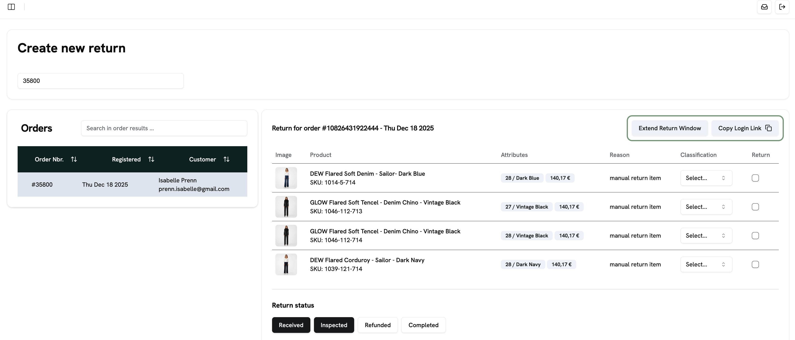
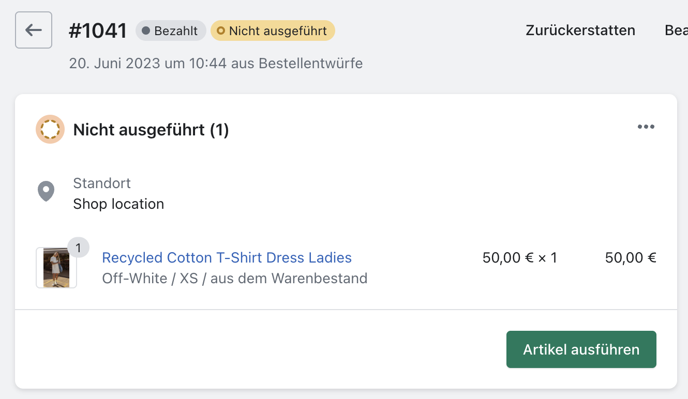
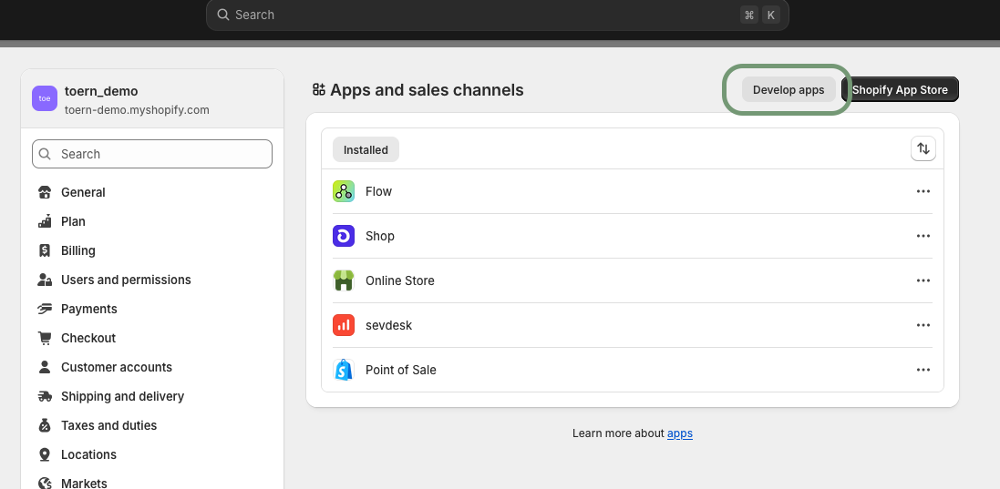

Hier findest du Antworten auf die häufigsten Fragen rund um toern. Im zweiten Teil der Seite findest du alle Klärfälle, die bei Retouren, Rückerstattungen und Umtauschen auftreten können, und wie du sie löst.

## Retouren und Umtausche anmelden

<AccordionGroup>
  <Accordion title="Die Retourenfrist ist abgelaufen. Wie kann ich trotzdem eine Retoure anmelden?">
    Du hast zwei Möglichkeiten: Du legst eine manuelle Retoure an oder du verlängerst die Retourenfrist für die Bestellung.

    **Manuelle Retoure anlegen:**

    1. Gehe zu **Manage Returns**.
    2. Klicke auf **Create New Return**.
    3. Suche nach der Bestellnummer.
    4. Wähle die Zeile mit der gesuchten Bestellung aus.
    5. Wähle die Artikel aus, die retourniert werden sollen.
    6. Wähle den aktuellen Stand der Retoure aus, z. B. **Registered**, **Received** (wenn die Ware schon beim Fulfiller ist) oder **Inspected** (wenn der Fulfiller sie schon klassifiziert hat).
    7. Klicke auf **Create**. Die Retoure wird angelegt und du landest in der gewohnten Retourenansicht.

    Unter **Refund Method** wählst du, ob die KundInnen ihr Geld über die ursprüngliche Zahlungsart zurückbekommen oder einen Gutschein für den Shop erhalten.

    **Retourenfrist verlängern:**

    Suche die Bestellung über **Create New Return** und öffne sie.

    

    Mit **Extend Return Window** verlängerst du die Retourenfrist für diese Bestellung. Die KundInnen können die Retoure dann selbst im Portal anmelden. Mit **Copy Login Link** kopierst du einen Link, den du den KundInnen schicken kannst. Damit landen sie direkt in der Artikelauswahl und müssen ihre Bestelldaten nicht mehr eingeben.

    Mehr dazu findest du unter [Retouren verwalten](/dashboard/manage-returns).
  </Accordion>
  <Accordion title="Wie melde ich eine Retoure für KundInnen an?">
    Du legst die Retoure manuell im Dashboard an:

    1. Gehe zu **Manage Returns**.
    2. Klicke auf **Create New Return**.
    3. Im Suchfeld durchsuchst du alle Bestellungen. Du kannst nach Kundenname oder Bestellnummer suchen.
    4. Wähle die passende Bestellung aus der Liste aus.
    5. Rechts erscheinen die Details der Bestellung. Wähle die relevanten Artikel aus und klassifiziere sie bei Bedarf.
    6. Passe unter **Return Status** die Timeline an. **Inspected** bedeutet, dass die Retoure dir bereits vorliegt und bearbeitet wurde. Klicke auf die beiden Buttons **Received** und **Inspected**, um den Status zurückzusetzen. Die Retoure hat dann den Status **Registered**, so als hätten die KundInnen sie selbst angemeldet.
    7. Lege bei Bedarf einen Klärfall an.
    8. Klicke auf **Create**. Die Retoure wird angelegt und durchläuft danach den normalen Retourenprozess.

    <Warning>
      Wenn die Ware noch bei den KundInnen ist, setze den Status unbedingt zurück. Sonst kann die Rückerstattung automatisch ausgelöst werden.
    </Warning>

    Mehr dazu findest du unter [Retouren verwalten](/dashboard/manage-returns).
  </Accordion>
  <Accordion title="Wie melde ich einen Umtausch für KundInnen an?">
    Du hast zwei Wege:

    - **Über das Retourenportal:** Öffne den Link zu deinem Portal (er ist auf deiner Shop-Website hinterlegt). Durchlaufe den Retourenprozess für die KundInnen und wähle die Artikel für den Umtausch aus.
    - **Über das Dashboard:** Lege unter **Manage Returns → Create New Return** eine manuelle Retoure an. Sobald du einen Artikel auswählst, kannst du über das Dropdown einen Umtausch daraus machen. Mit **Show Variants for Exchange** siehst du alle verfügbaren Varianten des Artikels. toern prüft sie über die Shopify-Schnittstelle.

    Mehr dazu findest du unter [Umtausch](/returns/exchange) und [Retouren verwalten](/dashboard/manage-returns).
  </Accordion>
  <Accordion title="Wer trägt die Versandkosten bei einem reinen Umtausch?">
    Bei einem reinen Umtausch wird keine Retourengebühr abgezogen. Ein reiner Umtausch heißt: Neben dem getauschten Artikel werden keine weiteren Artikel retourniert. Die KundInnen bekommen in diesem Fall kein Geld zurück.

    Aus Kulanz wird dann keine Gebühr abgezogen, weil die Wahrscheinlichkeit hoch ist, dass die KundInnen den neuen Artikel behalten. Wenn sie auch diesen Artikel zurückschicken möchten, müssen sie sich an deinen Kundenservice wenden. Dann kannst du manuell eine beliebige Retourengebühr erheben.

    Mehr dazu findest du unter [Umtausch](/returns/exchange).
  </Accordion>
</AccordionGroup>

## Rückerstattungen

<AccordionGroup>
  <Accordion title="Wie führe ich einen manuellen Refund durch? Wie entferne ich dabei die Retourengebühr? Wie erstatte ich die Versandkosten?">
    Einen manuellen Refund führst du in der Regel aus, wenn es für die Retoure keine Automatisierung gibt oder sie aufgehoben wurde.

    1. Öffne die Retoure, die du erstatten möchtest.
    2. Klicke auf **Create New Refund** (jederzeit möglich) oder auf **Refund** (nur möglich, wenn das der nächste Schritt in der Timeline ist).
    3. Wähle die Retoure aus, die erstattet werden soll, falls sie nicht schon vorausgewählt ist. Rechts siehst du alle Einstellungen für den Refund. Sie sind an die Voreinstellungen deiner Brand angepasst. Hier kannst du z. B. die Retourengebühr entfernen oder die Versandkosten erstatten.
    4. Mit **Real Refund Amount** kannst du auch einen ganz individuellen Betrag eingeben, unabhängig von den Retourenartikeln und Voreinstellungen. Er darf den maximalen Refund-Betrag (den Bestellwert) aber nicht überschreiten.

    Mehr dazu findest du unter [Rückerstattung](/returns/refund) und [Retouren verwalten](/dashboard/manage-returns).
  </Accordion>
  <Accordion title="Wie und wann erhalten KundInnen ihren Gutschein?">
    Der Gutschein wird wie ein normaler Refund ausgelöst, und zwar nach dem Trigger, den du in den Refund-Einstellungen festgelegt hast. toern löst den Versand des Gutscheins mit dem berechneten Betrag aus. Die KundInnen erhalten ihn per E-Mail. Wie lange er gültig ist, richtet sich nach deinen Einstellungen.

    Mehr dazu findest du unter [Gutschein-Erstattung](/returns/gift-card-refund).
  </Accordion>
</AccordionGroup>

## Kommunikation mit KundInnen

<AccordionGroup>
  <Accordion title="Wie erstelle ich ein neues Label für KundInnen?">
    1. Öffne die Retoure der KundInnen.
    2. Klicke in der Box **Return Labels** auf **Generate New Label**.
    3. Warte kurz. Unten rechts erscheint zuerst die Meldung „New label requested, please wait for the new label to be created.“ Sobald das Label ersetzt wurde, erscheint „label recreated“.
    4. Öffne das Label mit **Open PDF**, lade es herunter und schicke es an die KundInnen.
  </Accordion>
  <Accordion title="Was sollte ich in die E-Mail mit einem neuen Versandlabel schreiben?">
    Diese Vorlage deckt alle typischen Fälle ab:

    > Hallo liebe/r XY,
    >
    > danke für deine Rückmeldung – das ist natürlich ärgerlich, so soll das nicht laufen. Auf den ersten Blick sehen das Label und der QR-Code für mich korrekt aus, aber zur Sicherheit habe ich dir ein neues Rücksendelabel erstellt und im Anhang beigefügt.
    >
    > Was ansonsten oft hilft:
    >
    > - Die Retoure in einer anderen DHL-Filiale abgeben
    > - Label vorsichtshalber ausdrucken, damit der Barcode direkt gescannt werden kann
    > - QR-Code und/oder Barcode funktionieren nicht? Die Filiale kann die darunter stehende Nummer manuell eingeben – bitte bestehe darauf, dass dies versucht wird
    >
    > Ich hoffe, so klappt es jetzt reibungslos. Falls nicht, melde dich gerne direkt wieder bei mir!
    >
    > Viele Grüße
  </Accordion>
  <Accordion title="Wann wird was per E-Mail an KundInnen kommuniziert?">
    Während des Retourenprozesses erhalten die KundInnen mehrere personalisierte E-Mails zum Ablauf und Status ihrer Retoure:

    - **Anmeldebestätigung:** Am Ende des Retourenprozesses sehen die KundInnen eine Bestätigung. Dort steht bereits, dass das Label per E-Mail kommt oder dass sie eine E-Mail mit der Versandadresse und den nächsten Schritten erhalten.
    - **E-Mail mit Label:** Sie enthält das Label und Infos zum weiteren Ablauf:

      > Packe die Artikel, die du zur Rücksendung angemeldet hast, in ihre Originalverpackung zurück und verschließe den Karton sorgfältig. Besuche eine [Versanddienstleister]-Station in deiner Nähe und zeige dort das Versandlabel vor, um dein Paket zurückzusenden. Die Erstattung des Betrags wird ausgeführt, nachdem dein Paket bei uns eingetroffen ist. Bitte beachte, dass die Rückerstattung erst nach Erhalt der Ware erfolgt.

    - **E-Mail mit Versandadresse:** Sie enthält kein Label, dafür Infos zum Ablauf und ggf. einen Rücksendeschein, den die KundInnen ausdrucken und ins Paket legen:

      > Bitte beachte, dass wir keine unfrankierten Rücksendungen oder Nachnahmesendungen annehmen können. Um sicherzustellen, dass deine Rücksendung bei uns ankommt, empfehlen wir, den Versand als versichertes Paket mit Sendungsverfolgung durchzuführen. Wenn im Anhang ein Rücksendeschein enthalten ist, drucke ihn bitte aus und lege ihn ins Paket. Er enthält alle nötigen Infos, damit wir deine Retoure schnell und korrekt zuordnen können. Packe die Artikel, die du zur Rücksendung angemeldet hast, in ihre Originalverpackung zurück und verschließe den Karton sorgfältig. Nutze die oben angegebene Adresse für die Rücksendung und sende den Artikel zurück an uns. Die Erstattung des Betrags wird ausgeführt, nachdem dein Paket bei uns eingetroffen ist. Bitte beachte, dass die Rückerstattung erst nach Erhalt der Ware erfolgt.

    - **Benachrichtigung nach Bearbeitung:** Sobald das Fulfillment die Retoure bearbeitet und klassifiziert hat, erhalten die KundInnen eine Benachrichtigung. Sie wird von deinem Shop in Shopify erstellt und über die toern-Anbindung ausgelöst.
    - **Gutschein:** Bei einem Refund per Gutschein wird statt der Erstattung ein Gutschein in Shopify ausgelöst. Auch dieser ist von deinem Shop vorkonfiguriert und wird von toern nur ausgelöst.
  </Accordion>
  <Accordion title="Kann ich die E-Mails an KundInnen individuell anpassen?">
    Ja. Wenn du **Transactional E-Mails by toern** als Notification Service ausgewählt hast, kannst du Betreff, Cc/Bcc und Inhalt pro Event und Sprache im [E-Mail-Editor](/branding/email-templates) anpassen. Dort prüfst du die E-Mails auch mit Testdaten und verschickst Test-E-Mails.

    Wenn du [Klaviyo](/integrations/klaviyo) nutzt, verwaltest du die Inhalte weiterhin direkt in Klaviyo.
  </Accordion>
  <Accordion title="Wie und wo hinterlege ich die Rückgaberichtlinien in meinem Shop?">
    Jedes Shopsystem hat einen eigenen Bereich für Richtlinien. Dort können deine KundInnen sie nachlesen. Wo genau du die Einstellung findest, hängt von deinem Shopsystem ab.

    Du kannst gerne die vorformulierten Textbausteine verwenden, die wir zu Beginn des Onboardings mit dir geteilt haben.
  </Accordion>
</AccordionGroup>

## Shopify

<AccordionGroup>
  <Accordion title="Warum wird mein Retourenstatus nicht in Shopify angezeigt?">
    Shopify zeigt einen Retourenstatus **nur** an, wenn der Artikel ausgeführt („fulfilled“) ist.

    Ist der Artikel nicht ausgeführt, schlägt die Übertragung von toern fehl. Der Status kann dann nicht an Shopify übertragen und dort nicht angezeigt werden.

    

    Keine Sorge: In der [Auswertung in toern](/dashboard/analytics) siehst du die Retourengründe trotzdem.
  </Accordion>
  <Accordion title="Wo passe ich die Shopify-Berechtigungen für meinen Shop an?">
    Manche Funktionen brauchen spezielle Berechtigungen in Shopify, z. B. Umtausche, Gutscheine und Rückerstattungen. Bevor du diese Funktionen aktivieren kannst, musst du die Berechtigungen vergeben. Fehlen sie, erscheint eine Fehlermeldung mit den benötigten Berechtigungen.

    So vergibst du die Berechtigungen in deinem Shopify-Shop:

    1. Öffne **Apps and sales channels**.
    2. Klicke oben rechts auf **Develop apps**.

       

    3. Wähle die App **toern Retoureportal** aus und öffne **Configuration**.
    4. Klicke bei **Admin API integration** auf **Edit**. Setze die Häkchen bei den benötigten Berechtigungen.

    Mehr dazu findest du unter [Shopify-Integration](/getting-started/shopify-integration).
  </Accordion>
</AccordionGroup>

## Allgemeine Fragen

<AccordionGroup>
  <Accordion title="Wie lege ich einen neuen Nutzer für meine Brand an?">
    Neue NutzerInnen legst du selbst im **User Management** an. Klicke dort auf **Add New User** und gib den vollständigen Namen, die E-Mail-Adresse und die Rolle an. Die Zugangsdaten werden den neuen NutzerInnen per E-Mail zugeschickt.

    Mehr dazu findest du unter [Nutzerverwaltung](/dashboard/user-management).
  </Accordion>
</AccordionGroup>

## Klärfälle und wie du sie löst

Wenn toern eine Retoure nicht automatisch weiterverarbeiten kann oder du sie bewusst prüfen sollst, entsteht ein **Klärfall**. Die Retoure bekommt den Status **needs review** bzw. **Clarification**, und in der Retoure siehst du für jedes offene Problem eine eigene Klärfall-Karte. Wie Klärfälle grundsätzlich funktionieren, erfährst du unter [Klärfälle](/returns/clarifications).

Unten findest du alle Klärfälle, sortiert nach der Art des Problems, wie im Filter **Issue** in der Retourenübersicht. Der Titel jedes Eintrags ist der Titel der Klärfall-Karte. Werte in eckigen Klammern, zum Beispiel [Land] oder [Artikel], füllt toern auf der Karte mit den Daten der Retoure.

<Tip>
  Jede Klärfall-Karte zeigt genau einen Button:

  - **Erneut versuchen**: Behebe die Ursache und starte den fehlgeschlagenen Schritt neu. Klappt es, schließt sich der Punkt von selbst.
  - **Als erledigt markieren**: Prüfe die Retoure und schließe den Punkt, optional mit einer Notiz für den Verlauf.
  - **Manuell erstatten**: Erstatte die Retoure selbst. Sobald die Erstattung durchgeht, schließt sich der Punkt von selbst.
  - **@ToernBot im Chat erwähnen**: Der toern Support muss sich das Problem ansehen.

  Die automatische Verarbeitung läuft erst weiter, wenn alle Punkte einer Retoure erledigt sind.
</Tip>

### Rücksendeetikett

Das Rücksende- oder Umtauschetikett konnte nicht erstellt werden.

<AccordionGroup>
  <Accordion title="Kundenadresse ist unvollständig">
    Das Rücksendeetikett konnte nicht erstellt werden, weil in der Kundenadresse etwas fehlt, zum Beispiel Straße, Hausnummer oder Postleitzahl. Ergänze sie unter Kundeninformationen › Kunde bearbeiten und klicke danach in der Klärfall-Karte auf **Erneut versuchen**.

    Hast du das Etikett selbst unter Versandetiketten erstellt, zeigt die Karte stattdessen **Als erledigt markieren**: Behebe die Ursache, erstelle das Etikett unter **Versandetiketten › Neues Rücksendeetikett erstellen** neu und markiere den Punkt danach als erledigt.

    **Button in der Klärfall-Karte:** Erneut versuchen (Retry)
  </Accordion>
  <Accordion title="Versanddienstleister hat die Adresse abgelehnt">
    Dein Versanddienstleister hat die Kundenadresse nicht akzeptiert. Straße, Hausnummer, Postleitzahl und Ort müssen stimmen, und kein Feld darf zu lang sein. Korrigiere sie unter Kundeninformationen › Kunde bearbeiten und klicke danach in der Klärfall-Karte auf **Erneut versuchen**.

    Hast du das Etikett selbst unter Versandetiketten erstellt, zeigt die Karte stattdessen **Als erledigt markieren**: Behebe die Ursache, erstelle das Etikett unter **Versandetiketten › Neues Rücksendeetikett erstellen** neu und markiere den Punkt danach als erledigt.

    **Button in der Klärfall-Karte:** Erneut versuchen (Retry)
  </Accordion>
  <Accordion title="Versanddienstleister ist nicht eingerichtet">
    Das Rücksendeetikett konnte nicht erstellt werden, weil die Zugangsdaten deines Versanddienstleisters fehlen, unvollständig oder ungültig sind. Prüfe sie unter Einstellungen › Versanddienste für Retouren in den Zugangsdaten deines Versanddienstleisters und klicke danach in der Klärfall-Karte auf **Erneut versuchen**.

    Hast du das Etikett selbst unter Versandetiketten erstellt, zeigt die Karte stattdessen **Als erledigt markieren**: Behebe die Ursache, erstelle das Etikett unter **Versandetiketten › Neues Rücksendeetikett erstellen** neu und markiere den Punkt danach als erledigt.

    **Button in der Klärfall-Karte:** Erneut versuchen (Retry)
  </Accordion>
  <Accordion title="Anmeldung beim Versanddienstleister fehlgeschlagen">
    Dein Versanddienstleister hat deine Zugangsdaten abgelehnt. Sie müssen stimmen und deine Live-Zugangsdaten sein, nicht die für Tests. Prüfe sie unter Einstellungen › Versanddienste für Retouren in den Zugangsdaten deines Versanddienstleisters und klicke danach in der Klärfall-Karte auf **Erneut versuchen**.

    Hast du das Etikett selbst unter Versandetiketten erstellt, zeigt die Karte stattdessen **Als erledigt markieren**: Behebe die Ursache, erstelle das Etikett unter **Versandetiketten › Neues Rücksendeetikett erstellen** neu und markiere den Punkt danach als erledigt.

    **Button in der Klärfall-Karte:** Erneut versuchen (Retry)
  </Accordion>
  <Accordion title="Versanddienstleister ist für dieses Land nicht eingerichtet">
    Für Retouren aus [Land] ist bei deinem Versanddienstleister keine Rücksendeadresse hinterlegt. Ergänze sie unter Einstellungen › Versanddienste für Retouren in den Ländereinstellungen deines Versanddienstleisters und klicke danach in der Klärfall-Karte auf **Erneut versuchen**.

    Hast du das Etikett selbst unter Versandetiketten erstellt, zeigt die Karte stattdessen **Als erledigt markieren**: Behebe die Ursache, erstelle das Etikett unter **Versandetiketten › Neues Rücksendeetikett erstellen** neu und markiere den Punkt danach als erledigt.

    **Button in der Klärfall-Karte:** Erneut versuchen (Retry)
  </Accordion>
  <Accordion title="Rücksendemethode ist nicht richtig eingerichtet">
    Die Rücksendemethode dieser Retoure hat keinen Versanddienstleister, oder er ist nicht richtig eingerichtet. Prüfe die Rücksendemethode unter Einstellungen › Retouren › Rücksendemethoden und klicke danach in der Klärfall-Karte auf **Erneut versuchen**.

    Hast du das Etikett selbst unter Versandetiketten erstellt, zeigt die Karte stattdessen **Als erledigt markieren**: Behebe die Ursache, erstelle das Etikett unter **Versandetiketten › Neues Rücksendeetikett erstellen** neu und markiere den Punkt danach als erledigt.

    **Button in der Klärfall-Karte:** Erneut versuchen (Retry)
  </Accordion>
  <Accordion title="Kein Etikett aus diesem Land möglich">
    Dein Versanddienstleister kann kein Rücksendeetikett aus [Land] erstellen, weil diese Retouren Zolldokumente brauchen, die noch nicht unterstützt werden. Schicke dem Kunden die Rücksendeanleitung selbst und klicke danach in der Klärfall-Karte auf **Als erledigt markieren**. Damit das nicht wieder passiert, biete für [Land] unter Einstellungen › Retouren › Rücksendemethoden eine andere Rücksendemethode an.

    **Button in der Klärfall-Karte:** Als erledigt markieren (Mark resolved)
  </Accordion>
  <Accordion title="Versanddienstleister vorübergehend nicht erreichbar">
    Dein Versanddienstleister hat beim Erstellen des Etiketts nicht geantwortet oder einen vorübergehenden Fehler gemeldet. Warte ein paar Minuten und klicke danach in der Klärfall-Karte auf **Erneut versuchen**. Falls es erneut fehlschlägt, erwähne **@ToernBot** im Chat.

    Hast du das Etikett selbst unter Versandetiketten erstellt, zeigt die Karte stattdessen **Als erledigt markieren**: Behebe die Ursache, erstelle das Etikett unter **Versandetiketten › Neues Rücksendeetikett erstellen** neu und markiere den Punkt danach als erledigt.

    **Button in der Klärfall-Karte:** Erneut versuchen (Retry)
  </Accordion>
  <Accordion title="Etikett hat keine Sendungsnummer">
    Dein Versanddienstleister hat das Rücksendeetikett ohne Sendungsnummer erstellt, deshalb konnte sie nicht bei der Retoure in deinem Shop eingetragen werden. Erwähne **@ToernBot** im Chat, damit wir das Etikett prüfen.

    **Button in der Klärfall-Karte:** @ToernBot im Chat erwähnen
  </Accordion>
  <Accordion title="Rücksendeetikett konnte nicht erstellt werden">
    Beim Erstellen des Rücksendeetiketts ist ein unbekannter Fehler aufgetreten. Prüfe die Kundenadresse unter Kundeninformationen › Kunde bearbeiten und klicke danach in der Klärfall-Karte auf **Erneut versuchen**. Falls es erneut fehlschlägt, erwähne **@ToernBot** im Chat.

    Hast du das Etikett selbst unter Versandetiketten erstellt, zeigt die Karte stattdessen **Als erledigt markieren**: Behebe die Ursache, erstelle das Etikett unter **Versandetiketten › Neues Rücksendeetikett erstellen** neu und markiere den Punkt danach als erledigt.

    **Button in der Klärfall-Karte:** Erneut versuchen (Retry)
  </Accordion>
  <Accordion title="Sendcloud ist für Umtauschetiketten nicht eingerichtet">
    Das Versandetikett für die Umtauschartikel konnte nicht erstellt werden, weil deine Sendcloud-Zugangsdaten fehlen. Ergänze sie unter Einstellungen › Integrationen › Sendcloud › Zugangsdaten und klicke danach in der Klärfall-Karte auf **Erneut versuchen**.

    **Button in der Klärfall-Karte:** Erneut versuchen (Retry)
  </Accordion>
  <Accordion title="Anmeldung bei Sendcloud fehlgeschlagen">
    Sendcloud hat deine Zugangsdaten abgelehnt, deshalb konnte das Versandetikett für die Umtauschartikel nicht erstellt werden. Prüfe sie unter Einstellungen › Integrationen › Sendcloud › Zugangsdaten und klicke danach in der Klärfall-Karte auf **Erneut versuchen**.

    **Button in der Klärfall-Karte:** Erneut versuchen (Retry)
  </Accordion>
  <Accordion title="Keine Sendcloud-Absenderadresse für dieses Land">
    Für [Land] ist keine Sendcloud-Absenderadresse hinterlegt, deshalb konnte das Versandetikett für die Umtauschartikel nicht erstellt werden. Ergänze sie unter Einstellungen › Integrationen › Sendcloud › Absenderadressen und klicke danach in der Klärfall-Karte auf **Erneut versuchen**.

    **Button in der Klärfall-Karte:** Erneut versuchen (Retry)
  </Accordion>
  <Accordion title="Sendcloud hat das Umtauschetikett abgelehnt">
    Sendcloud hat das Versandetikett für die Umtauschartikel nicht erstellt. Meist ist die Kundenadresse unvollständig, oder keine deiner Versandregeln in Sendcloud passt zu dieser Sendung. Prüfe die Adresse unter Kundeninformationen › Kunde bearbeiten und deine Versandregeln in Sendcloud und klicke danach in der Klärfall-Karte auf **Erneut versuchen**. Meldung von Sendcloud: „[Meldung]“

    **Button in der Klärfall-Karte:** Erneut versuchen (Retry)
  </Accordion>
  <Accordion title="Umtauschetikett konnte nicht erstellt werden">
    Das Versandetikett für die Umtauschartikel konnte nicht erstellt werden, und Sendcloud hat keinen Grund genannt. Prüfe die Adresse unter Kundeninformationen › Kunde bearbeiten und deine Sendcloud-Einstellungen unter Einstellungen › Integrationen › Sendcloud und klicke danach in der Klärfall-Karte auf **Erneut versuchen**. Falls es erneut fehlschlägt, erwähne **@ToernBot** im Chat.

    **Button in der Klärfall-Karte:** Erneut versuchen (Retry)
  </Accordion>
  <Accordion title="Umtauschetikett nicht an der Bestellung">
    Das Versandetikett für die Umtauschartikel wurde erstellt, konnte aber nicht an die Bestellung in Shopify angehängt werden. Klicke in der Klärfall-Karte auf **Erneut versuchen**, das Etikett wird dabei nicht neu erstellt.

    **Button in der Klärfall-Karte:** Erneut versuchen (Retry)
  </Accordion>
</AccordionGroup>

### Shop-Abgleich

Die Retoure konnte nicht in deinem Shop angelegt oder aktualisiert werden.

<AccordionGroup>
  <Accordion title="Shop-Verbindung fehlt">
    Die Zugangsdaten deines Shops fehlen, deshalb konnten wir ihn nicht erreichen. Verbinde deinen Shop unter Einstellungen › Shop-Anbindung › Shopify-Zugangsdaten neu und klicke danach in der Klärfall-Karte auf **Erneut versuchen**.

    **Button in der Klärfall-Karte:** Erneut versuchen (Retry)
  </Accordion>
  <Accordion title="Shop hat den Zugriff verweigert">
    Dein Shop hat unsere Anfrage abgelehnt. Meist wurde die toern-App deinstalliert, ihre Berechtigungen wurden geändert oder der Shop ist pausiert. Prüfe in Shopify unter Apps, ob die toern-App installiert ist und alle Berechtigungen hat, und klicke danach in der Klärfall-Karte auf **Erneut versuchen**.

    **Button in der Klärfall-Karte:** Erneut versuchen (Retry)
  </Accordion>
  <Accordion title="Shop vorübergehend nicht erreichbar">
    Dein Shop hat nicht geantwortet oder ist gerade ausgelastet. Warte ein paar Minuten und klicke danach in der Klärfall-Karte auf **Erneut versuchen**. Falls es erneut fehlschlägt, erwähne **@ToernBot** im Chat.

    **Button in der Klärfall-Karte:** Erneut versuchen (Retry)
  </Accordion>
  <Accordion title="Shopsystem ist nicht eingestellt">
    Für deine Marke ist kein unterstütztes Shopsystem eingestellt, deshalb konnte die Retoure an keinen Shop übertragen werden. Erwähne **@ToernBot** im Chat, damit wir deine Shop-Einstellungen prüfen.

    **Button in der Klärfall-Karte:** @ToernBot im Chat erwähnen
  </Accordion>
  <Accordion title="Retoure konnte nicht im Shop erstellt werden">
    Die Retoure konnte in deinem Shop nicht angelegt werden, und dein Shop hat keinen Grund genannt. Prüfe in Shopify, ob die Bestellung existiert und ihre Artikel versendet (fulfilled) und noch nicht retourniert sind, und klicke danach in der Klärfall-Karte auf **Erneut versuchen**. Falls es erneut fehlschlägt, erwähne **@ToernBot** im Chat.

    **Button in der Klärfall-Karte:** Erneut versuchen (Retry)
  </Accordion>
  <Accordion title="Shopify hat die Retoure abgelehnt">
    Shopify hat diese Retoure nicht angelegt. Meist wurden ihre Artikel dort schon retourniert oder erstattet, die Bestellung wurde storniert oder die Artikel sind noch nicht versendet (fulfilled). Öffne die Bestellung in Shopify, behebe das dort und klicke danach in der Klärfall-Karte auf **Erneut versuchen**. Meldung von Shopify: „[Meldung]“

    **Button in der Klärfall-Karte:** Erneut versuchen (Retry)
  </Accordion>
  <Accordion title="Sendungsverfolgung konnte nicht im Shop ergänzt werden">
    Die Retoure wurde in deinem Shop erstellt, aber Rücksendeetikett und Sendungsnummer konnten nicht hinzugefügt werden. Klicke in der Klärfall-Karte auf **Erneut versuchen**. Falls es erneut fehlschlägt, erwähne **@ToernBot** im Chat.

    **Button in der Klärfall-Karte:** Erneut versuchen (Retry)
  </Accordion>
  <Accordion title="Rücksendegebühr konnte nicht berechnet werden">
    Die Rücksendegebühr dieser Retoure konnte nicht berechnet werden, zum Beispiel weil für das Land des Kunden keine Gebühr oder Währung hinterlegt ist. Prüfe die Rücksendegebühren unter Einstellungen › Retouren › Rücksendemethoden und klicke danach in der Klärfall-Karte auf **Erneut versuchen**.

    **Button in der Klärfall-Karte:** Erneut versuchen (Retry)
  </Accordion>
  <Accordion title="Retoure konnte in deinem Shop nicht angepasst werden">
    Die Artikel dieser Retoure wurden geändert, aber die Retoure in deinem Shop konnte nicht angepasst werden, deshalb wurde die Erstattung nicht gestartet. Klicke in der Klärfall-Karte auf **Erneut versuchen**. Falls es erneut fehlschlägt, erwähne **@ToernBot** im Chat.

    **Button in der Klärfall-Karte:** Erneut versuchen (Retry)
  </Accordion>
  <Accordion title="Retoure in deinem Shop kann nicht mehr geändert werden">
    Die Artikel dieser Retoure wurden geändert, aber die Retoure in Shopify hat den Status „[Status]“ und kann nicht mehr angepasst werden. Passe sie selbst in Shopify an. Klicke dann in der Klärfall-Karte auf **Manuell erstatten**, danach schließt sich dieser Punkt von selbst.

    **Button in der Klärfall-Karte:** Manuell erstatten (Refund manually)
  </Accordion>
  <Accordion title="Retoure konnte in deinem Shop nicht storniert werden">
    Das Stornieren dieser Retoure ist in Shopify fehlgeschlagen, deshalb wurde sie auch in toern nicht storniert. In Shopify ist sie eventuell schon erstattet, umgetauscht oder abgeschlossen. Prüfe die Retoure in Shopify, und falls sie noch storniert werden muss, storniere sie erneut unter Aktionen › Retoure stornieren. Klicke danach in der Klärfall-Karte auf **Als erledigt markieren**.

    **Button in der Klärfall-Karte:** Als erledigt markieren (Mark resolved)
  </Accordion>
</AccordionGroup>

### Versand

Dein Shop hat für die Artikel der Bestellung nichts, was retourniert werden kann.

<AccordionGroup>
  <Accordion title="Bestellung hat keine retournierbaren Artikel im Shop">
    Dein Shop meldet für diese Bestellung keine Artikel, die retourniert werden können. Meist ist die Bestellung noch nicht versendet (fulfilled), ihre Artikel wurden schon retourniert oder die Bestellung wurde storniert. Markiere die Artikel in Shopify als versendet und klicke danach in der Klärfall-Karte auf **Erneut versuchen**.

    **Button in der Klärfall-Karte:** Erneut versuchen (Retry)
  </Accordion>
  <Accordion title="Einige Artikel sind nicht versendet">
    Diese Artikel können in deinem Shop noch nicht retourniert werden, weil sie nicht versendet (fulfilled) oder schon retourniert wurden: [Artikel]. Markiere sie in Shopify als versendet und klicke danach in der Klärfall-Karte auf **Erneut versuchen**. Wurden sie storniert und nie verschickt, klicke oben in der Retoure auf **Als erhalten markieren**, entferne sie unter Retournierte Artikel und klicke danach in der Klärfall-Karte auf **Erneut versuchen**.

    **Button in der Klärfall-Karte:** Erneut versuchen (Retry)
  </Accordion>
  <Accordion title="Bestellartikel im Shop nicht gefunden">
    Ein Artikel dieser Bestellung wurde in deinem Shop nicht gefunden, zum Beispiel weil er gelöscht wurde. Erwähne **@ToernBot** im Chat, damit wir die Bestellung prüfen.

    **Button in der Klärfall-Karte:** @ToernBot im Chat erwähnen
  </Accordion>
</AccordionGroup>

### Umtausch

Der Umtausch oder die Umtauschbestellung konnte nicht verarbeitet werden.

<AccordionGroup>
  <Accordion title="Umtauschartikel hat keinen Ersatzartikel">
    Ein Artikel dieser Retoure ist zum Umtausch markiert, aber es ist kein Ersatzartikel hinterlegt. Erwähne **@ToernBot** im Chat, damit wir den Umtausch prüfen.

    **Button in der Klärfall-Karte:** @ToernBot im Chat erwähnen
  </Accordion>
  <Accordion title="Ersatzartikel nicht verfügbar">
    Der Preis des Ersatzartikels konnte nicht aus Shopify geladen werden. Möglicherweise wurde der Artikel gelöscht oder wird im Markt des Kunden nicht verkauft. Prüfe den Artikel in Shopify und klicke danach in der Klärfall-Karte auf **Erneut versuchen**.

    **Button in der Klärfall-Karte:** Erneut versuchen (Retry)
  </Accordion>
  <Accordion title="Umtausch konnte in Shopify nicht geprüft werden">
    Die Retoure wurde in Shopify erstellt, aber ihre Umtauschbestellung konnte danach nicht geprüft werden. Prüfe die Umtauschbestellung in Shopify und erwähne **@ToernBot** im Chat, bevor du auf **Erneut versuchen** klickst, damit die Retoure nicht doppelt erstellt wird.

    **Button in der Klärfall-Karte:** @ToernBot im Chat erwähnen
  </Accordion>
  <Accordion title="Umtauschbestellung konnte nicht erstellt werden">
    Die Bestellung für die Ersatzartikel konnte in deinem Shop nicht angelegt werden, und dein Shop hat keinen Grund genannt. Prüfe in Shopify, ob alle Ersatzartikel noch existieren und auf Lager sind, und klicke danach in der Klärfall-Karte auf **Erneut versuchen**. Falls es erneut fehlschlägt, erwähne **@ToernBot** im Chat.

    **Button in der Klärfall-Karte:** Erneut versuchen (Retry)
  </Accordion>
  <Accordion title="Shopify hat die Umtauschbestellung abgelehnt">
    Shopify hat die Bestellung für die Ersatzartikel dieses Umtauschs nicht angelegt. Meist ist ein Ersatzartikel nicht auf Lager, wurde gelöscht oder wird im Markt des Kunden nicht mehr verkauft. Prüfe die Ersatzartikel in Shopify und klicke danach in der Klärfall-Karte auf **Erneut versuchen**. Meldung von Shopify: „[Meldung]“

    **Button in der Klärfall-Karte:** Erneut versuchen (Retry)
  </Accordion>
  <Accordion title="Ersatzartikel nicht auf Lager">
    Mindestens ein Ersatzartikel dieses Umtauschs ist in Shopify nicht auf Lager, deshalb konnte die Umtauschbestellung nicht angelegt werden. Sorge dafür, dass alle Ersatzartikel in Shopify auf Lager sind, und klicke danach in der Klärfall-Karte auf **Erneut versuchen**.

    **Button in der Klärfall-Karte:** Erneut versuchen (Retry)
  </Accordion>
  <Accordion title="Ersatzartikel gibt es im Shop nicht mehr">
    Einen oder mehrere Ersatzartikel dieses Umtauschs gibt es in Shopify nicht mehr, deshalb konnte die Umtauschbestellung nicht erstellt werden. Lege sie in Shopify wieder an und klicke danach in der Klärfall-Karte auf **Erneut versuchen**. Falls das nicht möglich ist, erwähne **@ToernBot** im Chat.

    **Button in der Klärfall-Karte:** Erneut versuchen (Retry)
  </Accordion>
  <Accordion title="Umtauschartikel noch nicht versandbereit">
    Shopify hat die Umtauschartikel dieser Retoure noch nicht für den Versand vorbereitet, deshalb konnten sie nicht freigegeben werden. Warte ein paar Minuten und klicke danach in der Klärfall-Karte auf **Erneut versuchen**. Wurde der Umtausch außerhalb von toern abgewickelt, zum Beispiel weil die Retoure direkt in Shopify erstattet wurde, klicke stattdessen oben in der Retoure auf **Als abgeschlossen markieren**.

    **Button in der Klärfall-Karte:** Erneut versuchen (Retry)
  </Accordion>
  <Accordion title="Umtauschartikel konnten nicht für den Versand freigegeben werden">
    Die Umtauschartikel sind in Shopify zurückgehalten, und das konnte nicht aufgehoben werden, deshalb werden sie noch nicht verschickt. Klicke in der Klärfall-Karte auf **Erneut versuchen**. Falls es erneut fehlschlägt, gib die Umtauschbestellung selbst in Shopify frei und klicke danach noch einmal in der Klärfall-Karte auf **Erneut versuchen**.

    **Button in der Klärfall-Karte:** Erneut versuchen (Retry)
  </Accordion>
  <Accordion title="Reservierte Umtauschbestellung konnte nicht freigegeben werden">
    Das Reservierungs-Tag konnte nicht von der Umtauschbestellung in Shopify entfernt werden, deshalb wird die Bestellung eventuell noch nicht verschickt. Klicke in der Klärfall-Karte auf **Erneut versuchen**. Falls es erneut fehlschlägt, entferne das Tag selbst von der Bestellung in Shopify und klicke danach noch einmal in der Klärfall-Karte auf **Erneut versuchen**.

    **Button in der Klärfall-Karte:** Erneut versuchen (Retry)
  </Accordion>
  <Accordion title="Retoure nicht rechtzeitig erhalten, Umtauschbestellung storniert">
    Die Retoure ist nicht innerhalb von X Tagen angekommen, deshalb wurde die dafür reservierte Umtauschbestellung in Shopify storniert und der Bestand freigegeben. Falls die Retoure doch noch ankommt, entscheide, wie es mit dem Umtausch weitergeht, und klicke danach in der Klärfall-Karte auf **Als erledigt markieren**.

    **Button in der Klärfall-Karte:** Als erledigt markieren (Mark resolved)
  </Accordion>
  <Accordion title="Umtauschartikel geändert">
    Ein Umtauschartikel dieser Retoure wurde geändert. Die verschickten Ersatzartikel passen deshalb eventuell nicht mehr zur Retoure, und die Erstattung kann falsch sein. Prüfe die Umtauschbestellung in Shopify und die Erstattung unter Retourenerstattungen und klicke danach in der Klärfall-Karte auf **Als erledigt markieren**.

    **Button in der Klärfall-Karte:** Als erledigt markieren (Mark resolved)
  </Accordion>
</AccordionGroup>

### Erstattung

Die Erstattung konnte nicht automatisch durchgeführt werden, oder sie wurde bewusst angehalten, damit du sie prüfst.

<AccordionGroup>
  <Accordion title="Keine Erstattungsmethode ausgewählt">
    Für diese Retoure ist keine Erstattungsmethode hinterlegt, deshalb konnte sie nicht automatisch erstattet werden. Klicke in der Klärfall-Karte auf **Manuell erstatten**, danach schließt sich dieser Punkt von selbst.

    **Button in der Klärfall-Karte:** Manuell erstatten (Refund manually)
  </Accordion>
  <Accordion title="Retoure von außerhalb der EU">
    Diese Retoure kommt aus [Land], also von außerhalb der EU. Wie mit dir vereinbart, werden solche Retouren nicht automatisch erstattet. Prüfe die Retoure und klicke dann in der Klärfall-Karte auf **Manuell erstatten**, danach schließt sich dieser Punkt von selbst.

    **Button in der Klärfall-Karte:** Manuell erstatten (Refund manually)
  </Accordion>
  <Accordion title="Retourenwert über der Grenze für automatische Erstattungen">
    Der Wert dieser Retoure liegt über deiner Grenze für automatische Erstattungen unter Einstellungen › Erstattung › Grenze für automatische Erstattungen. Prüfe die Retoure und klicke dann in der Klärfall-Karte auf **Manuell erstatten**, danach schließt sich dieser Punkt von selbst.

    **Button in der Klärfall-Karte:** Manuell erstatten (Refund manually)
  </Accordion>
  <Accordion title="Gutscheinwert über der Grenze für automatische Erstattungen">
    Der Gutscheinwert dieser Retoure liegt einschließlich Bonus über deiner Grenze für automatische Gutscheinerstattungen unter Einstellungen › Erstattung › Gutschein-Konfiguration. Prüfe die Retoure und klicke dann in der Klärfall-Karte auf **Manuell erstatten**, danach schließt sich dieser Punkt von selbst.

    **Button in der Klärfall-Karte:** Manuell erstatten (Refund manually)
  </Accordion>
  <Accordion title="Ampeln des Kunden nicht alle grün">
    Nicht alle Ampeln dieses Kunden sind grün, deshalb wurde die automatische Erstattung gestoppt. Prüfe den Kunden unter Kundeninformationen und klicke dann in der Klärfall-Karte auf **Manuell erstatten** und passe dort bei Bedarf die Rücksendegebühr an. Danach schließt sich dieser Punkt von selbst.

    **Button in der Klärfall-Karte:** Manuell erstatten (Refund manually)
  </Accordion>
  <Accordion title="Rabattcode von automatischen Erstattungen ausgeschlossen">
    Diese Bestellung nutzt den Rabattcode „[Rabattcode]“, den du unter Einstellungen › Erstattung › Rabattcode-Klärungen von automatischen Erstattungen ausgeschlossen hast. Klicke in der Klärfall-Karte auf **Manuell erstatten**, danach schließt sich dieser Punkt von selbst.

    **Button in der Klärfall-Karte:** Manuell erstatten (Refund manually)
  </Accordion>
  <Accordion title="Rabattcode erfordert eine manuelle Erstattung">
    Wie mit dir vereinbart, werden Bestellungen mit dem Rabattcode „[Rabattcode]“ nicht automatisch erstattet. Prüfe die Retoure und klicke dann in der Klärfall-Karte auf **Manuell erstatten**, danach schließt sich dieser Punkt von selbst.

    **Button in der Klärfall-Karte:** Manuell erstatten (Refund manually)
  </Accordion>
  <Accordion title="Kaufe-X-erhalte-Y-Rabatt von automatischen Erstattungen ausgeschlossen">
    Diese Bestellung nutzt den Kaufe-X-erhalte-Y-Rabatt „[Rabatt]“, und du hast solche Rabatte unter Einstellungen › Erstattung › BuyXGetY-Rabatte blockieren von automatischen Erstattungen ausgeschlossen. Klicke in der Klärfall-Karte auf **Manuell erstatten**, danach schließt sich dieser Punkt von selbst.

    **Button in der Klärfall-Karte:** Manuell erstatten (Refund manually)
  </Accordion>
  <Accordion title="Rabatte können nicht automatisch erstattet werden">
    Diese Bestellung kombiniert den Kaufe-X-erhalte-Y-Rabatt „[Rabatt]“ mit anderen Rabatten, deshalb kann der Erstattungsbetrag nicht automatisch berechnet werden. Klicke in der Klärfall-Karte auf **Manuell erstatten**, danach schließt sich dieser Punkt von selbst.

    **Button in der Klärfall-Karte:** Manuell erstatten (Refund manually)
  </Accordion>
  <Accordion title="Rabatte der Bestellung konnten nicht geprüft werden">
    Die Rabatte dieser Bestellung konnten nicht aus Shopify geladen werden, deshalb ließ sich der Erstattungsbetrag nicht sicher berechnen. Klicke in der Klärfall-Karte auf **Erneut versuchen**. Falls es erneut fehlschlägt, erstatte sie manuell über **Neue Erstattung erstellen** unter Retourenerstattungen.

    **Button in der Klärfall-Karte:** Erneut versuchen (Retry)
  </Accordion>
  <Accordion title="Geänderte Retoure mit Umtauschartikeln">
    Die Artikel dieser Retoure wurden geändert, sie enthält aber Umtauschartikel, deshalb konnte die Retoure in Shopify nicht automatisch angepasst werden. Passe die Retoure selbst in Shopify an, prüfe, ob der Ersatzartikel noch stimmt, und melde dich bei Bedarf beim Kunden. Klicke dann in der Klärfall-Karte auf **Manuell erstatten**, danach schließt sich dieser Punkt von selbst.

    **Button in der Klärfall-Karte:** Manuell erstatten (Refund manually)
  </Accordion>
  <Accordion title="Retoure nach dem Anlegen in Xentral geändert">
    Die Artikel oder die Rücksendegebühr dieser Retoure wurden geändert, nachdem sie in Xentral angelegt wurde. Das lässt sich nicht automatisch nachziehen. Passe die Retoure selbst in Xentral und in Shopify an. Klicke dann in der Klärfall-Karte auf **Manuell erstatten**, danach schließt sich dieser Punkt von selbst.

    **Button in der Klärfall-Karte:** Manuell erstatten (Refund manually)
  </Accordion>
  <Accordion title="Retoure konnte vor der Erstattung nicht geprüft werden">
    Wir konnten in deinem Shop nicht prüfen, ob die Artikel dieser Retoure geändert wurden, deshalb wurde die Erstattung nicht gestartet. Klicke in der Klärfall-Karte auf **Erneut versuchen**. Falls es erneut fehlschlägt, erwähne **@ToernBot** im Chat.

    **Button in der Klärfall-Karte:** Erneut versuchen (Retry)
  </Accordion>
  <Accordion title="Prüfung vor der automatischen Erstattung fehlgeschlagen">
    Die mit dir vereinbarte zusätzliche Prüfung vor automatischen Erstattungen konnte nicht abgeschlossen werden, deshalb wurde die Retoure nicht erstattet. Prüfe die Retoure selbst und klicke danach in der Klärfall-Karte auf **Erneut versuchen**, um sie zu erstatten.

    **Button in der Klärfall-Karte:** Erneut versuchen (Retry)
  </Accordion>
  <Accordion title="Erstattungseinstellungen fehlen">
    Für deine Marke sind keine Erstattungseinstellungen eingerichtet, deshalb konnte die Retoure nicht erstattet werden. Richte sie unter Einstellungen › Erstattung ein und klicke danach in der Klärfall-Karte auf **Erneut versuchen**.

    **Button in der Klärfall-Karte:** Erneut versuchen (Retry)
  </Accordion>
  <Accordion title="Gutscheinerstattungen sind ausgeschaltet">
    Diese Retoure soll als Gutschein erstattet werden, aber Gutscheinerstattungen sind ausgeschaltet. Schalte sie unter Einstellungen › Erstattung › Gutscheinerstattungen ein und klicke danach in der Klärfall-Karte auf **Erneut versuchen**. Oder erstatte sie manuell über **Neue Erstattung erstellen** unter Retourenerstattungen.

    **Button in der Klärfall-Karte:** Erneut versuchen (Retry)
  </Accordion>
  <Accordion title="Gutscheinbetrag ist 0">
    Der Gutschein hätte einen Wert von 0 oder weniger gehabt, deshalb hat Shopify ihn nicht erstellt. Das passiert, wenn die retournierten Artikel nichts gekostet haben, zum Beispiel Gratisartikel, oder wenn ein Umtausch ihren Wert bereits abdeckt. Die Retoure selbst wurde in Shopify schon verarbeitet. Wenn dem Kunden nichts zusteht, klicke oben in der Retoure auf **Als abgeschlossen markieren**. Andernfalls klicke in der Klärfall-Karte auf **Manuell erstatten**, danach schließt sich dieser Punkt von selbst.

    **Button in der Klärfall-Karte:** Manuell erstatten (Refund manually)
  </Accordion>
  <Accordion title="Bestellung wurde in Shopify storniert">
    Die Bestellung wurde in Shopify storniert, deshalb kann sie nicht automatisch erstattet werden. Prüfe die Bestellung in Shopify. Falls noch etwas offen ist, klicke in der Klärfall-Karte auf **Manuell erstatten**, danach schließt sich dieser Punkt von selbst. Ist nichts offen, klicke oben in der Retoure auf **Als abgeschlossen markieren**.

    **Button in der Klärfall-Karte:** Manuell erstatten (Refund manually)
  </Accordion>
  <Accordion title="Bestellung hat bereits andere Erstattungen">
    Die Bestellung hat in Shopify bereits Erstattungen, die nicht über toern erstellt wurden. Damit der Kunde nicht doppelt Geld bekommt, wurde sie nicht automatisch erstattet. Prüfe diese Erstattungen in Shopify. Falls noch etwas offen ist, klicke in der Klärfall-Karte auf **Manuell erstatten**, danach schließt sich dieser Punkt von selbst. Ist nichts offen, klicke oben in der Retoure auf **Als abgeschlossen markieren**.

    **Button in der Klärfall-Karte:** Manuell erstatten (Refund manually)
  </Accordion>
  <Accordion title="Zahlungsstatus erlaubt keine Erstattung">
    Der Zahlungsstatus der Bestellung in Shopify ist „[Status]“ und erlaubt keine Erstattung. Prüfe die Bestellung in Shopify. Hat der Kunde bezahlt und steht ihm Geld zu, klicke in der Klärfall-Karte auf **Manuell erstatten**, danach schließt sich dieser Punkt von selbst. Ist nichts offen, klicke oben in der Retoure auf **Als abgeschlossen markieren**.

    **Button in der Klärfall-Karte:** Manuell erstatten (Refund manually)
  </Accordion>
  <Accordion title="Bestellung kann in Shopify nicht erstattet werden">
    Shopify meldet, dass diese Bestellung nicht erstattet werden kann. Prüfe die Bestellung in Shopify und erstatte dem Kunden, falls etwas offen ist, auf anderem Weg, zum Beispiel bei deinem Zahlungsanbieter. Klicke danach oben in der Retoure auf **Als abgeschlossen markieren**.

    **Button in der Klärfall-Karte:** Manuell erstatten (Refund manually)
  </Accordion>
  <Accordion title="Zahlungsart kann nicht automatisch erstattet werden">
    Die Bestellung wurde mit [Zahlungsart] bezahlt, das nicht automatisch erstattet werden kann. Erstatte dem Kunden das Geld bei deinem Zahlungsanbieter und klicke danach oben in der Retoure auf **Als abgeschlossen markieren**.

    **Button in der Klärfall-Karte:** Manuell erstatten (Refund manually)
  </Accordion>
  <Accordion title="Shopify hat die Erstattung abgelehnt">
    Shopify hat die Erstattung abgelehnt, es wurde also kein Geld ausgezahlt. Meist ist der Betrag höher als das, was auf der Bestellung noch erstattet werden kann, die Artikel wurden dort schon erstattet oder die Zahlung kann nicht mehr erstattet werden. Prüfe die Bestellung und ihre Erstattungen in Shopify und klicke danach in der Klärfall-Karte auf **Erneut versuchen** oder erstatte sie manuell über **Neue Erstattung erstellen** unter Retourenerstattungen. Meldung von Shopify: „[Meldung]“

    **Button in der Klärfall-Karte:** Erneut versuchen (Retry)
  </Accordion>
  <Accordion title="Zahlungen decken den Erstattungsbetrag nicht">
    Die Zahlungen der Bestellung decken den Erstattungsbetrag nicht, deshalb konnte er nicht automatisch auf sie verteilt werden. Prüfe den Betrag und klicke dann in der Klärfall-Karte auf **Manuell erstatten**, danach schließt sich dieser Punkt von selbst.

    **Button in der Klärfall-Karte:** Manuell erstatten (Refund manually)
  </Accordion>
  <Accordion title="Ausgewählte Artikel passen nicht zur Retoure">
    Die für die manuelle Erstattung ausgewählten Artikel passen nicht mehr zu dieser Retoure. Klicke in der Klärfall-Karte auf **Manuell erstatten** und prüfe die Auswahl, danach schließt sich dieser Punkt von selbst.

    **Button in der Klärfall-Karte:** Manuell erstatten (Refund manually)
  </Accordion>
  <Accordion title="Retoure für die ausgewählten Artikel konnte nicht erstellt werden">
    Einige ausgewählte Artikel gehören zu keiner Retoure, und Shopify hat für sie keine neue Retoure angelegt. Prüfe in Shopify, ob sie noch retournierbar und nicht schon erstattet sind, und erstatte sie direkt in Shopify. Für den Rest klicke in der Klärfall-Karte auf **Manuell erstatten** und wähle diese Artikel nicht aus, danach schließt sich dieser Punkt von selbst.

    **Button in der Klärfall-Karte:** Manuell erstatten (Refund manually)
  </Accordion>
  <Accordion title="Erstattung konnte nicht durchgeführt werden">
    Die Erstattung konnte nicht durchgeführt werden, und Shopify hat keinen Grund genannt. Prüfe zuerst die Bestellung und ihre Erstattungen in Shopify, damit der Kunde nicht doppelt Geld bekommt. Klicke danach in der Klärfall-Karte auf **Erneut versuchen** oder erstatte sie manuell über **Neue Erstattung erstellen** unter Retourenerstattungen. Falls es erneut fehlschlägt, erwähne **@ToernBot** im Chat.

    **Button in der Klärfall-Karte:** Erneut versuchen (Retry)
  </Accordion>
  <Accordion title="Zahlungsanbieter hat die Erstattung abgelehnt">
    Die Erstattung wurde gestartet, aber der Zahlungsanbieter hat sie abgelehnt, deshalb hat der Kunde das Geld nicht erhalten. Details findest du bei der Erstattung unter Retourenerstattungen. Shopify zählt ihre Artikel trotzdem als erstattet, deshalb erscheinen sie in der manuellen Erstattung als bereits erstattet und du kannst sie nicht auswählen: Gib einfach nur den Betrag ein. Klicke in der Klärfall-Karte auf **Manuell erstatten**, danach schließt sich dieser Punkt von selbst.

    **Button in der Klärfall-Karte:** Manuell erstatten (Refund manually)
  </Accordion>
  <Accordion title="Umtauschretoure wurde bereits erstattet">
    Diese Retoure gehört zu einer Umtauschbestellung und wird über die ursprüngliche Bestellung erstattet, die dafür bereits eine Erstattung hat. Damit der Kunde nicht doppelt Geld bekommt, wurde nichts erstattet. Prüfe die Erstattungen der ursprünglichen Bestellung in Shopify. Falls noch etwas offen ist, erstatte es in der Retoure der ursprünglichen Bestellung über **Neue Erstattung erstellen**. Klicke danach oben in der Retoure auf **Als abgeschlossen markieren**.

    **Button in der Klärfall-Karte:** Manuell erstatten (Refund manually)
  </Accordion>
  <Accordion title="Erstattung für den Umtausch konnte nicht ermittelt werden">
    Diese Retoure gehört zu einer Umtauschbestellung, aber die ursprüngliche Bestellung oder Retoure oder der daraus einbehaltene Wert wurde nicht gefunden. Der Erstattungsbetrag ist deshalb unbekannt und es wurde nichts erstattet. Erwähne **@ToernBot** im Chat, damit wir den Umtausch prüfen.

    **Button in der Klärfall-Karte:** @ToernBot im Chat erwähnen
  </Accordion>
  <Accordion title="Retoure in Shopify nicht gefunden">
    Die Retoure wurde in der Bestellung in Shopify nicht gefunden, zum Beispiel weil sie dort gelöscht oder storniert wurde. Es wurde deshalb nichts erstattet. Prüfe die Bestellung in Shopify und klicke dann in der Klärfall-Karte auf **Manuell erstatten**, danach schließt sich dieser Punkt von selbst.

    **Button in der Klärfall-Karte:** Manuell erstatten (Refund manually)
  </Accordion>
  <Accordion title="Bestellung hat keinen Kunden für den Gutschein">
    Ein Gutschein wird immer einem Kunden ausgestellt, aber diese Bestellung hat in Shopify keinen Kunden, deshalb wurde kein Gutschein erstellt. Klicke in der Klärfall-Karte auf **Manuell erstatten** und erstatte auf die ursprüngliche Zahlungsart, danach schließt sich dieser Punkt von selbst.

    **Button in der Klärfall-Karte:** Manuell erstatten (Refund manually)
  </Accordion>
  <Accordion title="Erstattete Retoure konnte im Shop nicht abgeschlossen werden">
    Die Erstattung ist durchgegangen, aber die Retoure konnte in deinem Shop nicht abgeschlossen werden. Klicke in der Klärfall-Karte auf **Erneut versuchen**, die Erstattung wird dabei nicht wiederholt.

    **Button in der Klärfall-Karte:** Erneut versuchen (Retry)
  </Accordion>
  <Accordion title="Artikel nach der Erstattung geändert">
    Die Artikel dieser Retoure wurden geändert, nachdem sie erstattet oder abgeschlossen war. Die Erstattung stimmt deshalb eventuell nicht mehr, zum Beispiel fehlt ein Artikel oder es wurde zu viel erstattet. Prüfe die Erstattung unter Retourenerstattungen, korrigiere sie bei Bedarf und klicke danach in der Klärfall-Karte auf **Als erledigt markieren**.

    **Button in der Klärfall-Karte:** Als erledigt markieren (Mark resolved)
  </Accordion>
</AccordionGroup>

### Xentral

Die Retoure, die Umtauschbestellung oder die Gutschrift konnte nicht mit Xentral abgeglichen werden.

<AccordionGroup>
  <Accordion title="Xentral-Verbindung ist unvollständig">
    Deine Xentral-Zugangsdaten fehlen. Ergänze sie unter Einstellungen › Integrationen › Xentral › Zugangsdaten und klicke danach in der Klärfall-Karte auf **Erneut versuchen**.

    **Button in der Klärfall-Karte:** Erneut versuchen (Retry)
  </Accordion>
  <Accordion title="Xentral hat den Zugriff verweigert">
    Xentral hat deine Zugangsdaten abgelehnt. Prüfe unter Einstellungen › Integrationen › Xentral › Zugangsdaten, ob dein Zugangstoken gültig ist und alle nötigen Berechtigungen hat, und klicke danach in der Klärfall-Karte auf **Erneut versuchen**.

    **Button in der Klärfall-Karte:** Erneut versuchen (Retry)
  </Accordion>
  <Accordion title="Xentral vorübergehend nicht erreichbar">
    Xentral hat nicht geantwortet oder einen vorübergehenden Fehler gemeldet. Warte ein paar Minuten und klicke danach in der Klärfall-Karte auf **Erneut versuchen**. Falls es erneut fehlschlägt, erwähne **@ToernBot** im Chat.

    **Button in der Klärfall-Karte:** Erneut versuchen (Retry)
  </Accordion>
  <Accordion title="Bestellung in Xentral nicht gefunden">
    Diese Bestellung gibt es in Xentral nicht. Prüfe in Xentral, ob die Bestellung importiert wurde, und klicke danach in der Klärfall-Karte auf **Erneut versuchen**.

    **Button in der Klärfall-Karte:** Erneut versuchen (Retry)
  </Accordion>
  <Accordion title="Kein Standard-Retourengrund für Xentral">
    Die Retoure konnte nicht in Xentral angelegt werden, weil kein Standard-Retourengrund für Xentral eingestellt ist. Lege ihn unter Einstellungen › Integrationen › Xentral › Retourengrund-Zuordnung fest und klicke danach in der Klärfall-Karte auf **Erneut versuchen**.

    **Button in der Klärfall-Karte:** Erneut versuchen (Retry)
  </Accordion>
  <Accordion title="Artikel nicht im Xentral-Auftrag gefunden">
    Ein retournierter Artikel wurde im Auftrag in Xentral nicht gefunden. Prüfe in Xentral, ob der Auftrag diesen Artikel enthält, und klicke danach in der Klärfall-Karte auf **Erneut versuchen**.

    **Button in der Klärfall-Karte:** Erneut versuchen (Retry)
  </Accordion>
  <Accordion title="Xentral hat die Retoure nicht bestätigt">
    Xentral hat nicht bestätigt, dass die Retoure angelegt wurde. Prüfe in Xentral, ob es sie gibt, und erwähne **@ToernBot** im Chat, bevor du auf **Erneut versuchen** klickst, damit sie nicht doppelt angelegt wird.

    **Button in der Klärfall-Karte:** @ToernBot im Chat erwähnen
  </Accordion>
  <Accordion title="Retoure konnte nicht in Xentral angelegt werden">
    Die Retoure konnte in Xentral nicht angelegt werden, und Xentral hat keinen Grund genannt. Prüfe in Xentral, ob der Auftrag zu dieser Bestellung existiert und die retournierten Artikel enthält, und klicke danach in der Klärfall-Karte auf **Erneut versuchen**. Falls es erneut fehlschlägt, erwähne **@ToernBot** im Chat.

    **Button in der Klärfall-Karte:** Erneut versuchen (Retry)
  </Accordion>
  <Accordion title="Xentral-Umtauscheinstellungen fehlen">
    Die Umtauschbestellung konnte nicht in Xentral angelegt werden, weil deine Xentral-Umtauscheinstellungen fehlen. Prüfe und speichere sie unter Einstellungen › Integrationen › Xentral › Umtauschaufträge und klicke danach in der Klärfall-Karte auf **Erneut versuchen**.

    **Button in der Klärfall-Karte:** Erneut versuchen (Retry)
  </Accordion>
  <Accordion title="Keine Xentral-Versandart für dieses Land">
    Für [Land] ist keine Xentral-Versandart eingestellt, deshalb konnte die Umtauschbestellung nicht in Xentral angelegt werden. Ergänze sie unter Einstellungen › Integrationen › Xentral › Umtauschaufträge und klicke danach in der Klärfall-Karte auf **Erneut versuchen**.

    **Button in der Klärfall-Karte:** Erneut versuchen (Retry)
  </Accordion>
  <Accordion title="Ersatzartikel nicht in Xentral gefunden">
    Der Ersatzartikel mit der SKU [SKU] wurde in Xentral nicht gefunden oder ist nicht mit dem Shopify-Artikel verknüpft, deshalb konnte die Umtauschbestellung dort nicht angelegt werden. Synchronisiere den Artikel in Xentral aus Shopify und klicke danach in der Klärfall-Karte auf **Erneut versuchen**.

    **Button in der Klärfall-Karte:** Erneut versuchen (Retry)
  </Accordion>
  <Accordion title="Xentral hat die Umtauschbestellung nicht bestätigt">
    Xentral hat nicht bestätigt, dass die Umtauschbestellung angelegt wurde. Prüfe in Xentral, ob es sie gibt, und erwähne **@ToernBot** im Chat, bevor du auf **Erneut versuchen** klickst, damit sie nicht doppelt angelegt wird.

    **Button in der Klärfall-Karte:** @ToernBot im Chat erwähnen
  </Accordion>
  <Accordion title="Umtauschbestellung konnte nicht in Xentral angelegt werden">
    Die Bestellung für die Ersatzartikel konnte in Xentral nicht angelegt werden, und Xentral hat keinen Grund genannt. Prüfe in Xentral, ob die Ersatzartikel existieren und mit Shopify verknüpft sind, und klicke danach in der Klärfall-Karte auf **Erneut versuchen**. Falls es erneut fehlschlägt, erwähne **@ToernBot** im Chat.

    **Button in der Klärfall-Karte:** Erneut versuchen (Retry)
  </Accordion>
  <Accordion title="Bestellung hat keine Xentral-Rechnung">
    Die Erstattung ist durchgegangen, aber die Gutschrift konnte nicht angelegt werden, weil diese Bestellung in Xentral keine Rechnung hat. Erstelle die Rechnung in Xentral und klicke danach in der Klärfall-Karte auf **Erneut versuchen**, die Erstattung wird dabei nicht wiederholt.

    **Button in der Klärfall-Karte:** Erneut versuchen (Retry)
  </Accordion>
  <Accordion title="Xentral-Servicegebühr ist nicht vollständig eingerichtet">
    Bei einer Xentral-Servicegebühr fehlen Artikel, Betrag oder Währung, deshalb konnte die Gutschrift nicht angelegt werden. Ergänze sie unter Einstellungen › Integrationen › Xentral › Servicegebühren für Gutschriften und klicke danach in der Klärfall-Karte auf **Erneut versuchen**, die Erstattung wird dabei nicht wiederholt.

    **Button in der Klärfall-Karte:** Erneut versuchen (Retry)
  </Accordion>
  <Accordion title="Xentral hat die Gutschrift nicht bestätigt">
    Xentral hat nicht bestätigt, dass die Gutschrift angelegt wurde. Prüfe in Xentral, ob es sie gibt, und erwähne **@ToernBot** im Chat, bevor du auf **Erneut versuchen** klickst, damit sie nicht doppelt angelegt wird.

    **Button in der Klärfall-Karte:** @ToernBot im Chat erwähnen
  </Accordion>
  <Accordion title="Gutschrift konnte nicht in Xentral angelegt werden">
    Die Erstattung ist durchgegangen, aber die Gutschrift konnte nicht in Xentral angelegt werden. Klicke in der Klärfall-Karte auf **Erneut versuchen**, die Erstattung wird dabei nicht wiederholt. Falls es erneut fehlschlägt, erwähne **@ToernBot** im Chat.

    **Button in der Klärfall-Karte:** Erneut versuchen (Retry)
  </Accordion>
  <Accordion title="Alte Xentral-Retoure konnte nicht ersetzt werden">
    Die Artikel dieser Retoure wurden geändert, aber Xentral konnte die alte Retoure [Retouren-Nr.] nicht löschen, um sie neu anzulegen: „[Meldung]“. Lösche oder korrigiere sie in Xentral und klicke danach in der Klärfall-Karte auf **Erneut versuchen**.

    **Button in der Klärfall-Karte:** Erneut versuchen (Retry)
  </Accordion>
  <Accordion title="Retoure gibt es in Xentral nicht">
    Die Retoure konnte in Xentral nicht abgeschlossen werden, weil sie dort nie angelegt wurde. Lege die Retoure in Xentral an und klicke danach in der Klärfall-Karte auf **Erneut versuchen**.

    **Button in der Klärfall-Karte:** Erneut versuchen (Retry)
  </Accordion>
  <Accordion title="Kein Xentral-Lagerplatz für diesen Zustand">
    Die Retoure wurde in Xentral abgeschlossen, aber ein Artikel konnte nicht eingelagert werden, weil für den Zustand „[Zustand]“ kein Lager oder Lagerplatz eingestellt ist. Ergänze ihn unter Einstellungen › Integrationen › Xentral › Lager- und Lagerplatzzuordnung und klicke danach in der Klärfall-Karte auf **Erneut versuchen**.

    **Button in der Klärfall-Karte:** Erneut versuchen (Retry)
  </Accordion>
  <Accordion title="Retoure konnte in Xentral nicht abgeschlossen werden">
    Die Erstattung ist durchgegangen, aber die Retoure konnte in Xentral nicht abgeschlossen werden. Klicke in der Klärfall-Karte auf **Erneut versuchen**, die Erstattung wird dabei nicht wiederholt. Falls es erneut fehlschlägt, erwähne **@ToernBot** im Chat.

    **Button in der Klärfall-Karte:** Erneut versuchen (Retry)
  </Accordion>
  <Accordion title="Bestellung konnte nicht aus Xentral geladen werden">
    Die Erstattung ist durchgegangen, aber die Bestellung konnte für die nächsten Schritte nicht aus Xentral geladen werden. Klicke in der Klärfall-Karte auf **Erneut versuchen**, die Erstattung wird dabei nicht wiederholt. Falls es erneut fehlschlägt, erwähne **@ToernBot** im Chat.

    **Button in der Klärfall-Karte:** Erneut versuchen (Retry)
  </Accordion>
</AccordionGroup>

### Prüfung nötig

Es ist nichts fehlgeschlagen, aber du solltest dir die Retoure ansehen, bevor sie weiterläuft.

<AccordionGroup>
  <Accordion title="Artikel eventuell nicht im Originalzustand">
    Der Kunde hat angegeben, dass diese Artikel nicht ungetragen, ungewaschen oder ungeöffnet sind: [Artikel]. Es wurden kein Rücksendeetikett und keine Rücksendeanleitung verschickt. Entscheide, wie du mit der Retoure umgehst, gib dem Kunden Bescheid und klicke danach in der Klärfall-Karte auf **Als erledigt markieren**.

    **Button in der Klärfall-Karte:** Als erledigt markieren (Mark resolved)
  </Accordion>
  <Accordion title="Retoure enthält einen Set-Artikel">
    Diese Retoure enthält den Set-Artikel „[Artikel]“, deshalb wurde sie angehalten, damit du sie von Hand prüfen kannst. Wenn du die Retoure geprüft hast, klicke in der Klärfall-Karte auf **Erneut versuchen**: Der Set-Artikel gilt dann als geprüft und die Verarbeitung läuft weiter.

    **Button in der Klärfall-Karte:** Erneut versuchen (Retry)
  </Accordion>
  <Accordion title="Retoure enthält einen Poolsofa-Artikel">
    Diese Retoure enthält den Poolsofa-Artikel „[Artikel]“, deshalb wurde sie angehalten, damit du sie von Hand prüfen kannst. Wenn du die Retoure geprüft hast, klicke in der Klärfall-Karte auf **Erneut versuchen**: Der Artikel gilt dann als geprüft und die Verarbeitung läuft weiter.

    **Button in der Klärfall-Karte:** Erneut versuchen (Retry)
  </Accordion>
  <Accordion title="Reklamation ist nicht freigegeben">
    Diese Reklamation ist noch nicht freigegeben, deshalb konnte die Retoure nicht verarbeitet werden. Gib sie in dieser Retoure unter Reklamation genehmigen oder ablehnen frei und klicke danach in der Klärfall-Karte auf **Erneut versuchen**.

    **Button in der Klärfall-Karte:** Erneut versuchen (Retry)
  </Accordion>
</AccordionGroup>

### Wareneingangsprüfung

Die Prüfung der zurückgeschickten Artikel braucht eine Entscheidung von dir.

<AccordionGroup>
  <Accordion title="Geprüfte Artikel gehören nicht zur Bestellung">
    Bei der Prüfung wurden Artikel gemeldet, die nicht zu dieser Bestellung gehören: [Artikel]. Details findest du im Chat. Prüfe, was tatsächlich zurückgekommen ist, und klicke danach in der Klärfall-Karte auf **Als erledigt markieren**.

    **Button in der Klärfall-Karte:** Als erledigt markieren (Mark resolved)
  </Accordion>
  <Accordion title="Artikelzustand erfordert eine Entscheidung">
    Bei der Prüfung haben Artikel dieser Retoure einen Zustand bekommen, für den du unter Einstellungen › Retouren › Klassifizierungseinstellungen eine Klärung eingestellt hast. Prüfe die Artikel unter Retournierte Artikel, entscheide, wie es weitergeht, und klicke danach in der Klärfall-Karte auf **Als erledigt markieren**.

    **Button in der Klärfall-Karte:** Als erledigt markieren (Mark resolved)
  </Accordion>
  <Accordion title="Prüfkommentar erfordert eine Entscheidung">
    Bei der Prüfung wurden Kommentare hinterlegt, für die du unter Einstellungen › Retouren › Fulfillment-basierte Klärungen eine Klärung eingestellt hast: [Kommentare]. Prüfe die Retoure und klicke danach in der Klärfall-Karte auf **Als erledigt markieren**.

    **Button in der Klärfall-Karte:** Als erledigt markieren (Mark resolved)
  </Accordion>
  <Accordion title="Umtauschartikel bei der Prüfung geändert">
    Bei der Prüfung wurden Umtauschartikel hinzugefügt, entfernt oder als fehlend markiert. Prüfe unter Retournierte Artikel, ob der Umtausch noch stimmt, und klicke danach in der Klärfall-Karte auf **Als erledigt markieren**.

    **Button in der Klärfall-Karte:** Als erledigt markieren (Mark resolved)
  </Accordion>
  <Accordion title="Retoure wurde X-mal geprüft">
    Diese Retoure wurde X-mal geprüft. Die Artikel der letzten Prüfung wurden hinzugefügt, die Artikel früherer Prüfungen blieben unverändert. Prüfe die Prüfungen im Chat, passe die Artikel bei Bedarf unter Retournierte Artikel an und klicke danach in der Klärfall-Karte auf **Als erledigt markieren**.

    **Button in der Klärfall-Karte:** Als erledigt markieren (Mark resolved)
  </Accordion>
  <Accordion title="Prüfung passt nicht zur Erstattung">
    Diese Retoure wurde ohne Prüfung bereits erstattet oder abgeschlossen, und die jetzt eingegangene Prüfung enthält nicht alle ihre Artikel. Prüfe, was tatsächlich zurückgekommen ist, korrigiere die Erstattung bei Bedarf unter Retourenerstattungen und klicke danach in der Klärfall-Karte auf **Als erledigt markieren**.

    **Button in der Klärfall-Karte:** Als erledigt markieren (Mark resolved)
  </Accordion>
  <Accordion title="Geprüfte Artikel ohne SKU">
    Bei der Prüfung wurden Artikel ohne SKU gemeldet, deshalb konnten sie nicht zur Retoure hinzugefügt werden. Prüfe, was tatsächlich zurückgekommen ist, passe die Artikel unter Retournierte Artikel an und klicke danach in der Klärfall-Karte auf **Als erledigt markieren**.

    **Button in der Klärfall-Karte:** Als erledigt markieren (Mark resolved)
  </Accordion>
  <Accordion title="Artikel als unzustellbar gemeldet">
    Bei der Prüfung wurden Artikel dieser Retoure als unzustellbar gemeldet. Details findest du im Chat. Prüfe die Retoure und klicke danach in der Klärfall-Karte auf **Als erledigt markieren**.

    **Button in der Klärfall-Karte:** Als erledigt markieren (Mark resolved)
  </Accordion>
  <Accordion title="Keiner der Artikel ist angekommen">
    Dein Fulfillment-Dienstleister hat die Retoure abgeschlossen, ohne einen ihrer Artikel zu erhalten, deshalb wurden alle als fehlend markiert. Prüfe die Retoure, bevor du sie erstattest, und klicke danach in der Klärfall-Karte auf **Als erledigt markieren**.

    **Button in der Klärfall-Karte:** Als erledigt markieren (Mark resolved)
  </Accordion>
  <Accordion title="Retoure erneut von Pickware abgeschlossen">
    Pickware hat diese Retoure ein zweites Mal abgeschlossen, die neuen Daten wurden nicht übernommen. Prüfe die Retoure in Pickware und klicke danach in der Klärfall-Karte auf **Als erledigt markieren**.

    **Button in der Klärfall-Karte:** Als erledigt markieren (Mark resolved)
  </Accordion>
  <Accordion title="Retoure war bereits geprüft">
    Pickware hat diese Retoure abgeschlossen, nachdem sie bereits geprüft war, deshalb wurden die Pickware-Daten nicht übernommen. Prüfe die Retoure in Pickware und klicke danach in der Klärfall-Karte auf **Als erledigt markieren**.

    **Button in der Klärfall-Karte:** Als erledigt markieren (Mark resolved)
  </Accordion>
  <Accordion title="Importierte Retourendaten passen nicht zur Retoure">
    Die Retourendaten deines Fulfillment-Dienstleisters passen nicht zu dieser Retoure: Ein Teil eines Sets fehlt, oder ein Artikel kam öfter zurück, als er retourniert werden kann. Die importierten Daten findest du im Chat. Korrigiere die Artikel unter Retournierte Artikel und klicke danach in der Klärfall-Karte auf **Als erledigt markieren**.

    **Button in der Klärfall-Karte:** Als erledigt markieren (Mark resolved)
  </Accordion>
  <Accordion title="Anmerkung des Fulfillment-Dienstleisters erfordert eine Entscheidung">
    Dein Fulfillment-Dienstleister hat bei dieser Retoure eine Anmerkung hinterlassen, die eine Entscheidung erfordert. Die Anmerkung findest du im Chat. Prüfe die Retoure und klicke danach in der Klärfall-Karte auf **Als erledigt markieren**.

    **Button in der Klärfall-Karte:** Als erledigt markieren (Mark resolved)
  </Accordion>
  <Accordion title="Artikel als C oder D klassifiziert">
    Ein Artikel dieser Retoure wurde als C oder D klassifiziert. Prüfe den Artikel unter Retournierte Artikel, entscheide, wie es weitergeht, und klicke danach in der Klärfall-Karte auf **Als erledigt markieren**.

    **Button in der Klärfall-Karte:** Als erledigt markieren (Mark resolved)
  </Accordion>
</AccordionGroup>

### System

Ein vorübergehender oder interner Fehler auf unserer Seite.

<AccordionGroup>
  <Accordion title="Vorübergehender Fehler">
    Ein vorübergehender Fehler hat die Verarbeitung dieser Retoure unterbrochen. Klicke in der Klärfall-Karte auf **Erneut versuchen**. Falls es erneut fehlschlägt, erwähne **@ToernBot** im Chat.

    **Button in der Klärfall-Karte:** Erneut versuchen (Retry)
  </Accordion>
  <Accordion title="Retoure konnte nicht verarbeitet werden">
    Ein interner Fehler hat die Verarbeitung dieser Retoure gestoppt. Klicke in der Klärfall-Karte auf **Erneut versuchen**. Falls es erneut fehlschlägt, erwähne **@ToernBot** im Chat.

    **Button in der Klärfall-Karte:** Erneut versuchen (Retry)
  </Accordion>
  <Accordion title="Umtausch konnte nicht verarbeitet werden">
    Ein interner Fehler hat den Umtausch dieser Retoure gestoppt. Klicke in der Klärfall-Karte auf **Erneut versuchen**. Falls es erneut fehlschlägt, erwähne **@ToernBot** im Chat.

    **Button in der Klärfall-Karte:** Erneut versuchen (Retry)
  </Accordion>
  <Accordion title="Erstattung konnte nicht verarbeitet werden">
    Ein interner Fehler hat die Erstattung dieser Retoure gestoppt. Klicke in der Klärfall-Karte auf **Erneut versuchen**. Falls es erneut fehlschlägt, erwähne **@ToernBot** im Chat.

    **Button in der Klärfall-Karte:** Erneut versuchen (Retry)
  </Accordion>
</AccordionGroup>

### Manuell

Du oder dein Team habt die Retoure selbst in Klärung gesetzt, im Dashboard oder über die API.

<AccordionGroup>
  <Accordion title="Manuell in Klärung gesetzt">
    Jemand aus deinem Team hat die Retoure im Dashboard über **Klärfall erstellen** (Create Clarification) in Klärung gesetzt. Als Text siehst du die Begründung, die dabei eingegeben wurde. Kläre den Punkt und klicke danach in der Klärfall-Karte auf **Als erledigt markieren**.

    **Button in der Klärfall-Karte:** Als erledigt markieren (Mark resolved)
  </Accordion>
  <Accordion title="Über die API in Klärung gesetzt">
    Die Retoure wurde über die toern-API in Klärung gesetzt, zum Beispiel von deinem Fulfillment-Dienstleister oder einem eigenen System. Als Text siehst du die mitgeschickte Begründung. Kläre den Punkt und klicke danach in der Klärfall-Karte auf **Als erledigt markieren**.

    **Button in der Klärfall-Karte:** Als erledigt markieren (Mark resolved)
  </Accordion>
</AccordionGroup>
